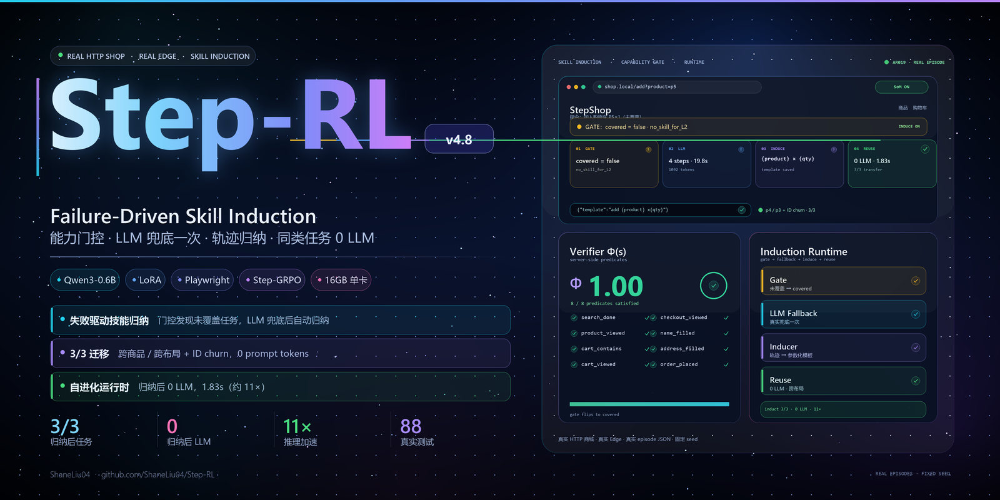
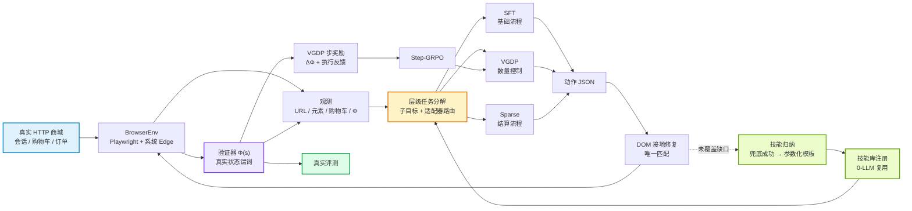

<div align="center">

<a href="https://gitee.com/liu-xingyan04/step-rl">
  
</a>

<br/>

# Step-RL v4.9

**验证器驱动的端侧 Web Agent 分层强化学习**

[](https://www.python.org/downloads/)
[](https://pytorch.org/)
[](https://huggingface.co/docs/transformers)
[](https://playwright.dev/)
[](tests/)
[](LICENSE)

> 面向自进化：能力门控发现未覆盖任务 → 真实 LLM 兜底成功一次 → 轨迹自动归纳为参数化技能 → 此后同类任务 **0 LLM**。  
> 移除任务：归纳前**未覆盖**，归纳后 **3/3**（跨商品/跨布局 + ID churn），0 prompt tokens；  
> **批量移除**：单条指令 2–3 商品，技能路径 **3/3**、0 LLM，单商品移除不回退。

<p align="center">
  <strong>失败驱动技能归纳</strong> ·
  <strong>多商品批量移除</strong> ·
  <strong>瞬时故障重试</strong> ·
  <strong>故障恢复</strong> ·
  <strong>Saga 补偿</strong> ·
  <strong>多订单组合</strong> ·
  <strong>CPU-first 运行时</strong> ·
  <strong>统一 Agent Runtime</strong>
</p>

</div>

---

## 目录索引

<table align="center">
  <tr>
    <td align="center" width="25%"><a href="#动机与目标"><b>01 · 动机与目标</b></a><br/><sub>Motivation</sub></td>
    <td align="center" width="25%"><a href="#核心架构"><b>02 · 核心架构</b></a><br/><sub>Architecture</sub></td>
    <td align="center" width="25%"><a href="#真实结果"><b>03 · 真实结果</b></a><br/><sub>Results</sub></td>
    <td align="center" width="25%"><a href="#训练算法"><b>04 · 训练算法</b></a><br/><sub>Algorithm</sub></td>
  </tr>
  <tr>
    <td align="center"><a href="#快速开始"><b>05 · 快速开始</b></a><br/><sub>Quick Start</sub></td>
    <td align="center"><a href="#复现手册"><b>06 · 复现手册</b></a><br/><sub>Reproduction</sub></td>
    <td align="center"><a href="#大模型实验"><b>07 · 大模型实验</b></a><br/><sub>Scaling</sub></td>
    <td align="center"><a href="#评测协议"><b>08 · 评测协议</b></a><br/><sub>Evaluation</sub></td>
  </tr>
  <tr>
    <td align="center"><a href="#项目结构"><b>09 · 项目结构</b></a><br/><sub>Layout</sub></td>
    <td align="center"><a href="#安全设计"><b>10 · 安全设计</b></a><br/><sub>Security</sub></td>
    <td align="center"><a href="#ar-演进"><b>11 · AR 演进</b></a><br/><sub>AR History</sub></td>
    <td align="center"><a href="#常见问题"><b>12 · 常见问题</b></a><br/><sub>FAQ</sub></td>
  </tr>
  <tr>
    <td align="center"><a href="#贡献与致谢"><b>13 · 贡献与致谢</b></a><br/><sub>Contributing</sub></td>
    <td align="center"><a href="#引用与许可"><b>14 · 引用与许可</b></a><br/><sub>Citation</sub></td>
    <td align="center"><a href="#版本与兼容"><b>15 · 版本与兼容</b></a><br/><sub>Compatibility</sub></td>
    <td align="center"><a href="#联系与支持"><b>16 · 联系与支持</b></a><br/><sub>Support</sub></td>
  </tr>
</table>

---

## 动机与目标

### 长链路 Web Agent 的三层失配

**1. 奖励失配：成功信号太稀疏**
真实任务只在最后给出成功/失败，中间大量“必要但无进展”的动作（输入数量、填写表单）得不到反馈。模型无法判断哪一步真正推进了任务。

**2. 技能失配：一个策略装不下多种能力**
数量控制、表单填写、多商品流程需要不同的行为分布。把它们塞进同一个策略，后训练的技能会覆盖先前的技能，造成长链路中断。

**3. 验证失配：成功不可执行验证**
如果“完成”由模型自己声明，训练信号就不可信。长链路任务必须有一个**外部、确定性、可执行**的成功判定。

### 本项目的目标

| 目标 | 设计回答 |
|------|----------|
| 成功可验证 | 可执行验证器 Φ，只读真实服务端状态 |
| 奖励可归因 | VGDP：步级 `ΔΦ` + 执行反馈 |
| 策略可优化 | Step-GRPO：任务分组 + token 级优势 |
| 技能可组合 | 层级任务分解 + 按子目标路由适配器 |
| 端侧可训练 | Qwen3-0.6B + LoRA，单卡 16GB |
| 实验可复现 | 真实浏览器 episode、JSON 产物、固定 seed |

---

## 核心架构



### 1. 可执行验证器（Φ）

任务被写成有序谓词链：

```
search_done → product_viewed → cart_contains
→ cart_viewed → checkout_viewed
→ name_filled → address_filled → order_placed
```

`Φ = 已满足谓词 / 总谓词`。验证器只读真实 URL 与服务端状态，模型无法伪造。

### 2. VGDP 稠密奖励

```
r_t = 2.0·(Φ(s_{t+1}) − Φ(s_t))
    + 0.05·1[执行成功] − 0.10·1[执行失败]
    − 0.02 − 0.10·1[循环]
    + 1.0·1[终局成功] − 0.10·1[终局失败]
```

它把“输入数量 2”这类延迟收益动作，与随后真实的 `cart_contains` 变化关联起来。

### 3. Step-GRPO

- 同一任务采样 `G` 条轨迹，按任务分组；
- 回报 `G_t = Σ γ^{k−t} r_k`，组内标准化为步级优势；
- response token 继承所属步的优势；
- old log-prob 与采样分布一致，参考模型通过关闭 LoRA 获得。

### 4. 层级任务分解

长任务按验证器谓词链拆分：

```
「加 p3×1 + 加 p4×2 + 结算」
  → add p3      [SFT adapter]
  → add p4×2    [VGDP adapter]
  → checkout    [Sparse adapter]
```

- 同一真实浏览器会话，购物车状态不重置；
- 控制器只执行真实 `goto` 导航；
- 最终成功仍由**原任务验证器**判定。

### 5. 语义 Set-of-Mark 动作（DOM 改版鲁棒）

动作不再绑定 CSS id，而是引用当前观测中的元素编号：

```json
{"action": "click", "params": {"element": "e2"}}
```

- 观测为每个可交互元素分配 `e1/e2…`，并给出 `role + accessible_name`；
- 执行器通过 `data-eid` 在真实 DOM 中定位；
- 语义编号只在当前步有效，页面变化后重新生成；
- 语义模式下关闭 selector 修复，非法动作显式失败，不做静默兜底。

真实压力测试：观测后随机化全部 DOM id，selector 接口 L1–L2 成功率 0%，语义接口 100%。

### 6. 验证器感知观测 + DOM 接地修复

- Prompt 写入 `进度: 0.75 | 未完成: 填写收货人、提交订单`；
- selector 模式下，选择器失效时用真实 DOM 做唯一匹配修复；多候选一律放弃。

### 7. 失败驱动的技能自动归纳（AR019）

能力闭环的最后一环：兜底成功一次，永久转为 0-LLM 技能。

```
能力门控判缺口 (covered=false)
  → 真实 LLM 兜底执行一次（GPU + 真实浏览器）
  → TrajectoryRecorder 记录动作 + 语义元素元数据（执行前解析）
  → induce_skill 泛化为参数化模板（{product} / {qty}）
  → 注册技能库 + JSON 持久化 → 同类任务 0-LLM 直接执行
```

- 记录发生在**执行前**：eid 在当时观测中解析回 `role + accessible_name`，
  页面随后重渲染或 ID 扰动不丢失语义信息；
- 未注册的非 add 操作显式返回 `None`：能力缺口不得静默误路由到加购技能；
- 归纳技能与人工技能同标准：注册即过能力门控，30 场景统一套件回归检验；
- AR020 批量扩展：多目标规划解析 + 运行时「前缀一次 + 单元×N」展开 +
  块式轨迹归纳（最长公共后缀 unit），模板不随商品数漂移。

---

## 真实结果

### 5.1 最终组合（9 个真实留出任务）

| 组合 | 成功率 | 平均步数 | 平均进度 |
|------|--------|----------|----------|
| SFT | 44.4% | 5.78 | 0.76 |
| SFT + 修复 | 55.6% | 5.78 | 0.79 |
| Sparse-GRPO + 修复 | 55.6% | 5.78 | 0.83 |
| VGDP-GRPO + 修复 | 66.7% | 5.33 | 0.85 |
| AR001 单策略路由 | 77.8% | 5.11 | 0.90 |
| AR003 层级分解（selector） | 100% | 5.89 | 1.00 |
| AR004 语义层级 | 100% | 6.33 | 1.00 |
| AR005 跨布局语义 | 100%（未见布局 + churn） | 7.89 | 1.00 |
| AR006 约束规划 | 100%（8 条约束指令） | 10.50 | 1.00 |
| AR007 闭环重规划 | 2/2 动态 + 3/3 静态 | 27（动态重试） | 1.00 |
| AR008 观测压缩（效率层） | 100%（5 任务） | 8.00 | 1.00 |
| AR009 错误可观测修复 | 2/2（表单校验） | 10 | 1.00 |
| AR010 技能编译 | 100%（9 任务） | 7.33 | 1.00 |
| AR011 统一 Runtime | 30/30（组合场景） | 9.20 | 1.00 |
| AR012 CPU-first Runtime | 30/30（0 GPU / 0 LLM） | 9.20 | 1.00 |
| AR013 对抗 UI 接地 | 3/3（基线 0/3） | 10–16 | 1.00 |
| AR014 检查点恢复 | 3/3（基线 0/3） | 9–16 | 1.00 |
| AR015 技能库扩展 | 3/3（基线 2/3） | 3 | 1.00 |
| AR016 多订单组合 | 2/2（基线 0/2） | 20 | 1.00 |
| AR017 Saga 补偿 | 2/2（基线 0/2） | 16 | 1.00 |
| AR018 瞬时重试 | 3/3（基线 0/3） | 10–20 | 1.00 |
| **AR019 技能自动归纳（最终）** | **3/3（归纳前未覆盖）** | 4 | **1.00** |

逐任务：

| 任务 | 等级 | AR001 路由 | AR003 | **AR004** |
|------|------|------------|-------|-----------|
| ev_search_p3 | L1 | ✓ | ✓ | ✓ |
| ev_search_p4 | L1 | ✓ | ✓ | ✓ |
| ev_add_p3 | L2 | ✓ | ✓ | ✓ |
| ev_add_p4 | L2 | ✓ | ✓ | ✓ |
| ev_qty_p3 | L3 | ✓ | ✓ | ✓ |
| ev_qty_p4 | L3 | ✓ | ✓ | ✓ |
| ev_checkout_p4 | L4 | ✓ | ✓ | ✓ |
| ev_checkout_p3（数量2+结算） | L4 | ✗ | ✓ | ✓ |
| ev_multi_p3p4（多商品） | L5 | ✗ | ✓ | ✓ |

### 5.2 DOM 改版鲁棒性（真实压力测试）

在观测快照之后随机化页面全部 DOM id，再执行动作：

| 接口 | L1–L2 成功率 | 原始非法动作 | 修复依赖 |
|------|--------------|--------------|----------|
| selector + 修复 | **0%** | 100% | 100% |
| **语义 Set-of-Mark** | **100%** | **0** | **0** |

完整 9 任务：

| 条件 | 成功率 | 平均步数 | 非法动作 | 修复 |
|------|--------|----------|----------|------|
| 语义层级（稳定 DOM） | 100% | 6.33 | 0 | 0 |
| **语义层级（ID 扰动）** | **100%** | 6.33 | **0** | **0** |

### 5.3 跨布局零样本迁移（第二套真实商城）

第二套布局 `ShopLite`：不同 id/标签层级/元素顺序，并加入排序、筛选、收藏、返回、继续购物等真实干扰按钮。

| 条件 | 接口 | 成功率 | 平均步数 | 非法动作 |
|------|------|--------|----------|----------|
| 稳定 v2 | selector | 100% | 6.78 | 2 |
| 稳定 v2 | 语义 | 100% | 7.33 | 0 |
| **v2 + 观测后 id 全随机化** | selector | **0%** | 12.00 | 99 |
| **v2 + 观测后 id 全随机化** | **语义** | **100%** | **7.89** | **0** |

结论：仅换布局时 selector 仍可通过观测中的新 selector 工作；一旦真实页面在“决策→执行”之间重渲染，selector 立即失效，而语义元素编号仍可执行。

### 5.4 约束任务规划（8 条真实指令）

| 条件 | 规划准确率 | 按用户期望成功率 | 平均步数 |
|------|------------|------------------|----------|
| 关键词基线（v1） | **0%** | **12.5%（1/8 偶然）** | 5.62 |
| 约束规划（v1） | **100%** | **100%** | 10.50 |
| **约束规划（v2 + ID churn）** | **100%** | **100%** | 12.00 |

覆盖：最便宜、预算内最贵、指定数量、多商品、预算合计、最贵、缺货替代。  
成功判定使用**用户期望 TaskSpec**，而不是规划器自证；基线唯一“成功”是模型偶然加购正确数量，但规划仍然错误。

### 5.5 数量控制消融（L3 留出）

| 组合 | 成功率 |
|------|--------|
| SFT | 0/2 |
| SFT + 修复 | 0/2 |
| Sparse-GRPO + 修复 | 0/2 |
| **VGDP-GRPO + 修复** | **2/2** |

训练日志：VGDP 第 2 轮训练成功率 66.7%，Sparse 33.3%；平均步奖励 +0.322 vs −0.020。

### 5.6 组合回退记录

| 尝试 | 成功率 | 决策 |
|------|--------|------|
| AR001 路由 | 77.8% | 保留为中间最优 |
| + 技能记忆 prompt | 66.7% | 回退 |
| + 验证器触发重规划 | 66.7% | 回退 |
| LoRA 权重融合 | 0% | 回退 |
| AR003 层级分解（selector） | 100% | 稳定 DOM 前最优 |
| AR004 语义层级 | 100%（同布局 ID 扰动） | 前最优 |
| AR005 跨布局语义迁移 | 100%（未见布局 + churn） | 前最优 |
| AR006 约束任务规划 | 100%（8 指令，含跨布局 churn） | 前最优 |
| AR007 闭环运行时重规划 | 2/2 动态场景；3/3 静态回归 | 前最优 |
| AR008 观测压缩 | 100%，prompt tokens −4.2% | 效率层 |
| AR009 错误可观测闭环修复 | 2/2 表单校验；基线 0/2 | 前最优 |
| AR010 技能编译免生成 | 100%，0 LLM 调用，约 21× | 前最优 |
| AR011 统一 Agent Runtime | 30/30，0 LLM 调用 | 前最优 |
| AR012 CPU-first 能力门控 | 30/30，0 GPU，2.7× 并发 | 前最优 |
| AR013 对抗 UI 接地 | 3/3，基线 0/3，20–25× | 前最优 |
| AR014 检查点恢复 | 3/3，基线 0/3，精确数量 | 前最优 |
| AR015 技能库扩展 | 3/3，基线 2/3，20–45× | 前最优 |
| AR016 多订单组合 | 2/2，基线 0/2，约 20× | 前最优 |
| AR017 Saga 补偿 | 2/2，基线 0/2，全部 cancelled | 前最优 |
| AR018 瞬时重试 | 3/3，基线 0/3 | 前最优 |
| AR019 技能自动归纳 | 3/3，0 LLM，约 11× | 保留 |
| **AR020 多商品批量移除** | **批量 3/3 + 单商品 3/3，0 LLM，约 10.5×** | **最终保留** |

所有结果来自 `outputs/` 下真实 episode JSON，详见：
`docs/results/AR001_eval_report.md`、`docs/results/AR003_hierarchical_report.md`、
`docs/results/AR004_semantic_report.md`、`docs/results/AR006_planning_report.md`、
`docs/results/AR007_runtime_report.md`。

### 5.7 闭环运行时重规划（AR007）

| 场景 | 一次性基线 | 闭环监督器 |
|------|------------|------------|
| D1 结算时库存骤降 → 替代 | 失败（18 步） | **成功（p4×2 → p2×2，2 次尝试）** |
| D2 结算时涨价 → 预算内替代 | 失败（18 步） | **成功（p3×1 → p2×1，2 次尝试）** |
| 静态回归（3 条） | — | **3/3，0 次重规划** |

机制：`Plan → Act → Verify → 刷新真实目录 → Replan → 重执行`；动态事件由真实服务器状态变化触发。

### 5.8 验证器引导观测压缩（AR008）

| 条件 | 成功率 | 平均步数 | Prompt tokens | 决策 |
|------|--------|----------|---------------|------|
| full observation | 100% | 8.00 | 10009 | 基线 |
| 相关性 top-K 裁剪 | **60%** | 10.80 | 12570 | 回退 |
| 历史行压缩 | **0%** | 12.00 | 15303 | 回退 |
| **仅移除真实干扰控件** | **100%** | **8.00** | **9589（−4.2%）** | **保留** |

- 30% token 目标未达到，如实记录；
- 保守方案不改变成功/步数，token 与时间小幅下降，作为效率层保留；
- 激进裁剪会破坏上下文，已回退。

### 5.9 错误可观测闭环修复（AR009）

| 条件 | 成功率 | 步数 |
|------|--------|------|
| 基线（看不到错误） | **0/2** | 18 |
| 仅错误可观测 | **0/2** | 18 |
| **错误可观测 + 控制器修复** | **2/2** | **10** |

- 表单校验：收货人需包含“先生/女士”，地址需包含“路”；
- 仅看到错误不够，错误页没有输入框；控制器执行真实 `goto /checkout → 重填字段 → 提交`；
- 修复动作真实执行，成功由原验证器确认。

### 5.10 技能编译免生成执行（AR010）

| 条件 | 成功率 | 平均步数 | LLM 步数 | Prompt tokens | 耗时 |
|------|--------|----------|----------|---------------|------|
| LLM 每步基线（v1） | 100% | 6.33 | **53** | 14858 | 292.7s |
| **编译技能（v1）** | **100%** | 7.33 | **0** | **0** | **13.9s** |
| **编译技能（v2 + ID churn）** | **100%** | 7.33 | **0** | **0** | **14.2s** |

- 技能：`search` / `add_item(pid,qty)` / `checkout`，真实成功轨迹动作模式参数化；
- 技能执行走真实浏览器与语义元素解析，不调用模型；失败回退 LLM；
- 首轮 v1 77.8% 因数量框无可访问名，加入唯一 spinbutton 真实回退后恢复 100%。

### 5.11 统一 Agent Runtime（AR011）

| 场景组 | 数量 | 一次性 LLM 基线 | 统一 Runtime |
|--------|------|------------------|--------------|
| 静态 9 | 9 | 9/9 | 9/9 |
| 约束 8 | 8 | 8/8 | 8/8 |
| 动态 2 | 2 | 0/2 | 2/2 |
| 表单错误 2 | 2 | 0/2 | 2/2 |
| 跨布局+churn 9 | 9 | 9/9 | 9/9 |
| **合计** | **30** | **26/30（86.7%）** | **30/30（100%）** |

- 统一 Runtime：规划 → 技能执行 → 验证 → 漂移重规划 → LLM 回退；
- 本轮实测 **0 LLM 调用、0 prompt tokens、82s**；
- 基线为 AR004/AR005/AR006/AR007/AR009 的真实 JSON 汇总。

### 5.12 CPU-first 能力门控运行时（AR012）

| 指标 | 结果 |
|------|------|
| 30 场景成功率 | **100%** |
| LLM 调用 | **0** |
| GPU 显存 | **0 bytes（未加载模型）** |
| 串行 12 任务 | 35.97s |
| **4 路并发 12 任务** | **13.16s（约 2.7×）** |
| 未覆盖指令“写一首诗” | covered=false，fallback_required=true |

- 能力清单显式判断覆盖率，未覆盖任务不误执行；
- 技能覆盖任务完全在 CPU 上运行，适合端侧/无 GPU 服务。

### 5.13 对抗 UI 接地鲁棒性（AR013）

| 条件 | 成功率 | 订单 | 耗时 |
|------|--------|------|------|
| 基线 LLM（伪装按钮） | **0/3** | 无订单 | 65–89s |
| **统一 Runtime（技能）** | **3/3** | **p3×1 / p4×2 / p1×1+p2×1** | **2.7–3.7s** |

- 商品页注入 `role=button`、名称为“加入购物车（推荐）”的伪装按钮，实际指向错误商品；
- 技能按 role=button + 精确名称 + 排除“推荐/广告/赞助”选真实按钮；
- 首版 `role=link` 未诱导基线（3/3），已如实记录；安全结论只适用于按钮级伪装。

### 5.14 崩溃恢复与持久化执行（AR014）

| 任务 | 重启基线 | 检查点恢复 |
|------|----------|------------|
| p4×2 | ✗ 订单 p4=4 | **✓ p4=2** |
| p3×2 | ✗ 订单 p3=4 | **✓ p3=2** |
| p1×1+p2×1 | ✗ p1=2,p2=2 | **✓ p1=1,p2=1** |

- 检查点保存 Playwright `storage_state`，恢复同一真实会话；
- 精确数量验证器（`==`）防止“多买也算成功”；
- 恢复 4–5s，基线 5–7s；不加载模型、不占 GPU。

### 5.15 技能库扩展：购物车数量更新（AR015）

| 任务 | LLM 基线 | 扩展技能 |
|------|----------|----------|
| p3 1→3 | ✓（61.7s） | **✓（1.75s）** |
| p4 2→4 | ✓（35.1s） | **✓（1.69s）** |
| p3 3→1 | ✗（p3=4） | **✓（1.68s）** |

- 新增真实 `/update` 路由、购物车数量输入/更新按钮；
- 新增精确谓词 `cart_quantity_exact` 与 `seed_cart`；
- `update_quantity` 技能由真实演示动作参数化，扩展后能力门控自动覆盖；
- 基线能加量但不能可靠减量。

### 5.16 多订单序列组合（AR016）

| 任务 | 合并 LLM 基线 | 序列 Runtime |
|------|----------------|--------------|
| M1（p3×1；p2×2） | ✗ 一笔 p3=2,p2=2 | **✓ 两笔** |
| M2（p4×2；p1×1） | ✗ 一笔 p4=2,p1=2 | **✓ 两笔** |

- 服务端维护订单历史；序列验证要求每个目标订单匹配不同历史订单；
- 第 1 单 reset，后续不 reset，购物车订单后真实清空；
- 4.3–4.4s vs 101–294s（约 20×），0 LLM。

### 5.17 Saga 补偿与失败回滚（AR017）

| 场景 | 无补偿基线 | Saga |
|------|------------|------|
| S1：p3 成功 → p4 缺货 | ✗ 第一单 active | **✓ cancelled** |
| S2：p2 成功 → p3 缺货 | ✗ 第一单 active | **✓ cancelled** |

- 服务端订单含 `active/cancelled` 状态与真实 `/cancel` 接口；
- 运行时记录已成功订单，失败后逐个取消；
- 不需要模型/GPU，验证器要求历史订单全部 cancelled。

### 5.18 瞬时故障重试（AR018）

| 任务 | 单次基线 | 技能重试 |
|------|----------|----------|
| F1 add 500 | ✗ | **✓（2 次尝试）** |
| F2 add 500（qty2） | ✗ | **✓（2 次尝试）** |
| F3 order 500 | ✗ | **✓（2 次尝试）** |

- 服务端一次性真实 HTTP 500；
- Runtime 同 TaskSpec 重试一次，真实 reset 会话后成功；
- 不加载模型/GPU，重试次数与订单状态可审计。

### 5.19 失败驱动的技能自动归纳（AR019）

**动机。** AR012 能力门控发现未覆盖任务后会拒绝执行或回退 LLM，但兜底成功的
轨迹此前被直接丢弃——同类任务下次仍要重新付出一次 LLM 成本。能力闭环
缺了最后一环：**把兜底成功经验自动沉淀为可复用技能**。此前所有技能
（AR010/AR015）都来自真实专家演示的人工参数化；AR019 把
「成功轨迹 → 参数化技能」这一步自动化：任何能力缺口，只要 LLM 兜底
成功一次，运行时自行完成沉淀，无需专家在场。

**真实评测（P0–P5，全部真实浏览器 / GPU / 服务端状态）。**

| 阶段 | 内容 | 结果 |
|------|------|------|
| P0 | 能力门控检查「移除」指令（归纳前） | covered=false（`no_skill_for_level_2`）——真实缺口证据 |
| P1 | LLM 兜底真实执行移除 p3（GPU，seed p3×2） | ✓，4 步，1092 prompt tokens，19.8s |
| P2 | 轨迹归纳 → 注册 → JSON 持久化 | 4 步模板，门控翻转为 covered（skills=`induced_remove`） |
| P3 | 同任务技能复跑（新会话，不加载模型） | ✓，**0 LLM / 0 tokens，1.83s（约 11× 提速）** |
| P4 | 迁移：换商品 p4（v1）/ p3（v2 + 全量 ID churn） | ✓ / ✓，均 0 LLM，1.8–1.97s |
| P5 | 组合门禁 | edge 套件 **153 passed**；AR011 30 场景 **0 LLM** |

**兜底轨迹与归纳模板（真实记录对照）。** LLM 兜底自选「先把数量改回 1
再移除」的策略，四步动作全部真实执行；记录器在执行前把 eid 解析回
`role + accessible_name`，归纳器把商品名替换为 `{product}` 占位符：

| 兜底轨迹（语义解析后） | 归纳模板（泛化后） |
|------|------|
| type（未解析元素）值 "2" | type 值 "2"（原样保留） |
| type spinbutton「数量 无线充电器」值 "1" | type spinbutton「数量 {product}」值 "1" |
| click button「更新数量 无线充电器」 | click button「更新数量 {product}」 |
| click button「移除 无线充电器」 | click button「移除 {product}」 |

模板按原样回放即复现成功（保留冗余前缀步，不做启发式裁剪——成功轨迹
即最小可复现单元），实例化时占位符按目标任务商品替换。

**效率对照（0-LLM 复用收益）。**

| 执行方式 | LLM 调用 | prompt tokens | 耗时 | 结果 |
|----------|----------|---------------|------|------|
| LLM 兜底（首次，沉淀成本） | 1 | 1092 | 19.8s | ✓ 购物车清空 |
| 技能复用（p3，v1，同任务） | 0 | 0 | 1.83s | ✓ |
| 技能复用（p4，v1，换商品） | 0 | 0 | 1.97s | ✓ |
| 技能复用（p3，v2 + ID churn） | 0 | 0 | 1.84s | ✓ |

**安全边界。** 未注册非 add 操作显式返回 `None`（不得静默误路由到加购
技能）；注册表模块级隔离、测试可重置；模板 JSON 持久化可审计；与既有
技能同标准接受组合门禁回归——归纳前 30 场景与归纳后完全一致。

**遗留技术债**（与 AR019 无关，git-stash 对照验证：改动前后均 17 failed）：
legacy 三文件 locator / progress_estimator / smart_wait 的历史失败，
已按仓库惯例记录、不纳入门禁。

产物：`outputs/ar019/eval/`（results JSON / 报告 / 模板 JSON）；
spec：`specs/archive/AR019-skill-induction/`；复现：`python scripts/ar019_eval.py`。

### 5.20 多商品批量移除（AR020）

**动机。** AR019 的归纳闭环只覆盖单目标任务；真实指令常是
「把购物车中的 p3 和 p2 移除」这类**一条指令多个目标**。改动前基线探针
（旧代码真实执行，`outputs/ar020/baseline_probe.json`）暴露两处真实缺陷：
规划器把批量指令解析成 `targets={"p3": 0}`——**第二商品被静默丢弃**；
旧模板实例化对批量任务 `success=false`（购物车剩 p4×3），而单商品对照
成功——缺陷确在批量链路。批量也不是「单商品 × N」的平凡扩展：真实兜底
轨迹对 p3 先「更新数量」再「移除」、对 p4 直接「移除」，块之间**前缀
单调而非严格相等**，归纳必须能从中切出对每件商品都被证明有效的单元。

**机制（三处增量，全部真实执行验证）。**

| 环节 | AR019（单目标） | AR020（批量） |
|------|------|------|
| 规划器 | `targets={p3: 0}` | 「和 / 与 / 顿号」多商品解析 → `targets={"p3": 0, "p2": 0}`，seed_cart 多键 |
| 模板实例化 | 单元直出 | **运行时多目标展开**：前缀 1 次 + 单元 × N + 后缀，模板不随 N 漂移 |
| 轨迹归纳 | 整条轨迹 → 模板 | **块式切分**（按真实「移除」点击边界）+ 块间最长公共后缀 → unit |

- 块式归纳的诚实约束：块内不一致时显式失败（不做多数投票式臆造）；
- unit 是「对每件商品都被真实证明有效的最小模式」，冗余前缀步原样保留。

**真实评测（P0–P5，真实 Edge / GPU / 服务端状态）。**

| 阶段 | 内容 | 结果 |
|------|------|------|
| P0 | 改动前基线探针（旧代码） | 规划丢第二商品；批量执行 ✗（cart 剩 p4×3）；单商品对照 ✓ |
| P0a | 新规划解析「移除 p3 和 p2」 | `targets={"p3":0,"p2":0}`，seed `{p3:2, p2:3}` ✓ |
| P1 | LLM 兜底真实执行批量移除（GPU，AR004 适配器，seed=42） | ✓，4 步，1267 prompt / 96 response tokens，19.22s |
| P2 | 块式归纳 → 注册 → 持久化 | 模板 2 步（`移除 {product}` unit），门控翻转 covered |
| P3 | 批量技能复跑 B1 v1 / B2 v1 带数量 / B3 v2+ID churn | **3/3，0 LLM / 0 tokens，1.80–1.85s**，cart 全空 |
| P4 | 单商品回归 S1/S2/S3（镜像 AR019，含 v2+churn） | **3/3，0 LLM，1.53–1.54s**，不回退 |
| P5 | 组合门禁 | edge 套件 **166 passed**（153 基线 + 13 新增）；AR011 30 场景 **0 LLM** |

**效率对照（0-LLM 复用收益）。**

| 执行方式 | LLM 调用 | prompt tokens | 耗时 | 结果 |
|----------|----------|---------------|------|------|
| LLM 兜底（双商品，首次沉淀） | 1 | 1267 | 19.22s | ✓ cart 清空 |
| 批量技能复用（B1/B2/B3） | 0 | 0 | 1.80–1.85s | ✓ 3/3（**≈10.5×**） |
| 单商品技能回归（S1/S2/S3） | 0 | 0 | 1.53–1.54s | ✓ 3/3 |

**兼容性验证。** `induce_skill` 对 AR019 单商品轨迹输出**逐字段不变**
（11/11 旧测试全绿）；批量展开是纯运行时行为，模板 JSON 不随商品数
变化——存量技能零迁移成本。

产物：`outputs/ar020/`（baseline_probe / eval results / 报告 / 模板 JSON）；
spec：`specs/archive/AR020-batch-remove/`；复现：`python scripts/ar020_eval.py`
（改动前基线：`python scripts/ar020_baseline_probe.py`）。

### 5.21 可解释性实验（EX001）

实验/归因类使用独立编号 `EXxxx`，不占用创新 AR 编号。完整报告与 6 张图：

**[docs/results/EX001_report.md](docs/results/EX001_report.md)**

| 归因问题 | 实验 | 结果 |
|----------|------|------|
| 语义接口是否必要 | E1 扰动概率曲线 | selector 25% 扰动即 25%；语义全程 100% |
| 层级分解是否必要 | E2 扁平 vs 层级 | 66.7% vs **100%** |
| 验证器观测贡献 | E3 移除 Φ/missing | 100% → **22.2%** |
| 跨布局是否记忆 | E4 v2 + churn | selector 0%；语义 **100%** |
| 约束规划贡献 | E5 基线 vs 规划器 | 规划准确率 0% → **100%** |
| 失败发生在哪 | E6 分类学 | selector 全在搜索层；旧 RL 在商品/结算层；基线在规划层 |
| 稳定性/成本 | E7 重复 + token | 全部 100%；L5 15 步 / 3944 tokens |
| 端侧瓶颈 | E8 CPU/GPU | 规划 0.03ms；生成 8.3s；显存 1.28GB |

设计文档：[docs/EXPERIMENTS.md](docs/EXPERIMENTS.md)。

---

## 训练算法

### SFT

- Qwen3-0.6B-Base + LoRA（`r=16, alpha=32, all-linear`）
- response-only 损失，prompt token 被 mask
- 真实专家轨迹，只覆盖 L1–L2

### Step-GRPO

```
G_t = Σ_{k=t}^T γ^{k−t} r_k
A_t = (G_t − mean_group) / (std_group + ε)
ratio = exp(logπ_new − logπ_old)
L = −min(ratio·A_t, clip(ratio,1−ε,1+ε)·A_t) + β·k3(π_ref, π_new)
```

`γ=0.95, ε=0.2, β=0.02`，损失只作用于 response token。

---

## 快速开始

### 环境要求

- Python 3.10+
- 16GB GPU（0.6B 端侧训练）
- 系统 Edge 或 Chrome（Playwright 驱动）
- 本地模型缓存或 HuggingFace 访问

### 安装

```bash
git clone https://gitee.com/liu-xingyan04/step-rl.git
cd step-rl
pip install -r requirements.txt
# Linux: playwright install chromium
# Windows/企业代理: 直接使用系统 Edge
```

### 一条命令

```bash
export PYTHONPATH=$PWD          # Windows: $env:PYTHONPATH="..."
python scripts/edge_pipeline.py --stage all --quick
```

### 分阶段

```bash
python scripts/edge_pipeline.py --stage data --repeats 2
python scripts/edge_pipeline.py --stage sft --sft_epochs 1
python scripts/edge_pipeline.py --stage rl --rl_epochs 2 --group_size 3 \
  --max_steps 6 --ppo_epochs 1
python scripts/ar002_eval.py       # 记忆/重规划负结果复现
python scripts/ar003_eval.py       # 层级分解（稳定 DOM）
python scripts/ar004_train.py --stage all   # 语义数据/SFT/RL/稳定+扰动评测
python scripts/ar005_eval.py       # 跨布局零样本 + 重渲染压力
python scripts/ar006_eval.py       # 自然语言约束规划 + 预期判定
python scripts/ar007_eval.py       # 环境漂移闭环重规划
python scripts/ar008_eval.py       # 观测压缩 full vs pruned
python scripts/ar009_eval.py       # 错误可观测/修复
python scripts/ar010_eval.py       # 技能编译 vs LLM 每步
python scripts/ar011_eval.py       # 30 场景统一 Runtime
python scripts/ar012_cpu.py        # CPU-only + 并发
python scripts/ar013_eval.py       # 对抗 UI 基线 vs Runtime
python scripts/ar014_checkpoint.py # 崩溃恢复 vs 重启
python scripts/ar015_eval.py       # 购物车更新 基线 vs 技能
python scripts/ar016_eval.py       # 多订单 合并 vs 序列
python scripts/ar017_eval.py       # Saga 补偿 vs 无补偿
python scripts/ar018_eval.py       # 瞬时故障 单次 vs 重试
python scripts/ar019_eval.py       # 失败驱动技能归纳 全链路（GPU）
```

### 测试

```bash
pytest tests/test_edge_site.py tests/test_edge_verifier.py \
       tests/test_edge_policy.py tests/test_edge_rollout.py \
       tests/test_edge_skill_memory.py tests/test_edge_hierarchical.py \
       tests/test_edge_semantic.py tests/test_edge_layout_v2.py \
       tests/test_edge_planner.py tests/test_edge_runtime.py tests/test_edge_observation.py tests/test_edge_error_repair.py tests/test_edge_skill_library.py tests/test_edge_unified_runtime.py tests/test_edge_capability.py tests/test_edge_adversarial.py tests/test_edge_checkpoint.py tests/test_edge_cart_update.py tests/test_edge_multi_order.py tests/test_edge_saga.py tests/test_edge_transient.py tests/test_edge_skill_induction.py tests/test_edge_batch_remove.py -v
# 166 passed
```

### 产物

```
outputs/
  ar001/   # SFT / VGDP / Sparse / 四组合矩阵
  ar002/   # 记忆与重规划负结果
  ar003/   # 层级分解（稳定 DOM）
  ar004/   # 语义 SFT / 语义 RL / 稳定+扰动评测
```

---

## 复现手册

完整端侧复现、7B/8B 服务器实验配置、数据规模、超参与资源估算：

**[docs/REPRODUCTION.md](docs/REPRODUCTION.md)**

关键原则：

- 所有结论来自真实浏览器 episode JSON；
- 训练/留出任务与商品显式分离；
- 组合必须优于当前最优，否则回退并记录负结果。

---

## 大模型实验

| 项 | 端侧 pilot | 服务器建议 |
|----|-----------|------------|
| 模型 | Qwen3-0.6B-Base | Qwen2.5-7B / Qwen3-8B |
| SFT 轨迹 | 20 | 400–800 |
| RL 任务 | 5 | 30–60 |
| G | 3 | 8 |
| RL epochs | 2 | 10–20 |
| 硬件 | 1×16GB | 1–4×A100 40GB / 8×H100 |
| 评测任务 | 9 | 60–100 |

```bash
export STEP_RL_MODEL=Qwen/Qwen2.5-7B-Instruct
python scripts/edge_pipeline.py --stage rl --rl_epochs 10 --group_size 8 \
  --max_steps 12 --ppo_epochs 2 --model "$STEP_RL_MODEL"
```

7B 的 SFT 建议 `max_length=1024, batch_size=4`，详见复现手册 §4.5。

---

## 评测协议

- **环境**：真实 Edge，headless，固定视口，真实服务端状态。
- **策略**：greedy。
- **任务**：留出商品 p3/p4，数量/组合未在训练出现。
- **指标**：成功率、平均步数、平均 Φ、控制器动作数。
- **回退**：新组合不优于当前最优则保留上一最优。

```bash
python scripts/ar003_eval.py
```

---

## 项目结构

```text
step-rl/
├── README.md
├── AGENTS.md
├── requirements.txt
├── config.yaml
├── Dockerfile / docker-compose*.yml
│
├── step_rl/
│   ├── edge/
│   │   ├── site.py               # 真实 HTTP 商城
│   │   ├── browser.py            # Playwright + 系统 Edge
│   │   ├── verifier.py           # 可执行进度 Φ
│   │   ├── tasks.py              # 任务与训练/留出划分
│   │   ├── expert.py             # 真实专家轨迹
│   │   ├── policy.py             # Prompt / JSON / DOM 修复
│   │   ├── modeling.py           # 模型/多适配器加载
│   │   ├── sft.py                # LoRA SFT
│   │   ├── rollout.py            # 真实 rollout + 步奖励
│   │   ├── step_grpo.py          # Step-GRPO
│   │   ├── skill_memory.py       # 技能记忆（AR002 负结果）
│   │   ├── planner.py            # 自然语言约束 → TaskSpec（AR006）
│   │   ├── supervisor.py         # 闭环重规划（AR007）
│   │   ├── observation.py        # 验证器引导观测压缩（AR008）
│   │   ├── error repair          # 错误可观测闭环修复（AR009）
│   │   ├── skill_library.py     # 技能编译免生成（AR010）
│   │   ├── runtime.py           # 统一 Agent Runtime（AR011）
│   │   ├── capability.py        # 能力门控（AR012）
│   │   ├── (site injection)     # 对抗 UI（AR013）
│   │   ├── (storage_state)      # 检查点恢复（AR014）
│   │   ├── update_quantity      # 技能扩展（AR015）
│   │   ├── order_sequence       # 多订单（AR016）
│   │   ├── cancel_order         # Saga 补偿（AR017）
│   │   ├── skill_retries        # 瞬时重试（AR018）
│   │   ├── skill_induction.py   # 失败驱动技能归纳 + 批量轨迹块式归纳（AR019/AR020）
│   │   ├── hierarchical.py       # 层级分解（AR003+）
│   │   ├── router.py             # 任务级路由（AR001）
│   │   └── evaluate.py           # 真实评测
│   ├── environment/ training/ reward/ memory/ evaluation/  # 历史组件兼容
│
├── scripts/
│   ├── edge_pipeline.py
│   ├── ar002_eval.py
│   ├── ar003_eval.py
│   ├── ar004_eval.py
│   ├── ar005_eval.py
│   ├── ar006_eval.py
│   ├── ar007_eval.py
│   ├── ar008_eval.py
│   ├── ar009_eval.py
│   ├── ar010_eval.py
│   ├── ar011_eval.py
│   ├── ar012_cpu.py
│   ├── ar013_eval.py
│   ├── ar014_checkpoint.py
│   ├── ar015_eval.py
│   ├── ar016_eval.py
│   ├── ar017_eval.py
│   ├── ar018_eval.py
│   ├── ar019_eval.py
│   ├── ar020_baseline_probe.py # 改动前基线探针（before 证据）
│   ├── ar020_eval.py
│   ├── ex001_*.py              # 可解释性实验/图表
│   ├── build_skill_memory.py
│   └── generate_cover.py
│
├── specs/
│   ├── component-detail-design/Step-RL_spec.md
│   ├── BACKLOG.md               # 夜间自动化取材队列
│   ├── changes/（进行中 AR）
│   └── archive/AR001 … AR020 / EX001
│
├── tests/                        # 169 项真实测试（166 过 + 3 skip）
├── docs/REPRODUCTION.md
├── docs/EXPERIMENTS.md
├── docs/results/EX001_report.md
└── outputs/                      # 实验产物（不入库）
```

---

## 安全设计

| 攻击面 | 防护 |
|--------|------|
| URL 劫持 | 仅允许本地商城 host；`goto` 同 host |
| 选择器注入 | 动作白名单 + 唯一匹配；多候选放弃 |
| 动作注入 | 仅 6 类动作；参数类型/范围校验 |
| 资源耗尽 | 浏览器超时；`wait`/`scroll` 钳制 |
| 成功伪造 | 成功由服务端谓词判定，`finish` 不授予成功 |
| 训练稳定性 | 梯度裁剪、KL 参考、NaN 检查 |
| 数据泄漏 | 训练/留出任务与商品显式分离 |

---

## AR 演进

| AR | 主题 | 结果 | 决策 |
|----|------|------|------|
| AR001 | 真实环境 + VGDP + Step-GRPO | 77.8% | 中间最优 |
| AR002 | 技能记忆 + 验证器触发重规划 | 66.7% | 回退，归档负结果 |
| AR003 | 验证器驱动层级任务分解 | 100%（稳定 DOM） | 稳定 DOM 前最优 |
| AR004 | 语义 Set-of-Mark + ID 扰动鲁棒性 | 100%（同布局） | 前最优 |
| AR005 | 跨布局零样本迁移 + 重渲染鲁棒 | 100%（未见布局 + churn） | 前最优 |
| AR006 | 自然语言约束规划 + 库存替代 | 100%（8 指令） | 前最优 |
| AR007 | 环境漂移闭环重规划 | 2/2 动态 + 3/3 静态 | 前最优 |
| AR008 | 验证器引导观测压缩 | 100%，−4.2% tokens | 效率层 |
| AR009 | 错误可观测闭环修复 | 2/2，基线 0/2 | 前最优 |
| AR010 | 技能编译免生成执行 | 100%，0 LLM，约 21× | 前最优 |
| AR011 | 统一 Agent Runtime | 30/30，0 LLM | 前最优 |
| AR012 | CPU-first 能力门控 | 30/30，0 GPU，2.7× | 前最优 |
| AR013 | 对抗 UI 接地 | 3/3，基线 0/3 | 前最优 |
| AR014 | 检查点恢复 | 3/3，基线 0/3 | 前最优 |
| AR015 | 技能库扩展（购物车更新） | 3/3，基线 2/3 | 前最优 |
| AR016 | 多订单序列组合 | 2/2，基线 0/2 | 前最优 |
| AR017 | Saga 补偿与失败回滚 | 2/2，基线 0/2 | 前最优 |
| AR018 | 瞬时故障重试 | 3/3，基线 0/3 | 前最优 |
| AR019 | 失败驱动技能自动归纳 | 3/3，0 LLM，约 11× | 保留 |
| **AR020** | **多商品批量移除（批量解析 + 多目标模板实例化 + 块式归纳）** | **批量 3/3 + 单商品 3/3，0 LLM，约 10.5×** | **最终保留** |

规格与完整实验记录：

- `specs/archive/AR001-edge-verifier-step-grpo/` … `AR010-skill-compilation/`
- `specs/archive/EX001-interpretability-ablation/`
- `specs/archive/AR011-unified-runtime/`
- `specs/archive/AR012-cpu-capability-runtime/`
- `specs/archive/AR013-adversarial-ui-grounding/`
- `specs/archive/AR014-checkpointed-execution/`
- `specs/archive/AR015-skill-extension-cart/`
- `specs/archive/AR016-multi-order-composition/`
- `specs/archive/AR017-saga-compensation/`
- `specs/archive/AR018-transient-retry/`
- `specs/archive/AR019-skill-induction/`
- `specs/archive/AR020-batch-remove/`

---

## 常见问题

<details>
<summary><b>Q1：为什么需要层级分解，而不是一个更大的模型？</b></summary>

层级分解解决的是**技能干扰与信用边界**，不是容量问题。把“数量控制/结算/多商品”拆到不同适配器后，每个子目标都在其训练分布内执行，端侧 0.6B 也能稳定完成长链路。
</details>

<details>
<summary><b>Q2：专家前缀是否影响公平性？</b></summary>

L4/L5 的 Step-GRPO 训练使用相同专家前缀到达结算页；Sparse 与 VGDP 完全一致，差异只来自奖励。最终 AR004 评测**不使用前缀**。
</details>

<details>
<summary><b>Q3：为什么有 AR002 负结果？</b></summary>

记忆 prompt 干扰小模型、重规划触发不足、LoRA 权重融合破坏能力。项目按“组合必须综合更优”原则回退，并保留负结果供后续研究。
</details>

<details>
<summary><b>Q4：只有一张小显卡能跑吗？</b></summary>

可以。端侧 pilot 使用 Qwen3-0.6B + LoRA，16GB 足够；7B 建议 A100 40GB。
</details>

<details>
<summary><b>Q5：语义动作如何保证不点错元素？</b></summary>

`eid` 只在当前观测快照内有效，执行器只接受本步生成的 `data-eid`；无效编号会显式失败，不做静默兜底。语义模式下关闭 selector 修复，避免掩盖错误。
</details>

<details>
<summary><b>Q6：如何扩展到公网网站？</b></summary>

替换 `BrowserEnv` 的服务端与 `TaskSpec`/验证器；语义接口可直接用于真实站点，但需注意 URL 白名单、登录态与安全沙箱。建议先在本地站点验证，再逐步放开域名。
</details>

---

## 贡献与致谢

### 贡献

1. Fork 并创建分支：`git checkout -b feat/your-feature`
2. 新能力优先放入 `step_rl/edge/`，保持旧模块兼容。
3. 必须新增真实测试；不得提交未经验证的指标。
4. 提交前：`black . && isort . && pytest tests -q`
5. PR 需包含：动机、真实执行证据、对组合指标的影响。

### 致谢

- [Transformers](https://github.com/huggingface/transformers) · [PEFT](https://github.com/huggingface/peft)
- [Playwright](https://playwright.dev/)
- [Qwen](https://github.com/QwenLM/Qwen)
- 所有坚持“先验证、再优化”的工程实践

---

## 引用与许可

```bibtex
@software{step_rl_v47,
  title = {Step-RL: Fault-Tolerant Saga-Compensated Multi-Order Extensible Checkpointed Adversarially-Grounded CPU-First Capability-Gated Unified Skill-Compiled Error-Aware Efficient Closed-Loop Constraint-Aware Cross-Layout Verifier-Grounded Agent Runtime},
  version = {4.7},
  year = {2026},
  url = {https://gitee.com/liu-xingyan04/step-rl}
}
```

本项目基于 [MIT License](LICENSE) 开源。

---

## 版本与兼容

| 版本 | 状态 | 说明 |
|------|------|------|
| **v4.9 / AR020** | **推荐** | 批量移除 3/3 + 单商品 3/3，0 LLM，约 10.5× |
| v4.8 / AR019 | 保留 | 技能归纳 3/3，0 LLM，约 11× |
| v4.7 / AR018 | 保留 | 重试 3/3，基线 0/3 |
| v3.2 / AR003 | 保留 | 层级分解，稳定 DOM 100% |
| v3.1 / AR001 | 保留 | VGDP + Step-GRPO，单策略路由 |
| AR002 | 归档 | 记忆/重规划负结果，默认关闭 |

---

## 联系与支持

- 仓库：<https://gitee.com/liu-xingyan04/step-rl>
- 问题反馈：提交 Issue，附 `outputs/` 下 run manifest 与复现命令
- 安全：请勿公开敏感环境信息，仅提供最小复现

---

<div align="center">

**Verifiable success · Attributable reward · Composable skills**

<a href="#目录索引">回到顶部 ↑</a>

</div>
