<div align="center">

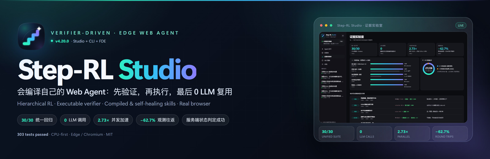

<br/>

[](https://github.com/ShaneLiu04/Step-RL/actions/workflows/ci.yml)
[](https://www.python.org/downloads/)
[](https://playwright.dev/)
[](step_rl/console/)
[](#实测结果)
[](tests/)
[](LICENSE)

**会编译自己的 Web Agent：先验证，再执行，最后 0 LLM 复用。**

[快速开始](#快速开始) · [Studio](#step-rl-studio) · [CLI](#step-rl-cli) · [实测结果](#实测结果) · [架构](#架构) · [FDE 工程化](docs/FDE_PLAYBOOK.md) · [研究账本](docs/RESEARCH_LEDGER.md)

</div>

---

Step-RL 是一个 **验证器驱动的端侧 Web Agent**。它在真实浏览器（系统 Edge / Chromium）里完成长链路购物任务，并且只认 **服务端状态** 作为成功依据：订单是否真的落库、优惠是否真的生效、购物车里是否真的是期望的商品与数量。

覆盖到的任务由 **编译技能** 执行，0 次 LLM 调用、0 tokens、确定性可复现；未覆盖的任务交给端侧 LLM 兜底一次，经验证器确认成功后自动归纳为新技能，下一次就回到 0 LLM。

<div align="center">

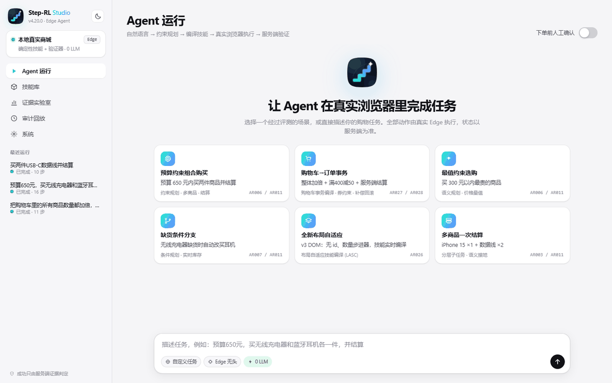

<sub>真实录制：购物车整体加倍 → 满 400 减 50 → 下单前人工确认 → 服务端订单 ¥1,196 / 实付 ¥1,146 · 11 个技能动作 · 0 LLM tokens</sub>

</div>

## 为什么是 Step-RL

| | 常见 LLM 浏览器 Agent | Step-RL |
|---|---|---|
| **成功的定义** | 模型自述“完成了”，或页面文字匹配 | 可执行验证器 Φ 读取服务端状态；训练、运行、评测、审计共用同一个 Φ |
| **每一步的成本** | 每一步都调用 LLM | 覆盖任务 0 LLM；LLM 只做兜底，成功后归纳为技能 |
| **页面改版** | selector 失效即失败 | 语义 Set-of-Mark 动作 + 按实时控件能力编译；ID 每次观测随机化也 30/30 |
| **长事务** | 中途失败留下半成品 | 购物车 / 订单事务带预检与 Saga 补偿，失败回滚 |
| **不可逆动作** | 直接执行 | 下单前人工确认门禁、动作白名单、导航范围限制、完整审计 |
| **部署** | 需要 GPU / 云端模型 | 普通笔记本 + 系统 Edge + CPU；训练栈是可选 extra |

## Step-RL Studio

iOS × Codex 设计语言的控制台：左侧导航与最近运行，中间是真实浏览器的实时画面，右侧是执行轨迹、服务端购物车与订单验证。深浅双色，零前端依赖（原生 JS + CSS）。

<table>
  <tr>
    <td width="50%">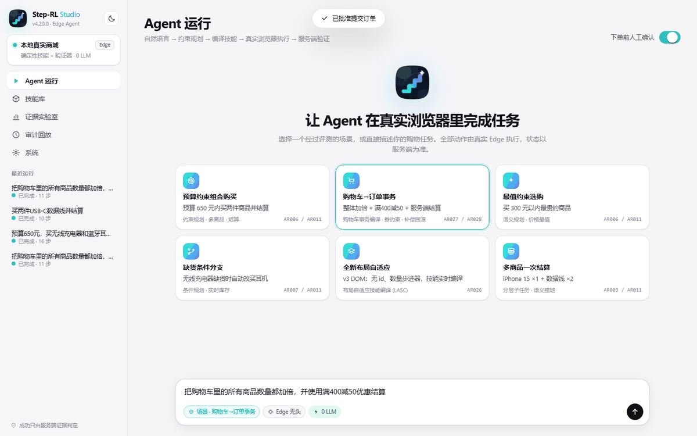<br/><sub><b>自由指令 + 约束规划</b>：“预算 650 元，买无线充电器和蓝牙耳机各一件，并结算”</sub></td>
    <td width="50%">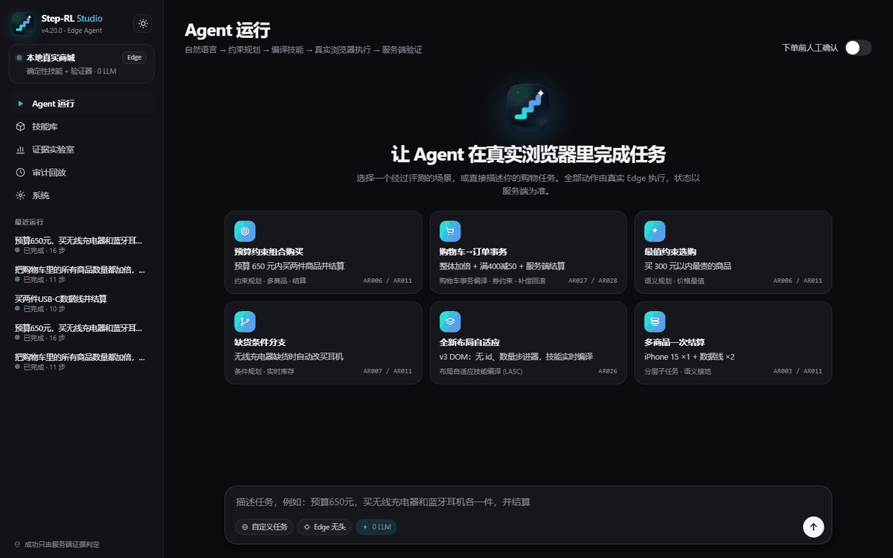<br/><sub><b>全新布局自适应</b>：v3 DOM 无 id、数量步进器，深色模式下实时运行</sub></td>
  </tr>
  <tr>
    <td>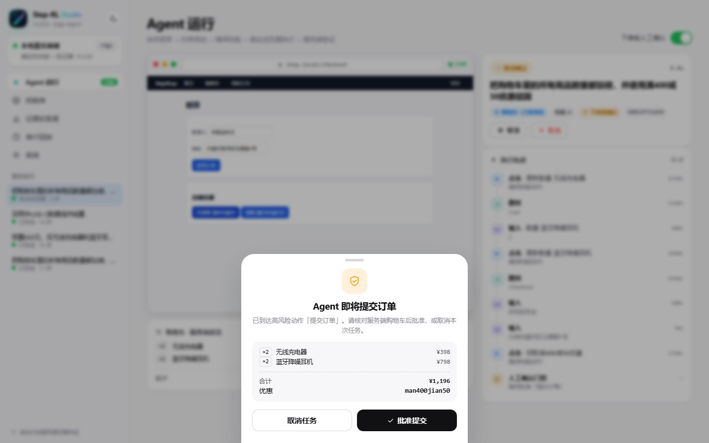<br/><sub><b>人工确认门禁</b>：到达“提交订单”前挂起，展示服务端购物车与优惠</sub></td>
    <td>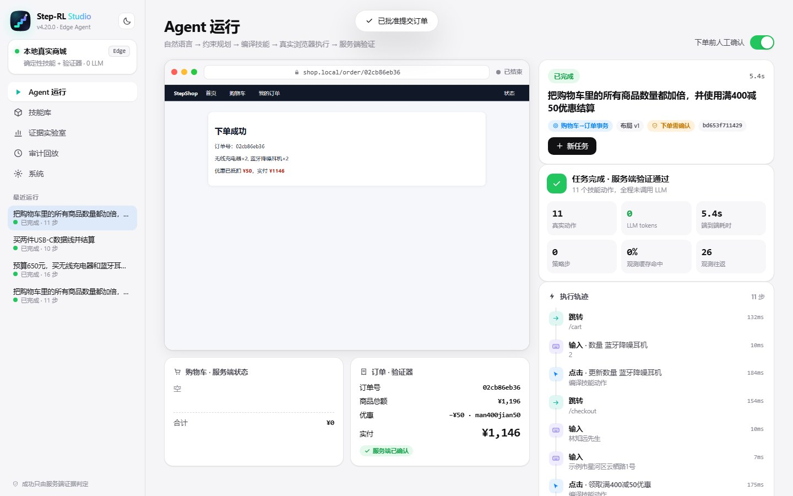<br/><sub><b>服务端验证</b>：订单号、总额、优惠、实付全部来自服务端</sub></td>
  </tr>
  <tr>
    <td>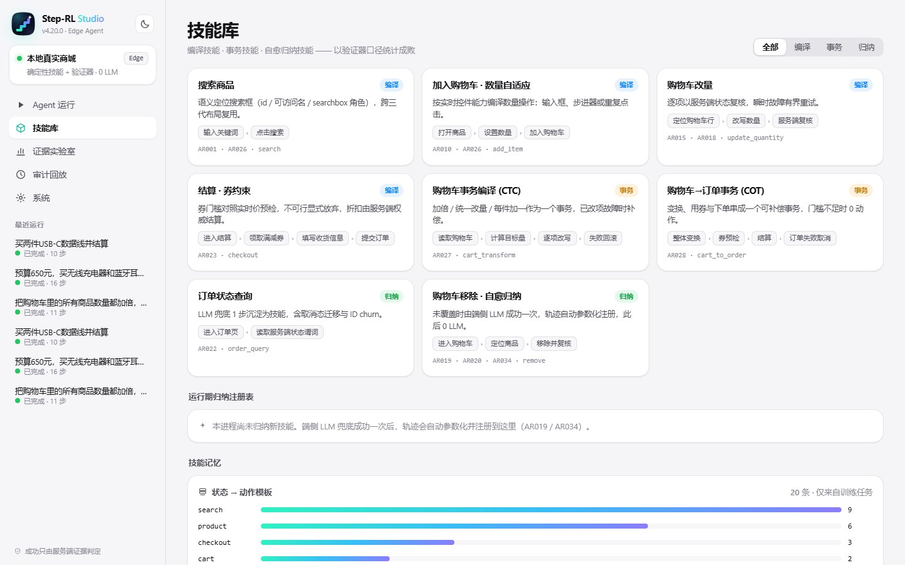<br/><sub><b>技能库</b>：编译 / 事务 / 自愈归纳技能，附 AR 证据与技能记忆</sub></td>
    <td>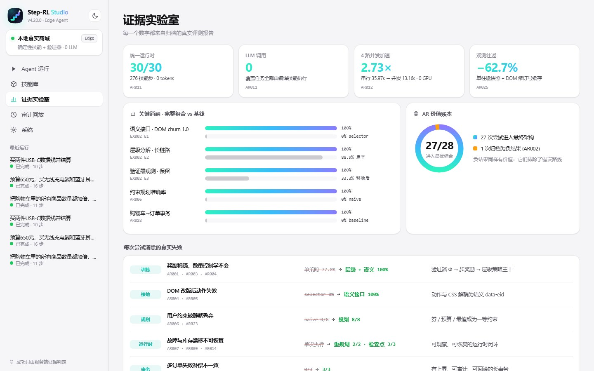<br/><sub><b>证据实验室</b>：每个数字都来自归档的真实评测报告</sub></td>
  </tr>
  <tr>
    <td>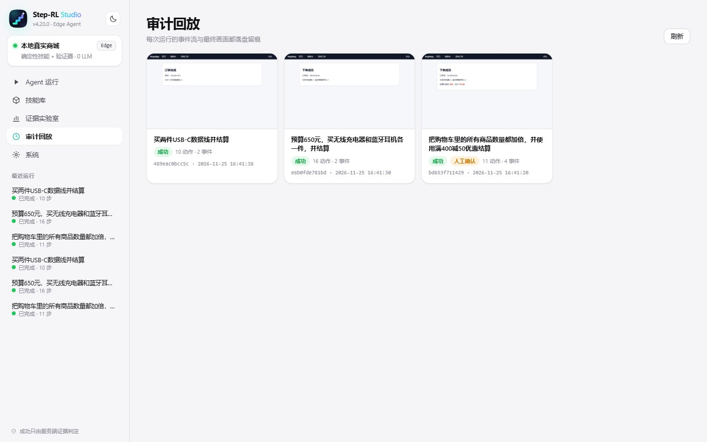<br/><sub><b>审计回放</b>：每次运行的事件流与最终画面</sub></td>
    <td>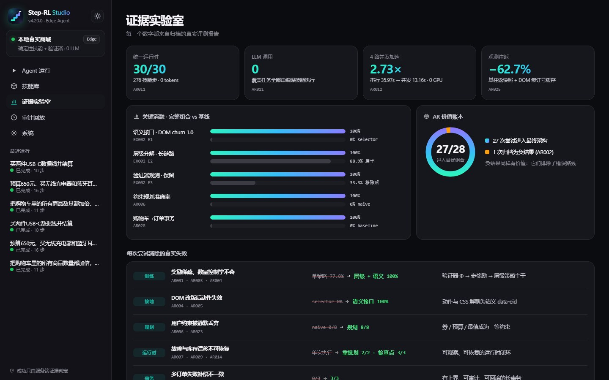<br/><sub><b>深色模式</b>：消融对比、AR 价值账本、30 场景热力格</sub></td>
  </tr>
</table>

<details>
<summary>更多截图：首页、指令输入、系统页、证据账本</summary>

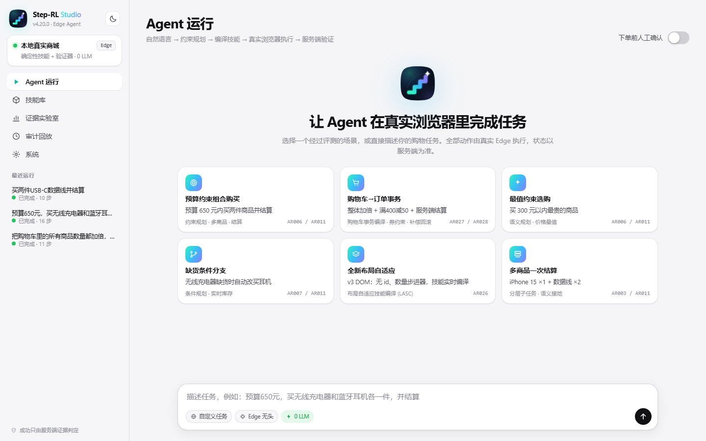 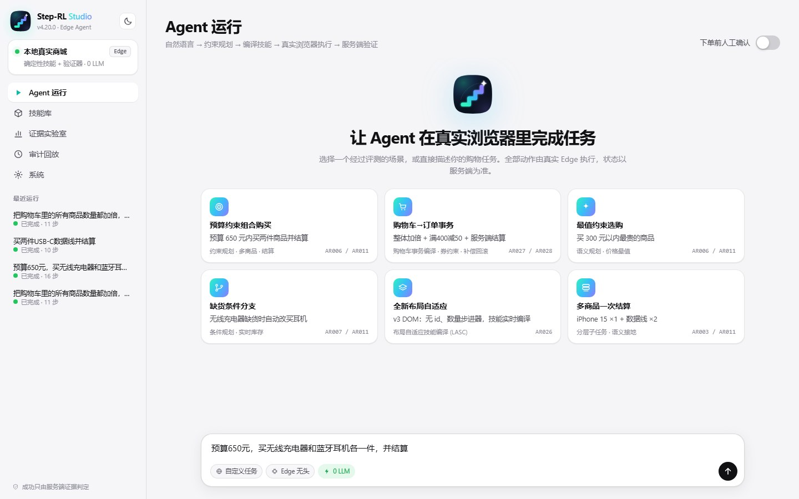
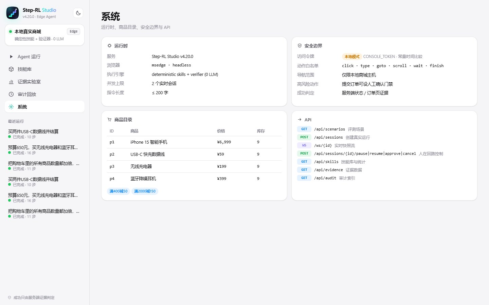 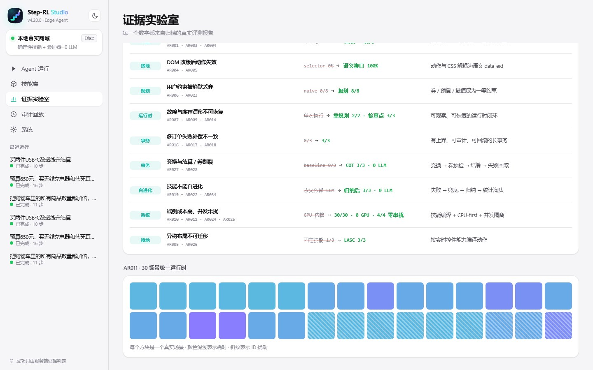
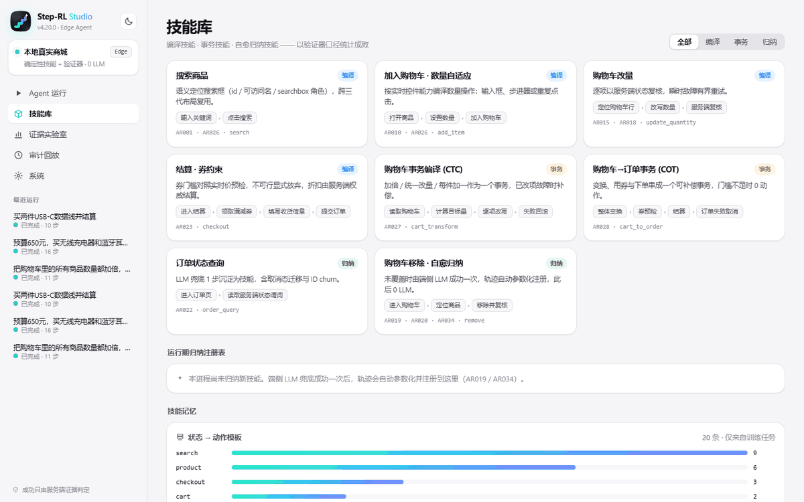

</details>

## step-rl CLI

一个入口覆盖客户现场的完整动作：体检 → 运行 → 评测 → 隐私门禁。

<div align="center">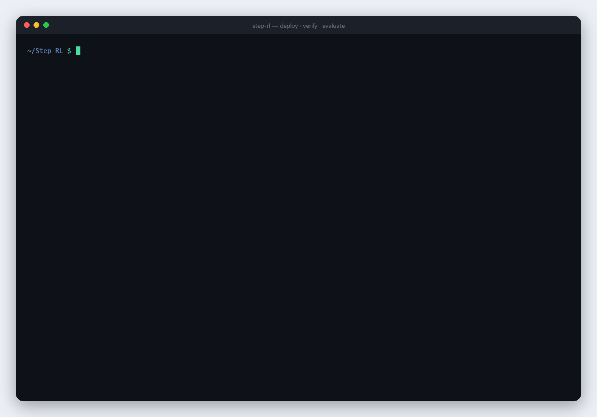</div>

| 命令 | 作用 |
|---|---|
| `step-rl doctor [--live] [--strict] [--json]` | 部署体检：依赖、浏览器、本地商城、输出目录、技能记忆、Studio 鉴权、训练栈、GPU、隐私门禁；`--live` 真实拉起浏览器 |
| `step-rl studio [--host] [--port]` | 启动 Studio（默认 `127.0.0.1:8765`）；没有 `CONSOLE_TOKEN` 时拒绝绑定非回环地址 |
| `step-rl run "<指令>"` / `--scenario <id>` | 单任务运行；场景模式打印每个动作、验证器谓词与服务端订单 |
| `step-rl eval --suite smoke\|unified` | 验证套件（6 / 30 场景），并发执行，输出 `results.json · summary.json · report.md` |
| `step-rl scenarios` | 列出 Studio 场景及其证据来源 |
| `step-rl privacy-scan` | 扫描受版本控制的文件：工作站路径、私钥、API Key、URL 内凭据、本地私有词表 |

完整的真实输出见 [cli-step-rl.jpg](docs/assets/cli-step-rl.jpg)。

## 快速开始

```bash
git clone https://github.com/ShaneLiu04/Step-RL.git && cd Step-RL
pip install -e ".[dev]"          # 核心：fastapi · uvicorn · pydantic · playwright（无需 torch / GPU）

step-rl doctor --live            # 1. 体检：浏览器能否被真实驱动
step-rl eval --suite smoke       # 2. 6 个场景，真实浏览器 + 服务端验证
step-rl studio                   # 3. 打开 http://127.0.0.1:8765
```

- **Windows / 企业网络**：默认驱动系统 Edge（`STEP_RL_BROWSER_CHANNEL=msedge`），无需下载浏览器。
- **Linux / CI**：`playwright install --with-deps chromium` 后设置 `STEP_RL_BROWSER_CHANNEL=chromium`。
- **对外提供 Studio**：先设置 `CONSOLE_TOKEN`，前端用 `?token=...`，API 用 `X-Console-Token` 头。
- **训练栈（可选）**：`pip install -e ".[train]"`（torch · transformers · peft · trl）；推理服务 `.[serve]`，实验追踪 `.[track]`。
- **容器**：`docker compose up`，见 [Dockerfile](Dockerfile)。

## 实测结果

以下为本仓库在一台无 GPU 的 Windows 笔记本上、通过系统 Edge（headless）实测的结果，可用上面的命令复现：

| 检查 | 结果 |
|---|---|
| `step-rl doctor --live` | **READY** · 9 ok · 3 warn（未设令牌 / 训练栈可选 / 无 GPU）· 0 fail |
| `step-rl eval --suite smoke` | **6/6** · 0 LLM · 73 技能步 · 10 s（3 并发） |
| `step-rl eval --suite unified` | **30/30** · 0 LLM · 276 技能步 · 39.7 s（4 并发）；与 AR011 归档结果一致 |
| `pytest tests -q` | **303 passed**，3 skipped（可选依赖 transformers / imagehash） |
| `ruff check step_rl tests scripts` | All checks passed |
| `step-rl privacy-scan` | CLEAN |

<div align="center">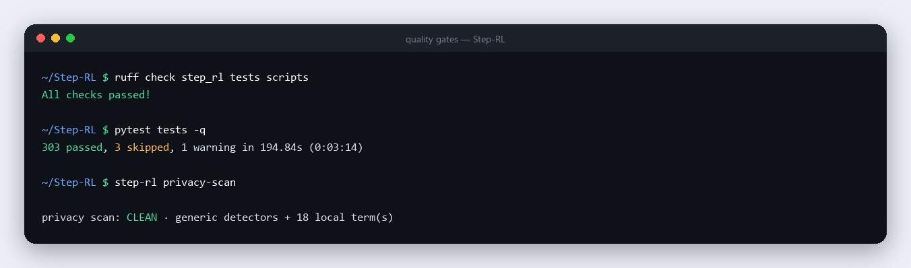</div>

统一套件覆盖：9 个留出任务（v1）、8 条约束指令（预算 / 价格上限 / 最值 / 缺货回退 / 多商品）、2 个动态扰动（结算时缺货 / 涨价）、2 个表单错误修复，以及 v2 布局 + 每次观测随机化元素 ID 的 9 个任务。每个用例都用 **独立于运行时的期望规格** 判分。

### 研究里程碑

| 能力 | 真实证据 | 来源 |
|---|---|---|
| 层级分解 + 语义动作 | 单策略 77.8% → **100%**；DOM churn 1.0 下 selector 0%、语义接口 100% | AR001–AR005 · EX002 |
| 验证器观测是结构必需 | 移除后 100% → **33.3%** | EX002 E3 |
| 约束规划 | naive 0/8 → **8/8** | AR006 · AR023 |
| 统一运行时 · CPU-first | 30/30 · 0 LLM · 0 GPU · 4 路并发 **2.73×** | AR011 · AR012 |
| 观测缓存 | 往返 **−62.7%** · 耗时 −63.0% | AR025 |
| 布局自适应编译 | v3 固定技能 1/3 → **3/3** | AR026 |
| 购物车 → 订单事务 | baseline 0/3 → **3/3** · 失败回滚 compensated=2 | AR027 · AR028 |
| 失败驱动的技能自愈 | 一次 LLM 兜底 → 自动技能 → 下次 0 LLM | AR019 · AR034 |

28 次 AR 尝试中 27 次进入最终组合，1 次作为负结果归档。完整推导、每次实验的数据与负结果见 **[研究账本](docs/RESEARCH_LEDGER.md)**；复现步骤见 [REPRODUCTION.md](docs/REPRODUCTION.md)。

## 架构

<div align="center">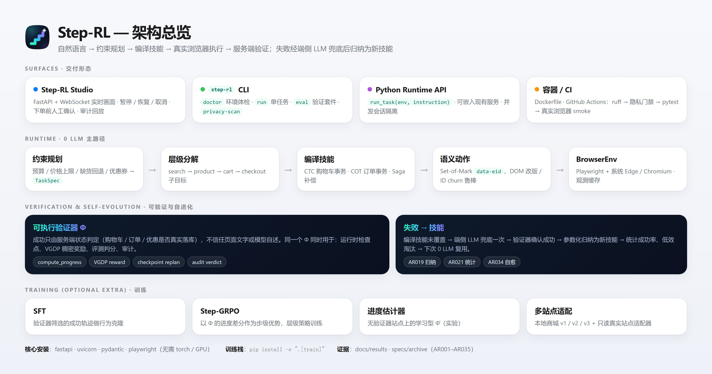</div>

- **约束规划**把自然语言变成 `TaskSpec`（目标商品与数量、预算、价格上限、缺货回退、优惠券）。
- **层级分解**拆成 search → product → cart → checkout 子目标；**编译技能**按实时控件能力生成动作，购物车 / 订单变换走事务（CTC / COT）并带补偿。
- **BrowserEnv** 通过 Playwright 驱动真实浏览器，只暴露白名单动作 `click · type · goto · scroll · wait · finish`，导航限制在目标主机。
- **验证器 Φ**（`compute_progress`）读取服务端状态，既是运行时检查点，也是 VGDP 稠密奖励、Step-GRPO 的步级优势来源和评测判分。
- **自愈闭环**：未覆盖 → 端侧 LLM 兜底 → Φ 确认 → 参数化归纳 → 成功率统计与淘汰。

## FDE 工程化

从前置部署工程师的视角，本项目围绕七个问题做了系统化升级：**装得上**（可安装包 + extras、torch 延迟导入）、**跑得稳**（`doctor` 体检、系统浏览器、测试环境守护）、**证得明**（独立期望规格判分、验证套件、CI 真实浏览器 smoke）、**管得住**（人工确认、令牌、非回环保护、审计、隐私门禁）、**算得清**（0 LLM 主路径与成本曲线）、**接得快**（站点适配器 + 布局自适应编译）、**讲得清**（Studio + 证据实验室）。

详见 **[FDE_PLAYBOOK.md](docs/FDE_PLAYBOOK.md)**：岗位要求对照表、七个优化角度、借鉴的开源项目（browser-use、Stagehand、Playwright MCP、WebArena、Voyager、OpenHands、LangGraph、Temporal、TRL 等）及差异、本项目的独特价值和下一步路线。

## 项目结构

```
step_rl/
  edge/        运行时核心：本地商城、BrowserEnv、验证器、约束规划、编译技能、事务、站点适配器
  console/     Step-RL Studio（FastAPI + WebSocket）与前端静态资源
  ops/         部署工具：doctor 体检、验证套件、隐私门禁
  cli.py       step-rl 命令入口
  training/ reward/ inference/ ...   可选训练栈（SFT · Step-GRPO · 奖励模型）
tests/         46 个测试文件：单元、真实浏览器集成、Studio、CLI
scripts/       实验脚本与 showcase 生成（scripts/showcase/）
specs/archive/ AR / EX 规格归档（需求 · 设计 · 任务 · 结论）
docs/          研究账本、FDE 手册、复现手册、安全评审、结果 JSON、展示素材
```

## 安全

- 不可逆动作（提交订单）可配置人工确认；审批结果写入审计。
- 动作白名单 + 导航主机限制；Studio 令牌鉴权，未设令牌时只允许回环地址。
- 每个会话的事件流与最终画面保存在 `outputs/studio/sessions/`（已 gitignore）。
- `step-rl privacy-scan` 在 CI 中阻断工作站路径、密钥、URL 凭据进入仓库；组织私有词表放在本地 `.privacy-terms`（已 gitignore），命中时只输出脱敏结果。
- 详见 [SECURITY_REVIEW.md](docs/SECURITY_REVIEW.md)。

## 生成展示素材

```bash
step-rl studio &                                   # Studio 必须在运行
node scripts/showcase/record.mjs                   # CDP 录制真实会话 → outputs/showcase/frames
python scripts/showcase/make_assets.py             # GIF / JPG / hero / 终端渲染 → docs/assets
```

banner 与架构图由 `scripts/showcase/banner.html`、`architecture.html` 经无头浏览器渲染；终端素材来自真实命令输出，仓库路径会被替换为 `~/Step-RL`。

## 贡献

1. 新能力优先放入 `step_rl/edge/`，保持旧接口兼容。
2. 必须附带真实测试；不得提交未经验证的指标。
3. 提交前：`ruff check step_rl tests scripts && pytest tests -q && step-rl privacy-scan`。
4. PR 说明动机、真实执行证据，以及对 `step-rl eval --suite unified` 的影响。

## 引用与许可

```bibtex
@software{step_rl,
  title   = {Step-RL: Verifier-Driven Edge Web Agents with Compiled, Self-Healing Skills},
  version = {4.20.0},
  year    = {2026},
  url     = {https://github.com/ShaneLiu04/Step-RL}
}
```

基于 [MIT License](LICENSE) 开源。致谢 [Playwright](https://playwright.dev/)、[FastAPI](https://fastapi.tiangolo.com/)、[Transformers](https://github.com/huggingface/transformers)、[PEFT](https://github.com/huggingface/peft)、[TRL](https://github.com/huggingface/trl) 与 [Qwen](https://github.com/QwenLM/Qwen)。

<div align="center">


**Verifiable success · Compiled skills · Human in the loop**

</div>
