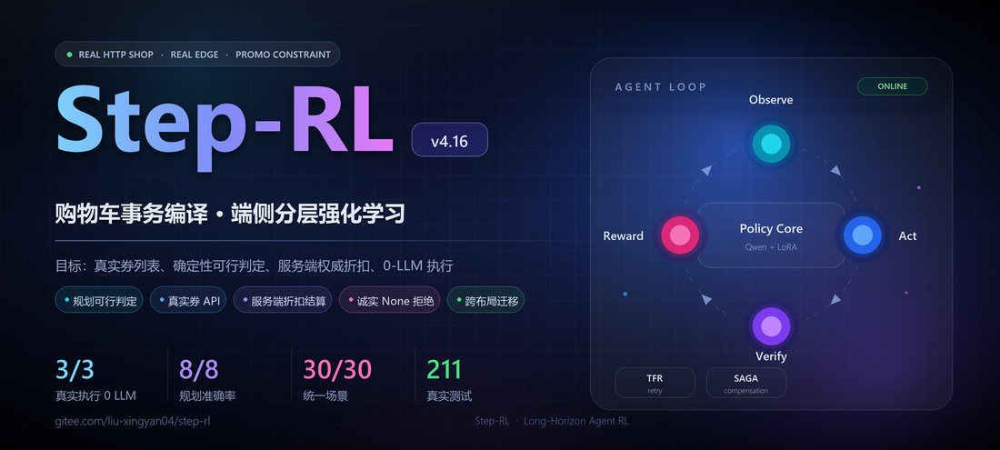
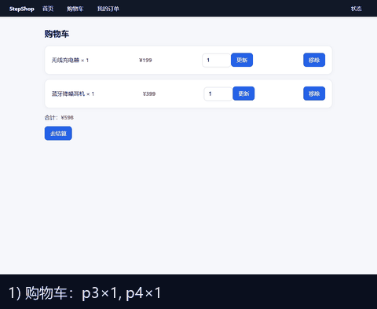
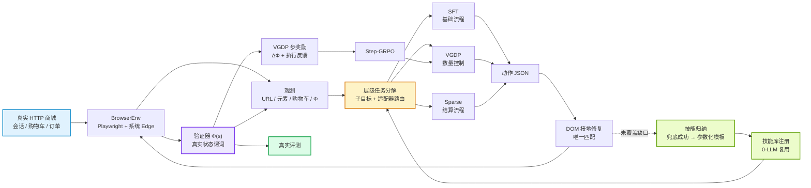

<div align="center">

<a href="https://github.com/ShaneLiu04/Step-RL">
  
</a>

<br/>

# Step-RL v4.17

**验证器驱动的端侧 Web Agent 分层强化学习**

[](https://www.python.org/downloads/)
[](https://pytorch.org/)
[](https://huggingface.co/docs/transformers)
[](https://playwright.dev/)
[](tests/)
[](LICENSE)

> 面向自进化：能力门控发现未覆盖任务 → 真实 LLM 兜底成功一次 → 轨迹自动归纳为参数化技能 → 此后同类任务 **0 LLM**。  
> 移除任务：归纳前**未覆盖**，归纳后 **3/3**（跨商品/跨布局 + ID churn），0 prompt tokens；  
> **批量移除**：单条指令 2–3 商品，技能路径 **3/3**、0 LLM，单商品移除不回退。  
> **技能统计与优先级**：技能成败以验证器口径留痕，成功率下降即淘汰让位（0/1 → 显式缺口 → LLM 兜底 → 闭环重归纳），让位后同类任务 **0 LLM**。  
> **订单状态查询**：真实订单页 + 服务端状态谓词（有效/已取消），LLM 兜底 **1 步 / 186 tokens** 沉淀为 1 步技能，同类指令 **3/3、0 LLM**（含取消态迁移 + v2 布局 + ID churn）。  
> **优惠券约束规划**：满减券成为与预算同级的一等约束——对照真实券列表 + 实时价做可行性判定（不可行显式 None，不猜测不降级），服务端权威折扣结算，同类指令 **8/8 规划 + 3/3 执行、0 LLM**。  
> **并发会话隔离**：4 个真实 Edge 会话共享真实服务端并发执行，**4/4 成功且零串扰**（2.75× 并行），4 次真实 DOM 失败留痕 **4/4 精确**，10×12 并发写者 **0 损坏**。  
> **自适应观测缓存**：单往返快照 + DOM 修订号缓存，30 场景仍 **30/30、0 LLM**，观测往返 **−62.7%**、观测耗时 **−63.0%**。  
> **布局自适应技能编译**：v3 全新 DOM/控件（searchbox、查找、无 id、数量步进器）下，固定技能 **1/3** → LASC **3/3、0 LLM**，v1/v2 30/30 零回退。  
> **购物车事务编译**：所有商品加倍/统一改量/每件加一，baseline **0/3** → CTC **3/3、0 LLM**；真实更新故障下已改项回滚，**compensated=1**。  
> **购物车→订单事务**：加倍+满400减50+结算，baseline **0/3** → COT **3/3、0 LLM**；`total=1196/paid=1146`，券门槛不足时 0 动作，订单失败回滚 **compensated=2**。

<p align="center">
  <strong>购物车→订单事务</strong> ·
  <strong>购物车事务编译</strong> ·
  <strong>布局自适应技能编译</strong> ·
  <strong>自适应观测缓存</strong> ·
  <strong>并发会话隔离</strong> ·
  <strong>优惠券约束规划</strong> ·
  <strong>订单状态查询技能</strong> ·
  <strong>技能成功率统计与优先级</strong> ·
  <strong>失败驱动技能归纳</strong> ·
  <strong>多商品批量移除</strong> ·
  <strong>瞬时故障重试</strong> ·
  <strong>故障恢复</strong> ·
  <strong>Saga 补偿</strong> ·
  <strong>多订单组合</strong> ·
  <strong>CPU-first 运行时</strong> ·
  <strong>统一 Agent Runtime</strong>
</p>

<p align="center">
   checkout -> promo" width="520">
  <br/>
  <sub>真实 Edge 演示：购物车整体加倍 → 满400减50 → 服务端订单 total ¥1196 / paid ¥1146（AR028）</sub>
</p>

</div>

---

> **先看价值账本**：[28 次 AR 尝试换来了什么](#ar-价值总览28-次尝试27-次进入最优组合) ·
> [全 AR 价值矩阵](#ar-价值矩阵全部尝试) · [EX002 压力实验](docs/results/EX002_report.md)

## 目录索引

<table align="center">
  <tr>
    <td align="center" width="25%"><a href="#动机与目标"><b>01 · 动机与目标</b></a><br/><sub>Motivation</sub></td>
    <td align="center" width="25%"><a href="#核心架构"><b>02 · 核心架构</b></a><br/><sub>Architecture</sub></td>
    <td align="center" width="25%"><a href="#真实结果"><b>03 · 真实结果</b></a><br/><sub>Results</sub></td>
    <td align="center" width="25%"><a href="#训练算法"><b>04 · 训练算法</b></a><br/><sub>Algorithm</sub></td>
  </tr>
  <tr>
    <td align="center"><a href="#快速开始"><b>05 · 快速开始</b></a><br/><sub>Quick Start</sub></td>
    <td align="center"><a href="#复现手册"><b>06 · 复现手册</b></a><br/><sub>Reproduction</sub></td>
    <td align="center"><a href="#大模型实验"><b>07 · 大模型实验</b></a><br/><sub>Scaling</sub></td>
    <td align="center"><a href="#评测协议"><b>08 · 评测协议</b></a><br/><sub>Evaluation</sub></td>
  </tr>
  <tr>
    <td align="center"><a href="#项目结构"><b>09 · 项目结构</b></a><br/><sub>Layout</sub></td>
    <td align="center"><a href="#安全设计"><b>10 · 安全设计</b></a><br/><sub>Security</sub></td>
    <td align="center"><a href="#ar-价值矩阵全部尝试"><b>11 · AR 价值矩阵</b></a><br/><sub>AR Value Matrix</sub></td>
    <td align="center"><a href="#常见问题"><b>12 · 常见问题</b></a><br/><sub>FAQ</sub></td>
  </tr>
  <tr>
    <td align="center"><a href="#贡献与致谢"><b>13 · 贡献与致谢</b></a><br/><sub>Contributing</sub></td>
    <td align="center"><a href="#引用与许可"><b>14 · 引用与许可</b></a><br/><sub>Citation</sub></td>
    <td align="center"><a href="#版本与兼容"><b>15 · 版本与兼容</b></a><br/><sub>Compatibility</sub></td>
    <td align="center"><a href="#联系与支持"><b>16 · 联系与支持</b></a><br/><sub>Support</sub></td>
  </tr>
</table>

---

## AR 价值总览：28 次尝试，27 次进入最优组合

我们不是先设计一个“大而全”的架构再寻找证据，而是让每次 AR 只回答一个真实失败：

> **失败发生在哪一层，就把那一层变成可执行、可验证、可回退的机制。**

28 次尝试中 **27 次进入最终组合**，1 次归档为负结果（AR002）；AR008 内部还回退了
“激进观测裁剪”，只保留干扰控件过滤。**负结果不是浪费**：它们排除了错误路线，
让最终组合没有被“看起来更多”的模块拖累。

### 每次尝试消除的真实失败

| 真实失败 | 代表尝试 | 真实证据 | 对最终架构的价值 |
|----------|----------|----------|------------------|
| 奖励稀疏、数量控制学不会 | AR001/003/004 | 单策略路由 77.8% → 层级+语义 **100%**；E2 扁平 88.9%、层级 100% | 建立“验证器 Φ → 步奖励 → 层级策略”的主干 |
| 长链路后段丢失结构 | AR003/004/005 | E3 移除验证器观测 **100% → 33.3%**；L5 扁平失败、层级成功 | 证明层级与验证器观测是结构必需，不是提示词技巧 |
| DOM 改版后动作失效 | AR004/005 | E1：churn 0.75/1.0 时 selector **0%**、语义 **100%**、非法动作 0 | 把动作从 CSS selector 解耦为语义 `data-eid`/可访问名 |
| 用户约束被静默丢弃 | AR006/AR023 | 规划准确率 naive **0/8** → **8/8**；执行 3/3、0 LLM、服务端 applied | 把失败前移到规划层，并让券/预算/最值成为一等约束 |
| 故障、库存漂移、表单错误不可恢复 | AR007/009/014 | 动态重规划 2/2；表单修复 2/2；检查点恢复 3/3 | 运行时不是“一次执行”，而是可观察、可恢复的闭环 |
| 多订单/失败补偿不一致 | AR016/017/018 | 0/2 → **2/2**；0/2 → **2/2**；0/3 → **3/3** | 把长事务做成有上界、可审计、可回滚的服务 |
| 购物车级整体变换无事务 | AR027 | baseline **0/3** → CTC **3/3、0 LLM**；故障补偿 **compensated=1** | 多商品事务 + 逐项服务端复核 + 失败回滚 |
| 变换与结算/券割裂 | AR028 | baseline **0/3** → COT **3/3、0 LLM**；`total=1196/paid=1146`；故障回滚 **compensated=2** | 变换→券预检→结算→订单，失败取消/回滚 |
| 技能不能自进化 | AR019/020/021/022 | 归纳后 3/3、0 LLM；批量移除 3/3；失败留痕后让位；订单查询 3/3 | 失败 → LLM 兜底 → 轨迹归纳 → 统计淘汰 → 0 LLM 复用 |
| 端侧运行成本高、并发串扰 | AR010/011/012/024/025 | 30/30、0 LLM、0 GPU；4 并发 4/4 零串扰；观测往返 **−62.7%** | 技能编译 + CPU-first + 并发隔离 + 单往返观测 |
| 异构布局/控件不可迁移 | AR005/AR026 | v3 固定技能 **1/3** → LASC **3/3**；v1/v2 30/30 零回退 | 从“记住布局”升级为“按实时控件能力编译动作” |
| 看似合理但实际有害的尝试 | AR002 + LoRA 融合 + 激进裁剪 | 66.7% / 0% / 60% | **全部回退**；排除错误路线也是实验价值 |

### 架构优越性：五个可验证结论

1. **可执行接地**：语义接口在 DOM churn 下仍是 100%，selector 在 0.75/1.0 时为 0%
   （EX002 E1）。
2. **长链路结构**：层级分解 9/9，扁平 8/9；移除验证器观测后 100% → 33.3%
   （EX002 E2/E3）。
3. **自进化闭环**：AR019–AR022 把未覆盖任务变成 0 LLM 技能复用，而不是永久依赖
   LLM 兜底。
4. **服务化可靠性**：AR024 在真实 4 并发会话下 4/4 零串扰、失败留痕 4/4、
   10×12 并发写者 0 损坏。
5. **端侧成本优势**：AR012 30/30、0 GPU、4 路并发约 2.73×；AR025 保持 30/30、
   0 LLM 的同时把观测往返降低 62.7%、观测耗时降低 63.0%。

### Agent + 端侧 LLM：组合而不是替代

| 层 | 真实证据 | 结论 |
|----|----------|------|
| 确定性 Agent/Runtime | 30/30、0 LLM、276 技能步、82.86s | 覆盖任务不调用模型 |
| 纯 LLM 本地执行 | 8/9（88.9%） | 能处理语义，但长链路退化 |
| 移除验证器观测 | 100% → 33.3% | LLM 不能替代权威验证 |
| 端侧 LLM 兜底 | remove 成功、4 policy steps、1142 tokens、28.17s | 未覆盖能力由模型补位 |
| 真实多站 | JD 风控/无商品链接、淘宝登录墙、Amazon 只读 | 需要 adapter/账号/人工，不由模型绕过 |

**组合原则**：确定性 adapter/verifier/事务优先；未覆盖/歧义/失败才调用端侧 LLM；
登录/验证码/支付/高风险由人工接管；成功只由服务端/订单页证据判定。

**当前组合（v4.18-dev）**：AR011 30 场景 **30/30、0 LLM、0 tokens、82.86s**；
edge **186 passed**；全量 **271 passed / 3 skipped**（排除既有 gpt2 网络文件）；
EX002 全 AR 覆盖矩阵无缺项。证据：
[docs/results/EX002_report.md](docs/results/EX002_report.md)、
[docs/results/EX003_report.md](docs/results/EX003_report.md)、
[docs/CODE_QUALITY.md](docs/CODE_QUALITY.md)。

---

## 动机与目标

### 长链路 Web Agent 的三层失配

**1. 奖励失配：成功信号太稀疏**
真实任务只在最后给出成功/失败，中间大量“必要但无进展”的动作（输入数量、填写表单）得不到反馈。模型无法判断哪一步真正推进了任务。

**2. 技能失配：一个策略装不下多种能力**
数量控制、表单填写、多商品流程需要不同的行为分布。把它们塞进同一个策略，后训练的技能会覆盖先前的技能，造成长链路中断。

**3. 验证失配：成功不可执行验证**
如果“完成”由模型自己声明，训练信号就不可信。长链路任务必须有一个**外部、确定性、可执行**的成功判定。

### 本项目的目标

| 目标 | 设计回答 |
|------|----------|
| 成功可验证 | 可执行验证器 Φ，只读真实服务端状态 |
| 奖励可归因 | VGDP：步级 `ΔΦ` + 执行反馈 |
| 策略可优化 | Step-GRPO：任务分组 + token 级优势 |
| 技能可组合 | 层级任务分解 + 按子目标路由适配器 |
| 端侧可训练 | Qwen3-0.6B + LoRA，单卡 16GB |
| 实验可复现 | 真实浏览器 episode、JSON 产物、固定 seed |

---

## 核心架构



### 运行时分层：每一层都由真实证据支撑

| 层 | 机制 | 支撑 AR | 真实证据 |
|----|------|---------|----------|
| 验证层 | 可执行谓词链 Φ，只读服务端状态 | AR001/003/006 | 9 任务 100%；E3 移除观测 100%→33.3% |
| 接地层 | 语义 `data-eid` + 可访问名 + 布局自适应 | AR004/005/026 | E1 churn 下语义 100%；v3 LASC 1/3→3/3 |
| 策略层 | 层级分解 + 适配器路由 + Step-GRPO | AR001/003/004 | 扁平 88.9% vs 层级 100% |
| 技能层 | 技能编译、归纳、统计淘汰、订单/券/批量扩展 | AR010/019–023 | 同类任务 0 LLM；失败留痕后让位 |
| 事务层 | 多商品变换 + 券预检 + 结算/订单 + 失败回滚 | AR027/028 | CTC 0/3→3/3；COT 0/3→3/3；compensated=1/2 |
| 恢复层 | 闭环重规划、错误修复、检查点、重试、Saga | AR007/009/014/016–018 | 0/2→2/2、0/3→3/3；失败可审计 |
| 服务层 | CPU-first、并发隔离、单往返观测 | AR012/024/025 | 4 并发零串扰；往返 −62.7%、耗时 −63.0% |

这张表是 README 的“架构主张”：**成功不是某个大模型的功劳，而是每层都有可执行、
可验证、可回退的机制。** 下面逐层说明。

### 1. 可执行验证器（Φ）

任务被写成有序谓词链：

```
search_done → product_viewed → cart_contains
→ cart_viewed → checkout_viewed
→ name_filled → address_filled → order_placed
```

`Φ = 已满足谓词 / 总谓词`。验证器只读真实 URL 与服务端状态，模型无法伪造。

### 2. VGDP 稠密奖励

```
r_t = 2.0·(Φ(s_{t+1}) − Φ(s_t))
    + 0.05·1[执行成功] − 0.10·1[执行失败]
    − 0.02 − 0.10·1[循环]
    + 1.0·1[终局成功] − 0.10·1[终局失败]
```

它把“输入数量 2”这类延迟收益动作，与随后真实的 `cart_contains` 变化关联起来。

### 3. Step-GRPO

- 同一任务采样 `G` 条轨迹，按任务分组；
- 回报 `G_t = Σ γ^{k−t} r_k`，组内标准化为步级优势；
- response token 继承所属步的优势；
- old log-prob 与采样分布一致，参考模型通过关闭 LoRA 获得。

### 4. 层级任务分解

长任务按验证器谓词链拆分：

```
「加 p3×1 + 加 p4×2 + 结算」
  → add p3      [SFT adapter]
  → add p4×2    [VGDP adapter]
  → checkout    [Sparse adapter]
```

- 同一真实浏览器会话，购物车状态不重置；
- 控制器只执行真实 `goto` 导航；
- 最终成功仍由**原任务验证器**判定。

### 5. 语义 Set-of-Mark 动作（DOM 改版鲁棒）

动作不再绑定 CSS id，而是引用当前观测中的元素编号：

```json
{"action": "click", "params": {"element": "e2"}}
```

- 观测为每个可交互元素分配 `e1/e2…`，并给出 `role + accessible_name`；
- 执行器通过 `data-eid` 在真实 DOM 中定位；
- 语义编号只在当前步有效，页面变化后重新生成；
- 语义模式下关闭 selector 修复，非法动作显式失败，不做静默兜底。

真实压力测试：观测后随机化全部 DOM id，selector 接口 L1–L2 成功率 0%，语义接口 100%。

### 6. 验证器感知观测 + DOM 接地修复

- Prompt 写入 `进度: 0.75 | 未完成: 填写收货人、提交订单`；
- selector 模式下，选择器失效时用真实 DOM 做唯一匹配修复；多候选一律放弃。

### 7. 失败驱动的技能自动归纳（AR019）

能力闭环的最后一环：兜底成功一次，永久转为 0-LLM 技能。

```
能力门控判缺口 (covered=false)
  → 真实 LLM 兜底执行一次（GPU + 真实浏览器）
  → TrajectoryRecorder 记录动作 + 语义元素元数据（执行前解析）
  → induce_skill 泛化为参数化模板（{product} / {qty}）
  → 注册技能库 + JSON 持久化 → 同类任务 0-LLM 直接执行
```

- 记录发生在**执行前**：eid 在当时观测中解析回 `role + accessible_name`，
  页面随后重渲染或 ID 扰动不丢失语义信息；
- 未注册的非 add 操作显式返回 `None`：能力缺口不得静默误路由到加购技能；
- 归纳技能与人工技能同标准：注册即过能力门控，30 场景统一套件回归检验；
- AR020 批量扩展：多目标规划解析 + 运行时「前缀一次 + 单元×N」展开 +
  块式轨迹归纳（最长公共后缀 unit），模板不随商品数漂移。

---

## 真实结果

### 5.1 从 77.8% 到 100%：9 个真实留出任务的关键节点

| 组合 | 成功率 | 平均步数 | 平均进度 |
|------|--------|----------|----------|
| SFT | 44.4% | 5.78 | 0.76 |
| SFT + 修复 | 55.6% | 5.78 | 0.79 |
| Sparse-GRPO + 修复 | 55.6% | 5.78 | 0.83 |
| VGDP-GRPO + 修复 | 66.7% | 5.33 | 0.85 |
| AR001 单策略路由 | 77.8% | 5.11 | 0.90 |
| AR003 层级分解（selector） | 100% | 5.89 | 1.00 |
| AR004 语义层级 | 100% | 6.33 | 1.00 |
| AR005 跨布局语义 | 100%（未见布局 + churn） | 7.89 | 1.00 |
| AR006 约束规划 | 100%（8 条约束指令） | 10.50 | 1.00 |
| AR007 闭环重规划 | 2/2 动态 + 3/3 静态 | 27（动态重试） | 1.00 |
| AR008 观测压缩（效率层） | 100%（5 任务） | 8.00 | 1.00 |
| AR009 错误可观测修复 | 2/2（表单校验） | 10 | 1.00 |
| AR010 技能编译 | 100%（9 任务） | 7.33 | 1.00 |
| AR011 统一 Runtime | 30/30（组合场景） | 9.20 | 1.00 |
| AR012 CPU-first Runtime | 30/30（0 GPU / 0 LLM） | 9.20 | 1.00 |
| AR013 对抗 UI 接地 | 3/3（基线 0/3） | 10–16 | 1.00 |
| AR014 检查点恢复 | 3/3（基线 0/3） | 9–16 | 1.00 |
| AR015 技能库扩展 | 3/3（基线 2/3） | 3 | 1.00 |
| AR016 多订单组合 | 2/2（基线 0/2） | 20 | 1.00 |
| AR017 Saga 补偿 | 2/2（基线 0/2） | 16 | 1.00 |
| AR018 瞬时重试 | 3/3（基线 0/3） | 10–20 | 1.00 |
| AR019 技能自动归纳 | 3/3（归纳前未覆盖） | 4 | 1.00 |
| AR020 多商品批量移除 | 批量 3/3 + 单商品 3/3，0 LLM | 2–3 | 1.00 |
| AR021 技能统计与优先级 | 0/1 失败留痕 → 让位；技能复用 4/4，0 LLM | 4 | 1.00 |
| AR022 订单状态查询 | 真实订单页谓词 + 3/3（0 LLM） | 1 | 1.00 |
| AR023 优惠券约束规划 | 8/8 规划 + 3/3 执行（0 LLM，服务端 applied） | 11–17 | 1.00 |

> 这张表只覆盖 **9 个留出任务**的主干能力节点。AR024–AR026 是运行层/布局层
> 创新（并发隔离、观测缓存、LASC），不以 9 任务成功率单独计分；它们的真实
> 证据见 5.24–5.26 与 EX002 E4–E6。把不同口径混成“最终总分”会误导。

逐任务：

| 任务 | 等级 | AR001 路由 | AR003 | **AR004** |
|------|------|------------|-------|-----------|
| ev_search_p3 | L1 | ✓ | ✓ | ✓ |
| ev_search_p4 | L1 | ✓ | ✓ | ✓ |
| ev_add_p3 | L2 | ✓ | ✓ | ✓ |
| ev_add_p4 | L2 | ✓ | ✓ | ✓ |
| ev_qty_p3 | L3 | ✓ | ✓ | ✓ |
| ev_qty_p4 | L3 | ✓ | ✓ | ✓ |
| ev_checkout_p4 | L4 | ✓ | ✓ | ✓ |
| ev_checkout_p3（数量2+结算） | L4 | ✗ | ✓ | ✓ |
| ev_multi_p3p4（多商品） | L5 | ✗ | ✓ | ✓ |

### 5.2 DOM 改版鲁棒性（真实压力测试）

在观测快照之后随机化页面全部 DOM id，再执行动作：

| 接口 | L1–L2 成功率 | 原始非法动作 | 修复依赖 |
|------|--------------|--------------|----------|
| selector + 修复 | **0%** | 100% | 100% |
| **语义 Set-of-Mark** | **100%** | **0** | **0** |

完整 9 任务：

| 条件 | 成功率 | 平均步数 | 非法动作 | 修复 |
|------|--------|----------|----------|------|
| 语义层级（稳定 DOM） | 100% | 6.33 | 0 | 0 |
| **语义层级（ID 扰动）** | **100%** | 6.33 | **0** | **0** |

### 5.3 跨布局零样本迁移（第二套真实商城）

第二套布局 `ShopLite`：不同 id/标签层级/元素顺序，并加入排序、筛选、收藏、返回、继续购物等真实干扰按钮。

| 条件 | 接口 | 成功率 | 平均步数 | 非法动作 |
|------|------|--------|----------|----------|
| 稳定 v2 | selector | 100% | 6.78 | 2 |
| 稳定 v2 | 语义 | 100% | 7.33 | 0 |
| **v2 + 观测后 id 全随机化** | selector | **0%** | 12.00 | 99 |
| **v2 + 观测后 id 全随机化** | **语义** | **100%** | **7.89** | **0** |

结论：仅换布局时 selector 仍可通过观测中的新 selector 工作；一旦真实页面在“决策→执行”之间重渲染，selector 立即失效，而语义元素编号仍可执行。

### 5.4 约束任务规划（8 条真实指令）

| 条件 | 规划准确率 | 按用户期望成功率 | 平均步数 |
|------|------------|------------------|----------|
| 关键词基线（v1） | **0%** | **12.5%（1/8 偶然）** | 5.62 |
| 约束规划（v1） | **100%** | **100%** | 10.50 |
| **约束规划（v2 + ID churn）** | **100%** | **100%** | 12.00 |

覆盖：最便宜、预算内最贵、指定数量、多商品、预算合计、最贵、缺货替代。  
成功判定使用**用户期望 TaskSpec**，而不是规划器自证；基线唯一“成功”是模型偶然加购正确数量，但规划仍然错误。

### 5.5 数量控制消融（L3 留出）

| 组合 | 成功率 |
|------|--------|
| SFT | 0/2 |
| SFT + 修复 | 0/2 |
| Sparse-GRPO + 修复 | 0/2 |
| **VGDP-GRPO + 修复** | **2/2** |

训练日志：VGDP 第 2 轮训练成功率 66.7%，Sparse 33.3%；平均步奖励 +0.322 vs −0.020。

### 5.6 组合冲突与回退账本

> **不是把所有 AR 加起来。** 每轮都按 design §9.1 做组合级回退：只在真实
> Edge/HTTP 结果不劣于当前最优时保留；失败尝试同样归档，避免下一轮重复踩坑。

| 节点 | 真实结果 | 决策 | 原因 / 替代 |
|------|----------|------|-------------|
| AR001 单策略路由 | 77.8% | 中间最优 | VGDP + Step-GRPO 主干成立 |
| AR002 技能记忆 + 重规划 | 66.7% | **回退** | 记忆噪声干扰长链路；后续用 AR019/021 的“真实验证器成败”替代 |
| 历史行压缩 | 0% | **回退** | 丢失后段状态；改为 AR025 的观测传输优化 |
| LoRA 权重融合 | 0% | **回退** | 适配器冲突；改为层级路由 + 技能编译 |
| AR008 激进观测裁剪 | 60% | **回退** | 裁掉可执行元素；仅保留“干扰控件过滤”（−4.2% tokens） |
| AR016 多订单 | 0/2 → 2/2 | 保留 | 合并订单会丢结构，序列运行时成功 |
| AR017 Saga | 0/2 → 2/2 | 保留 | 失败订单全部 cancelled，避免半成功 |
| AR018 瞬时重试 | 0/3 → 3/3 | 保留 | 失败上界明确，重试可审计 |
| AR021 技能统计 | 0/1 → 让位 | 保留 | 失败留痕触发淘汰，避免坏技能长期占用 |
| AR024 并发隔离 | 4/4 零串扰 | 保留 | 失败留痕 4/4、写者 0 损坏 |
| AR025 观测缓存 | 30/30、−62.7% 往返 | 保留 | 权威 state 不缓存，避免“省成本换错状态” |
| AR026 LASC | v3 1/3 → 3/3 | 保留 | 中途旧版数量输入回归，修复后 AR011 恢复 30/30 |
| AR027 CTC | 0/3 → 3/3；故障补偿成功 | 保留 | 多商品事务；真实 500 下已改项回滚 |
| AR028 COT | 0/3 → 3/3；券预检/订单回滚 | 保留 | 变换+结算+券；预检失败零动作，订单故障回滚 |

**最终账本：27 保留 / 1 归档负结果（AR002）；AR008 的激进部分单独回退。**
被回退的尝试不是“失败项目”，而是排除了错误路线，让最终组合没有噪声模块。

所有结果来自 `outputs/` 下真实 episode JSON；完整归因见
[docs/results/EX002_report.md](docs/results/EX002_report.md)。

### 5.7 闭环运行时重规划（AR007）

| 场景 | 一次性基线 | 闭环监督器 |
|------|------------|------------|
| D1 结算时库存骤降 → 替代 | 失败（18 步） | **成功（p4×2 → p2×2，2 次尝试）** |
| D2 结算时涨价 → 预算内替代 | 失败（18 步） | **成功（p3×1 → p2×1，2 次尝试）** |
| 静态回归（3 条） | — | **3/3，0 次重规划** |

机制：`Plan → Act → Verify → 刷新真实目录 → Replan → 重执行`；动态事件由真实服务器状态变化触发。

### 5.8 验证器引导观测压缩（AR008）

| 条件 | 成功率 | 平均步数 | Prompt tokens | 决策 |
|------|--------|----------|---------------|------|
| full observation | 100% | 8.00 | 10009 | 基线 |
| 相关性 top-K 裁剪 | **60%** | 10.80 | 12570 | 回退 |
| 历史行压缩 | **0%** | 12.00 | 15303 | 回退 |
| **仅移除真实干扰控件** | **100%** | **8.00** | **9589（−4.2%）** | **保留** |

- 30% token 目标未达到，如实记录；
- 保守方案不改变成功/步数，token 与时间小幅下降，作为效率层保留；
- 激进裁剪会破坏上下文，已回退。

### 5.9 错误可观测闭环修复（AR009）

| 条件 | 成功率 | 步数 |
|------|--------|------|
| 基线（看不到错误） | **0/2** | 18 |
| 仅错误可观测 | **0/2** | 18 |
| **错误可观测 + 控制器修复** | **2/2** | **10** |

- 表单校验：收货人需包含“先生/女士”，地址需包含“路”；
- 仅看到错误不够，错误页没有输入框；控制器执行真实 `goto /checkout → 重填字段 → 提交`；
- 修复动作真实执行，成功由原验证器确认。

### 5.10 技能编译免生成执行（AR010）

| 条件 | 成功率 | 平均步数 | LLM 步数 | Prompt tokens | 耗时 |
|------|--------|----------|----------|---------------|------|
| LLM 每步基线（v1） | 100% | 6.33 | **53** | 14858 | 292.7s |
| **编译技能（v1）** | **100%** | 7.33 | **0** | **0** | **13.9s** |
| **编译技能（v2 + ID churn）** | **100%** | 7.33 | **0** | **0** | **14.2s** |

- 技能：`search` / `add_item(pid,qty)` / `checkout`，真实成功轨迹动作模式参数化；
- 技能执行走真实浏览器与语义元素解析，不调用模型；失败回退 LLM；
- 首轮 v1 77.8% 因数量框无可访问名，加入唯一 spinbutton 真实回退后恢复 100%。

### 5.11 统一 Agent Runtime（AR011）

| 场景组 | 数量 | 一次性 LLM 基线 | 统一 Runtime |
|--------|------|------------------|--------------|
| 静态 9 | 9 | 9/9 | 9/9 |
| 约束 8 | 8 | 8/8 | 8/8 |
| 动态 2 | 2 | 0/2 | 2/2 |
| 表单错误 2 | 2 | 0/2 | 2/2 |
| 跨布局+churn 9 | 9 | 9/9 | 9/9 |
| **合计** | **30** | **26/30（86.7%）** | **30/30（100%）** |

- 统一 Runtime：规划 → 技能执行 → 验证 → 漂移重规划 → LLM 回退；
- 本轮实测 **0 LLM 调用、0 prompt tokens、82s**；
- 基线为 AR004/AR005/AR006/AR007/AR009 的真实 JSON 汇总。

### 5.12 CPU-first 能力门控运行时（AR012）

| 指标 | 结果 |
|------|------|
| 30 场景成功率 | **100%** |
| LLM 调用 | **0** |
| GPU 显存 | **0 bytes（未加载模型）** |
| 串行 12 任务 | 35.97s |
| **4 路并发 12 任务** | **13.16s（约 2.7×）** |
| 未覆盖指令“写一首诗” | covered=false，fallback_required=true |

- 能力清单显式判断覆盖率，未覆盖任务不误执行；
- 技能覆盖任务完全在 CPU 上运行，适合端侧/无 GPU 服务。

### 5.13 对抗 UI 接地鲁棒性（AR013）

| 条件 | 成功率 | 订单 | 耗时 |
|------|--------|------|------|
| 基线 LLM（伪装按钮） | **0/3** | 无订单 | 65–89s |
| **统一 Runtime（技能）** | **3/3** | **p3×1 / p4×2 / p1×1+p2×1** | **2.7–3.7s** |

- 商品页注入 `role=button`、名称为“加入购物车（推荐）”的伪装按钮，实际指向错误商品；
- 技能按 role=button + 精确名称 + 排除“推荐/广告/赞助”选真实按钮；
- 首版 `role=link` 未诱导基线（3/3），已如实记录；安全结论只适用于按钮级伪装。

### 5.14 崩溃恢复与持久化执行（AR014）

| 任务 | 重启基线 | 检查点恢复 |
|------|----------|------------|
| p4×2 | ✗ 订单 p4=4 | **✓ p4=2** |
| p3×2 | ✗ 订单 p3=4 | **✓ p3=2** |
| p1×1+p2×1 | ✗ p1=2,p2=2 | **✓ p1=1,p2=1** |

- 检查点保存 Playwright `storage_state`，恢复同一真实会话；
- 精确数量验证器（`==`）防止“多买也算成功”；
- 恢复 4–5s，基线 5–7s；不加载模型、不占 GPU。

### 5.15 技能库扩展：购物车数量更新（AR015）

| 任务 | LLM 基线 | 扩展技能 |
|------|----------|----------|
| p3 1→3 | ✓（61.7s） | **✓（1.75s）** |
| p4 2→4 | ✓（35.1s） | **✓（1.69s）** |
| p3 3→1 | ✗（p3=4） | **✓（1.68s）** |

- 新增真实 `/update` 路由、购物车数量输入/更新按钮；
- 新增精确谓词 `cart_quantity_exact` 与 `seed_cart`；
- `update_quantity` 技能由真实演示动作参数化，扩展后能力门控自动覆盖；
- 基线能加量但不能可靠减量。

### 5.16 多订单序列组合（AR016）

| 任务 | 合并 LLM 基线 | 序列 Runtime |
|------|----------------|--------------|
| M1（p3×1；p2×2） | ✗ 一笔 p3=2,p2=2 | **✓ 两笔** |
| M2（p4×2；p1×1） | ✗ 一笔 p4=2,p1=2 | **✓ 两笔** |

- 服务端维护订单历史；序列验证要求每个目标订单匹配不同历史订单；
- 第 1 单 reset，后续不 reset，购物车订单后真实清空；
- 4.3–4.4s vs 101–294s（约 20×），0 LLM。

### 5.17 Saga 补偿与失败回滚（AR017）

| 场景 | 无补偿基线 | Saga |
|------|------------|------|
| S1：p3 成功 → p4 缺货 | ✗ 第一单 active | **✓ cancelled** |
| S2：p2 成功 → p3 缺货 | ✗ 第一单 active | **✓ cancelled** |

- 服务端订单含 `active/cancelled` 状态与真实 `/cancel` 接口；
- 运行时记录已成功订单，失败后逐个取消；
- 不需要模型/GPU，验证器要求历史订单全部 cancelled。

### 5.18 瞬时故障重试（AR018）

| 任务 | 单次基线 | 技能重试 |
|------|----------|----------|
| F1 add 500 | ✗ | **✓（2 次尝试）** |
| F2 add 500（qty2） | ✗ | **✓（2 次尝试）** |
| F3 order 500 | ✗ | **✓（2 次尝试）** |

- 服务端一次性真实 HTTP 500；
- Runtime 同 TaskSpec 重试一次，真实 reset 会话后成功；
- 不加载模型/GPU，重试次数与订单状态可审计。

### 5.19 失败驱动的技能自动归纳（AR019）

**动机。** AR012 能力门控发现未覆盖任务后会拒绝执行或回退 LLM，但兜底成功的
轨迹此前被直接丢弃——同类任务下次仍要重新付出一次 LLM 成本。能力闭环
缺了最后一环：**把兜底成功经验自动沉淀为可复用技能**。此前所有技能
（AR010/AR015）都来自真实专家演示的人工参数化；AR019 把
「成功轨迹 → 参数化技能」这一步自动化：任何能力缺口，只要 LLM 兜底
成功一次，运行时自行完成沉淀，无需专家在场。

**真实评测（P0–P5，全部真实浏览器 / GPU / 服务端状态）。**

| 阶段 | 内容 | 结果 |
|------|------|------|
| P0 | 能力门控检查「移除」指令（归纳前） | covered=false（`no_skill_for_level_2`）——真实缺口证据 |
| P1 | LLM 兜底真实执行移除 p3（GPU，seed p3×2） | ✓，4 步，1092 prompt tokens，19.8s |
| P2 | 轨迹归纳 → 注册 → JSON 持久化 | 4 步模板，门控翻转为 covered（skills=`induced_remove`） |
| P3 | 同任务技能复跑（新会话，不加载模型） | ✓，**0 LLM / 0 tokens，1.83s（约 11× 提速）** |
| P4 | 迁移：换商品 p4（v1）/ p3（v2 + 全量 ID churn） | ✓ / ✓，均 0 LLM，1.8–1.97s |
| P5 | 组合门禁 | edge 套件 **153 passed**；AR011 30 场景 **0 LLM** |

**兜底轨迹与归纳模板（真实记录对照）。** LLM 兜底自选「先把数量改回 1
再移除」的策略，四步动作全部真实执行；记录器在执行前把 eid 解析回
`role + accessible_name`，归纳器把商品名替换为 `{product}` 占位符：

| 兜底轨迹（语义解析后） | 归纳模板（泛化后） |
|------|------|
| type（未解析元素）值 "2" | type 值 "2"（原样保留） |
| type spinbutton「数量 无线充电器」值 "1" | type spinbutton「数量 {product}」值 "1" |
| click button「更新数量 无线充电器」 | click button「更新数量 {product}」 |
| click button「移除 无线充电器」 | click button「移除 {product}」 |

模板按原样回放即复现成功（保留冗余前缀步，不做启发式裁剪——成功轨迹
即最小可复现单元），实例化时占位符按目标任务商品替换。

**效率对照（0-LLM 复用收益）。**

| 执行方式 | LLM 调用 | prompt tokens | 耗时 | 结果 |
|----------|----------|---------------|------|------|
| LLM 兜底（首次，沉淀成本） | 1 | 1092 | 19.8s | ✓ 购物车清空 |
| 技能复用（p3，v1，同任务） | 0 | 0 | 1.83s | ✓ |
| 技能复用（p4，v1，换商品） | 0 | 0 | 1.97s | ✓ |
| 技能复用（p3，v2 + ID churn） | 0 | 0 | 1.84s | ✓ |

**安全边界。** 未注册非 add 操作显式返回 `None`（不得静默误路由到加购
技能）；注册表模块级隔离、测试可重置；模板 JSON 持久化可审计；与既有
技能同标准接受组合门禁回归——归纳前 30 场景与归纳后完全一致。

**遗留技术债**（与 AR019 无关，git-stash 对照验证：改动前后均 17 failed）：
legacy 三文件 locator / progress_estimator / smart_wait 的历史失败，
已按仓库惯例记录、不纳入门禁。

产物：`outputs/ar019/eval/`（results JSON / 报告 / 模板 JSON）；
spec：`specs/archive/AR019-skill-induction/`；复现：`python scripts/ar019_eval.py`。

### 5.20 多商品批量移除（AR020）

**动机。** AR019 的归纳闭环只覆盖单目标任务；真实指令常是
「把购物车中的 p3 和 p2 移除」这类**一条指令多个目标**。改动前基线探针
（旧代码真实执行，`outputs/ar020/baseline_probe.json`）暴露两处真实缺陷：
规划器把批量指令解析成 `targets={"p3": 0}`——**第二商品被静默丢弃**；
旧模板实例化对批量任务 `success=false`（购物车剩 p4×3），而单商品对照
成功——缺陷确在批量链路。批量也不是「单商品 × N」的平凡扩展：真实兜底
轨迹对 p3 先「更新数量」再「移除」、对 p4 直接「移除」，块之间**前缀
单调而非严格相等**，归纳必须能从中切出对每件商品都被证明有效的单元。

**机制（三处增量，全部真实执行验证）。**

| 环节 | AR019（单目标） | AR020（批量） |
|------|------|------|
| 规划器 | `targets={p3: 0}` | 「和 / 与 / 顿号」多商品解析 → `targets={"p3": 0, "p2": 0}`，seed_cart 多键 |
| 模板实例化 | 单元直出 | **运行时多目标展开**：前缀 1 次 + 单元 × N + 后缀，模板不随 N 漂移 |
| 轨迹归纳 | 整条轨迹 → 模板 | **块式切分**（按真实「移除」点击边界）+ 块间最长公共后缀 → unit |

- 块式归纳的诚实约束：块内不一致时显式失败（不做多数投票式臆造）；
- unit 是「对每件商品都被真实证明有效的最小模式」，冗余前缀步原样保留。

**真实评测（P0–P5，真实 Edge / GPU / 服务端状态）。**

| 阶段 | 内容 | 结果 |
|------|------|------|
| P0 | 改动前基线探针（旧代码） | 规划丢第二商品；批量执行 ✗（cart 剩 p4×3）；单商品对照 ✓ |
| P0a | 新规划解析「移除 p3 和 p2」 | `targets={"p3":0,"p2":0}`，seed `{p3:2, p2:3}` ✓ |
| P1 | LLM 兜底真实执行批量移除（GPU，AR004 适配器，seed=42） | ✓，4 步，1267 prompt / 96 response tokens，19.22s |
| P2 | 块式归纳 → 注册 → 持久化 | 模板 2 步（`移除 {product}` unit），门控翻转 covered |
| P3 | 批量技能复跑 B1 v1 / B2 v1 带数量 / B3 v2+ID churn | **3/3，0 LLM / 0 tokens，1.80–1.85s**，cart 全空 |
| P4 | 单商品回归 S1/S2/S3（镜像 AR019，含 v2+churn） | **3/3，0 LLM，1.53–1.54s**，不回退 |
| P5 | 组合门禁 | edge 套件 **166 passed**（153 基线 + 13 新增）；AR011 30 场景 **0 LLM** |

**效率对照（0-LLM 复用收益）。**

| 执行方式 | LLM 调用 | prompt tokens | 耗时 | 结果 |
|----------|----------|---------------|------|------|
| LLM 兜底（双商品，首次沉淀） | 1 | 1267 | 19.22s | ✓ cart 清空 |
| 批量技能复用（B1/B2/B3） | 0 | 0 | 1.80–1.85s | ✓ 3/3（**≈10.5×**） |
| 单商品技能回归（S1/S2/S3） | 0 | 0 | 1.53–1.54s | ✓ 3/3 |

**兼容性验证。** `induce_skill` 对 AR019 单商品轨迹输出**逐字段不变**
（11/11 旧测试全绿）；批量展开是纯运行时行为，模板 JSON 不随商品数
变化——存量技能零迁移成本。

产物：`outputs/ar020/`（baseline_probe / eval results / 报告 / 模板 JSON）；
spec：`specs/archive/AR020-batch-remove/`；复现：`python scripts/ar020_eval.py`
（改动前基线：`python scripts/ar020_baseline_probe.py`）。

### 5.21 技能库成功率统计与优先级（AR021）

**动机。** AR019/AR020 的技能库是**无记忆的单槽注册表**：同一操作只保留一个
模板，技能执行成败不留任何统计。改动前基线探针（旧代码真实执行，
`outputs/ar021/baseline_probe.json`）暴露两处真实缺陷：同一操作先注册
模板 A 再注册模板 B 时 **A 被静默覆盖**；注入一个已失效的 remove 技能
（站点世代漂移，按钮「删除」→「移除」）后，**连续两次真实执行都选中
同一失效技能**并失败，能力门控仍报 `covered`——失败没有留下任何状态，
运行时持续押注反复失败的技能，既不让位给更好的候选，也不回退到显式
缺口（LLM 兜底 + 重新归纳）。

**机制（两处增量，全部真实执行验证）。**

| 环节 | AR019/AR020（单槽无记忆） | AR021（统计 + 优先级） |
|------|------|------|
| 注册表 | 每操作单槽（后注册覆盖） | 每操作多候选并存（按名 upsert；同名再注册 = 替换 + 统计重置） |
| 成败记录 | 无 | `run_skill_hierarchy` 记录**验证器确认**的成败（`skill_stats` 模块） |
| 选择 | 唯一候选 | 跳过已淘汰 → 真实成功率降序（未测试记 0.0）→ 同率先注册优先 |
| 淘汰策略 | 无 | attempts≥1 且成功率**严格 <0.5** → demoted（让位）；1/2=0.5 不淘汰 |
| 持久化 | induced_skills.json | 旧形状不变（写被选中候选）+ `skill_stats.json` 审计文件 |

- 淘汰只移出选择集、**不删注册表**：审计文件全程留痕，可人工复查；
- 全候选被淘汰 → `skill_for_subtask` 返回 `None` → 门控报
  `no_skill_for_level_*` 显式缺口 → LLM 兜底 → 成功一次重新归纳
  （同名注册重置统计），闭环自愈；
- 记录钩子为纯内存字典计数，不改变执行路径（AR011 30 场景行为不变）。

**真实评测（P0–P5，真实 Edge / GPU / 服务端状态）。**

| 阶段 | 内容 | 结果 |
|------|------|------|
| P0 | 改动后复核：多候选并存 + 选择让位 + 统计 API | 2 候选并存 ✓；候选 A 失败淘汰后选择切换到候选 B ✓ |
| P1 | 注入失效技能（唯一候选），组合运行时真实执行 | 技能真实 DOM 失败（`element not found: 删除 无线充电器`）；统计 0/1 → demoted；门控翻转 `no_skill_for_level_2`；**真实 LLM 兜底（GPU）完成任务**（4 步，1098 prompt tokens，17.72s，cart 清空） |
| P2 | 干净重归纳（AR019 链，GPU） | 门控缺口复核 ✓；真实 LLM 轨迹 4 步（1092/89 tokens，16.18s）→ 归纳 4 步模板 → 注册 `induced_remove`，门控翻回 covered |
| P3 | 让位（技能路径，不加载模型） | 选中 `induced_remove`，✓，**0 LLM**，1.61s；失效技能 attempts **冻结在 1**（未被再次选中） |
| P4 | 迁移：p4（v1）/ p3（v2 + 全量 ID churn） | ✓ / ✓，均 0 LLM，1.59–1.64s |
| P5 | 组合门禁 | edge 套件 **179 passed**（166 基线 + 13 新增）；AR011 30 场景 **0 LLM**（policy_steps=0） |

**效率对照（统计闭环的复用收益）。**

| 执行方式 | LLM 调用 | prompt tokens | 耗时 | 结果 |
|----------|----------|---------------|------|------|
| 失效技能执行（P1，失败留痕） | 0 | 0 | 记录 1 步（点击未执行） | ✗ 统计 0/1 → demoted |
| 真实 LLM 兜底（P1 / P2，沉淀成本） | 1 | 1098 / 1092 | 17.72 / 16.18s | ✓ cart 清空 |
| 让位后技能复用（P3/P4） | 0 | 0 | 1.59–1.64s | ✓ 4/4 |

**兼容性/安全边界。** 单候选路径与旧版逐字段一致：`save_induced_skills`
JSON 形状不变，AR019/AR020 产物可读可写；AR019/AR020 全部既有测试不回退
（门禁 166 基线 → 179 全绿）；成功率恰为 0.5（1/2）不淘汰——瞬态故障
不被一次打死（AR018 重试在执行内先消化）；淘汰为 sticky（后续成功不自动
撤销），恢复只能经同名再注册（新轨迹 = 新证据）或显式重置，避免统计振荡。

产物：`outputs/ar021/`（baseline_probe / eval results / 报告 /
induced_skills.json / skill_stats.json 审计）；
spec：`specs/archive/AR021-skill-stats-priority/`；
复现：`python scripts/ar021_eval.py`
（改动前基线：`python scripts/ar021_baseline_probe.py`）。

### 5.22 订单状态查询技能（AR022）

**动机。** AR016/AR017 覆盖了下单、多订单与 Saga 补偿，但用户侧高频的
**订单状态查询**（「查询我最近的订单状态」）三层都没有支撑——改动前基线
探针（旧代码真实执行，`outputs/ar022/baseline_probe.json`）：规划器对两条
查询指令均返回 `None`（门控 `planner_unsupported`，组合运行时显式失败）；
真实 `GET /orders` → **HTTP 404「页面不存在」**（下单成功页不渲染状态字段）；
技能注册表无 `order_query` 落点（AR019 归纳闭环接不住一次偶然的 LLM 成功）。

**机制（四处增量 + 技能库零改动）。**

| 环节 | AR021 前（无查询能力） | AR022（订单状态查询） |
|------|------|------|
| 规划器 | 「查询/查看 + 订单」→ `None` | 编译为 `order_query` TaskSpec：targets 空、start_path `/`、谓词 `orders_viewed` + `latest_order_active/cancelled`（指令含「取消」走 cancelled） |
| 站点 | `/orders` 404 | 真实路由 `/orders`：服务端 `orders` 最新在前，状态 pill「有效/已取消」；v1/v2 头部同名「我的订单」入口（跨布局语义迁移前提） |
| 验证器 | 无订单页谓词 | `orders_viewed`（真实访问日志）+ `latest_order_active`/`latest_order_cancelled`（读服务端 `orders[-1].status`，不信任页面文本） |
| 技能库/门控/运行时 | — | **零代码改动**：未注册 → 显式缺口 `no_skill_for_level_2`；归纳注册后走既有 `_materialize` 空 targets 分支；AR021 统计/优先级/淘汰自动生效 |

兜底轨迹与归纳模板（真实记录对照）。LLM 兜底从下单成功页**一步**点击
头部「我的订单」（φ 0→1），归纳器保持轨迹原样：

| 兜底轨迹（语义解析后） | 归纳模板（泛化后） |
|------|------|
| click link「我的订单」（/order/414abfa63c 页） | click link「我的订单」（1 步，无占位符） |

模板无 `{product}` 占位符——查询与商品无关；技能成败完全由服务端订单
状态谓词判定（同一模板在 active/cancelled 两种真实状态下分别通过对应
谓词，技能与状态解耦）。

**真实评测（P0–P5，全部真实浏览器 / GPU / 服务端状态）。**

| 阶段 | 内容 | 结果 |
|------|------|------|
| P0 | 改动后复核：规划器两条指令（active/cancelled 谓词）、`/orders` 真实 200 渲染真实订单号 +「有效」+ 取消后「已取消」、v1/v2 头部入口、门控 | 注册前 `no_skill_for_level_2`，注册后 covered ✓ |
| P1 | 编译技能真实下单 p3×2（0 LLM，10 步 1.87s，订单 active）→ 同会话**真实 LLM 兜底**执行查询（GPU，AR004 适配器） | ✓，**1 步，186 prompt / 19 response tokens，3.13s**，visited 含 `/orders` |
| P2 | 轨迹归纳 → 注册 `induced_order_query` → 持久化 | 1 步模板；门控翻转 covered |
| P3 | 技能路径 0 LLM 三场景 | **3/3**：R1 active 0.30s；R2 真实 `/cancel/` 后 cancelled 谓词 0.30s；R3 v2 布局 + 全量 ID churn 新真实订单（p4）0.31s |
| P4 | 效率对照 | 见下表 |
| P5 | 组合门禁 | edge 套件 **189 passed**（179 基线 + 10 新增）；AR011 30 场景 **0 LLM**（policy_steps=0） |

**效率对照（1-LLM 沉淀收益）。**

| 执行方式 | LLM 调用 | prompt tokens | 耗时 | 结果 |
|----------|----------|---------------|------|------|
| LLM 兜底（P1，首次沉淀成本） | 1 | 186 | 3.13s | ✓ 订单状态页 |
| 技能复用（P3 R1/R2/R3） | 0 | 0 | 0.30–0.31s | ✓ **3/3（≈10×）** |

**兼容性/安全边界。** 站点改动纯增量（新路由 + 头部一个链接，既有路由
逐字段不变）；结算类指令（「完成结算并提交订单」）不落入 `order_query`
分支（单测固化）；谓词只读服务端状态，页面文案漂移不影响判定；
`/orders` 对空列表显式渲染「暂无订单」；AR019–AR021 全部既有测试不回退
（门禁 179 基线 → 189 全绿）。

产物：`outputs/ar022/`（baseline_probe / eval results / 报告 /
induced_skills.json / skill_stats.json 审计）；
spec：`specs/archive/AR022-order-status-query/`；
复现：`python scripts/ar022_eval.py`
（改动前基线：`python scripts/ar022_baseline_probe.py`）。

### 5.23 优惠券约束规划（AR023）

**动机。** AR006 把自然语言约束（预算/最便宜/最贵/缺货替代）编译为
TaskSpec，但约束集合里没有「促销」这一类。改动前基线探针（旧代码真实
执行，`outputs/ar023/baseline_probe.json`）暴露三层缺口：

1. **规划器静默丢约束**：8 条优惠券指令全部编译出无促销约束的 spec，
   且 4 条不可行指令（199<400、398 贴线差 1 元、虚构券面 满999减99、
   无结算动作）也照常编译成看似成功的计划——**约束被丢弃、成功被
   保留**，属于不可接受的静默降级；
2. **站点无促销支撑**：真实 `GET /api/promos` → 404，v1/v2 结算页无
   领取元素，订单 JSON 无 `total/paid/promo` 字段——服务端无法权威确认
   「优惠是否真的生效」；
3. **验证器无促销谓词**：`order_promo_applied` 不存在，即使订单带折扣，
   成功判定也读不到。

目标（BACKLOG B05）：满减券成为与预算同级的**一等约束**——对照
**真实券列表**（`/api/promos`）与**实时目录价**做确定性可行性判定
（可行 → `require_promo` + 真实促销码；不可行 → 显式 `None`，不猜测
不降级）；站点提供真实**无导航领取**交互；服务端在下单时权威结算
折扣（`total/paid/promo.applied`）；验证器只读服务端订单字段；编译
结算技能增量一步「领取…」，全程 **0 LLM**。

**机制（与前序 AR 的对照）。**

| 环节 | AR006（预算约束） | AR023（券约束） |
|------|------|------|
| 约束表达 | spec 内 `budget` 数值 | `require_promo` + 促销码（来自真实 `/api/promos`） |
| 可行性判定 | 超预算 → 删最贵行或 None | 总额<门槛 / 券面不存在 / 无结算 / 无真实列表 / 仅泛称「优惠券」→ **显式 None**（4 组指令回归守卫） |
| 执行支撑 | 既有技能 | 编译结算技能在「提交订单」前插入一步 `click button「领取{券面}优惠」`（无码路径与旧 4 步逐字段一致，单测固化） |
| 成功判定 | `order_placed` 等 | `order_promo_applied`：只读服务端 `order.promo.applied ∧ code` |
| 负例语义 | 预算超限显式失败 | 贴线 398<400 诚实 applied=False 留痕，券**不消耗**（可审计） |

券消费语义：`applied=True` → 消耗（单张一次使用）；`applied=False`
（贴线未达）→ 不消耗，同一张券可用于下一单——两种语义在 P0 真实
HTTP 流中分别验证。

**真实评测（P0–P5，真实 Edge / 服务端状态，0 LLM）。**

| 阶段 | 内容 | 结果 |
|------|------|------|
| P0 | 改动后复核：8 指令真实编译（4 spec + 4 None）、`/api/promos` 200 两券、v1/v2 结算页领取按钮、真实全流程（598→548、applied、券消耗）、贴线路径（199→applied=False、券不消耗、同券再凑满 598→548）、门控 | **规划准确率 8/8**；真实订单 `total=598/paid=548/promo.applied=True`（v1 与 v2 各一单）；门控 covered |
| P1 | T1 真实 Edge 执行 C1（v1：p3+p4） | ✓，**17 步，0 LLM，3.17s**，598→548，applied=True |
| P2 | T2 真实 Edge 执行 C3（v1：p3×3） | ✓，**11 步，0 LLM，2.08s**，597→547，applied=True |
| P3 | T3 真实 Edge 执行 C2（v2 布局 + 全量 ID churn、新会话：p1） | ✓，**11 步，0 LLM，2.14s**，6999→6849，applied=True |
| P4 | 效率/收益对照 | 见下表 |
| P5 | 组合门禁 | edge 套件 **211 passed**（189 基线 + 22 新增）；AR011 30 场景 **0 LLM**（policy_steps=0、prompt_tokens=0） |

**效率/收益对照（naive = 旧代码真实订单，探针留证）。**

| 口径 | LLM 调用 | 同购物车（p3+p4）实付 | 结算技能步数 |
|------|----------|------------------------|----------------|
| 旧代码（naive，无折扣字段） | 0 | ¥598（无折扣） | 4 |
| 新链路 T1 | 0 | **¥548（省 ¥50）** | 5 |
| 新链路 T2 / T3 | 0 | **¥547（省 ¥50）/ ¥6849（省 ¥150）** | 5 |

**兼容性/安全边界。** 站点改动纯增量：既有路由行为逐字段不变
（189 基线测试全绿、AR011 30 场景 0 LLM 不回退）；`checkout_skill()`
无码输出与旧 4 步逐字段一致（单测固化）；领取是点击处理器内的
**同步 XHR**——服务端确认先于浏览器/代理继续，其后「提交订单」不会
与领取竞态（303 重定向方案会重置已填表单，实测否决）；规划器新参数
可选，AR011/AR013 等两参调用点行为不变；券面为服务端常量，
`/api/promos` 是唯一事实源（页面按钮、规划器、技能步骤名同源派生，
无漂移）。

产物：`outputs/ar023/`（baseline_probe / eval results / 报告）；
spec：`specs/archive/AR023-promo-constraint-planning/`；
复现：`python scripts/ar023_eval.py`
（改动前基线：`python scripts/ar023_baseline_probe.py`）。

### 5.24 并发会话隔离（AR024）

**动机。** AR011–AR023 的评测均是单会话串行：一个进程一个 `BrowserEnv`、
一个任务。端侧运行时若以多会话方式服务（同进程多个真实 Edge 会话并发），
进程内共享的**技能运行时组件**就成为串扰面。改动前基线探针（旧代码真实
执行，`outputs/ar024/baseline_probe.json`）实测四处缺口：

1. **统计读改写非原子**：`skill_stats._STATS` 的 `attempts/successes/failures`
   并发更新可能互相吞掉；
2. **跨会话重载擦除**：`from_dict` 的 `clear()` + 逐项插入不是原子替换，
   并发「记录 + 重载」可抹掉另一会话留痕，并暴露半完成中间态；
3. **持久化非原子**：并发 `save_skill_stats` 直写同一文件，探针中
   **10/10 轮出现混合快照**、**10/10 轮工作线程因
   `dictionary changed size during iteration` 崩溃**；
4. **注册表 upsert 竞态**：`register_induced_skill` 先查后追加，
   4 路同名并发注册产生 **2 个重复候选**，干扰 AR021 的成功率选择。

服务端 `SessionStore` 自带锁且按 `sid` 键控：探针 E4 用 2 个真实并发
Edge 会话验证**服务端层零串扰**，因此改动面严格限定在进程共享的
技能运行时层。

**机制（标准库 only，不改既有签名与 JSON 形状）。**

| 组件 | 加固 |
|------|------|
| `skill_stats.py` | 模块级 `threading.Lock`；`record_skill_outcome` 全临界区；`from_dict` 原子替换；保存取一致快照 |
| `skill_library.py` | 模块级锁；`register_induced_skill` 的「查重 + 替换/追加」原子化；保存取一致快照 |
| `concurrency.py` | `atomic_write_json`（同目录临时文件 + `os.replace`，Windows 重试）；`run_concurrent`（每会话一线程一事件循环，异常按槽位隔离，返回墙钟） |

关键决策：锁内只做内存读写/快照构建，**I/O 一律锁外原子写**；
`load` 语义为「完整解析后原子替换（后到者胜）」，不跨调用方合并；
保留 `list + 锁内查重` 的多候选语义（AR021 逐字段零漂移）。

**真实评测（P0–P4，真实 Edge / 共享真实服务端 / 0 LLM）。**

| 阶段 | 内容 | 结果 |
|------|------|------|
| P0 | 锁/原子写导入断言 + 单会话串行对照 | ✓ 0 LLM，`p3×2`，2.2s |
| P1 | 4 个真实 Edge 会话并发（不同任务，barrier 起跑） | **4/4 成功，零串扰**；墙钟 3.74s vs 逐会话和 5.80s（**2.75×**）；逐会话服务端快照精确等于自身任务 |
| P2 | 4 会话并发真实 DOM 失败（注入错误模板） | **失败 4/4、统计 attempts=4 / failures=4**，淘汰门控翻转，审计 JSON 可解析 |
| P3 | 10 轮 × 12 并发写者（统计 + 技能注册表） | **损坏 0、混合快照 0、死写者 0** |
| P4 | 串行回归：购买两件 + 数量改为 3 | 均成功，**0 LLM**，1.34s / 0.70s |

**组合门禁。** 新增 12 项并发单测全过；`tests/test_edge_*.py`
**158 passed**；全量 `pytest tests` 为 **237 passed / 10 failed / 3 skipped**，
其中 10 项失败仅因本机代理阻断 `gpt2` 下载（父提交对照同为该 10 项，
AR024 零回退）。串行语义与 AR021 审计形状不变。

产物：`outputs/ar024/`（baseline_probe / eval results / 报告 /
skill_stats.json / induced_skills.json）；spec：
`specs/archive/AR024-concurrent-session-isolation/`；
复现：`python scripts/ar024_eval.py`
（改动前基线：`python scripts/ar024_baseline_probe.py`）。

### 5.25 自适应观测缓存（AR025）

**动机。** AR011–AR024 每次动作后都调用 `BrowserEnv.observe()`；旧实现一次
observe 触发 **4 次浏览器往返**（元素扫描、body 文本、`/api/state`、title），
技能层还存在“末次已观测、返回后再观测”的冗余。真实基线探针
（`scripts/ar025_baseline_probe.py`，AR011 30 场景、真实 Edge、0 LLM）：

- observe **440 次**、耗时 **10.96s**、浏览器往返 **1760 次**；
- 相邻快照完全一致 **166 次（37.7%）**。

目标（BACKLOG B08）：不改变动作/技能/验证器语义，把观测层改为
**单往返快照 + DOM 修订号缓存**；服务端 state 永不缓存，保证验证器权威性。

**机制。**

| 组件 | 改动 |
|------|------|
| `browser.py` | init script 注入 MutationObserver（忽略 `data-eid` 自身写入），维护 `rev/doc`；`_META_JS` 一次返回 rev/doc/url/title + 实时 `/api/state`；`_OBSERVE_JS` 一次返回元素表 + body 文本 |
| 缓存 | 键 `(doc, url, rev, title)`；命中复用元素/文本、仅刷新 state；`type` 动作主动失效（value property 不触发 mutation）；导航/换页 doc 变化必失效 |
| `skill_library.py` | `run_skill(initial_obs=...)` 复用调用方观测；返回末次观测；`run_skill_hierarchy` 删除技能后重复 observe，并用其作为 LLM fallback 初始观测 |

**真实评测（30 场景 / 真实 Edge / 0 LLM）。**

| 指标 | 基线 | AR025 | 变化 |
|------|------|-------|------|
| 成功率 | 30/30 | **30/30** | 不回退 |
| LLM 步 / Prompt tokens | 0 / 0 | **0 / 0** | 不回退 |
| observe 调用 | 440 | **328** | −25.5% |
| 浏览器往返 | 1760 | **656** | **−62.7%** |
| observe 耗时 | 10.96s | **4.06s** | **−63.0%** |
| 总墙钟 | 81.65s | **76.71s** | −6.0% |

独立真实缓存探针（重复 observe + wait）：**4 次调用、3 命中、1 扫描**，
元素稳定且 state 实时。技能路径每个动作都真实改变 DOM，因此 30 场景
不依赖缓存收益——缓存收益来自重复/no-op 观测与后续 LLM 兜底。

**组合门禁。** 新增 6 项真实 Edge 测试；edge 套件 **164 passed**；
全量 `pytest tests` **243 passed / 10 个既有代理环境失败 / 3 skipped**，
与 AR024 基线同类失败集合，零新增失败。

产物：`outputs/ar025/`（baseline_probe / eval results / cache probe / 报告）；
spec：`specs/archive/AR025-observation-cache/`；
复现：`python scripts/ar025_eval.py`
（改动前：`python scripts/ar025_baseline_probe.py`）。

### 5.26 布局自适应技能编译（AR026）

**动机。** AR005 的 v2 仍保留 v1 同构控件（`input[type=number]`、搜索按钮）。
真实 Web 更异构：搜索框可能是 `role=searchbox`、搜索按钮叫“查找”、数量控件
可能是**无 input 的加减步进器**。固定技能把这些差异当成失败。

真实 v3（`LocalShopServer(layout="v3")`）新增：无 id、`searchbox` + “查找”、
`article` 卡片、`span[role=spinbutton][aria-valuenow]` + 增加/减少按钮 +
hidden qty。固定技能在 v3 加购/改量上真实报错：
`Locator.fill: Element is not an <input>`。

**机制（LASC）。**

| 组件 | 改动 |
|------|------|
| `site.py` | 真实 v3 六类页面 + 步进器 inline JS（同步显示、`aria-valuenow`、hidden qty） |
| `browser.py` | 观测包含 `[role=spinbutton]`；`value` 回退 `aria-valuenow`；AR025 单往返/缓存不变 |
| `skill_library.py` | `set_quantity` 语义微操作：input → type；步进器 → 读当前值并按差值点击增加/减少；`textbox↔searchbox`、`搜索↔查找` 别名；`adaptive=False` 真实消融 |

**真实评测（v3 / 真实 Edge / 0 LLM）。**

| 模式 | 成功 | LLM 步 | Prompt tokens |
|------|------|--------|---------------|
| 固定技能 baseline | **1/3** | 0 | 0 |
| LASC（AR026） | **3/3** | 0 | 0 |

逐任务：加购 p3×2（baseline 失败 → LASC `{p3:2}`）、改量 2→3
（baseline 失败 → LASC `{p3:3}`）、v3 结算 p4（两者均真实下单）。

**组合门禁。** 新增 5 项真实测试；edge 套件 **169 passed**；AR011 30 场景
**30/30、0 LLM、0 prompt tokens、77.38s**（与 AR025 同量级）；全量（排除
既有 `gpt2` 网络文件）**243 passed / 3 skipped**，已知环境失败仍为同一 10 项。
中途发现 `set_quantity` 对旧版无 aria-label 数量输入的回归，修复后复跑
30/30 才保留。

产物：`outputs/ar026/`（baseline/adaptive results + 报告）；
spec：`specs/archive/AR026-layout-adaptive-skill-compilation/`；
复现：`python scripts/ar026_eval.py`。

### 5.27 购物车事务编译器（AR027）

**动机（来自 EX002）。** E2 显示长链路瓶颈集中在多商品组合；E7 显示失败必须
可补偿。但“购物车级整体变换”（所有商品加倍/统一改量/每件加一）仍没有一等
能力：旧 planner 对 `double` 返回显式缺口，对 `set:N` 甚至可能误解释成买 p1；
技能层也没有跨多商品的事务语义。

**机制（CTC）。**

| 组件 | 改动 |
|------|------|
| `planner.py` | 仅对“购物车/购物袋 + 所有/每件/都/各”解析 `double/set:N/add:N`；提及具体商品则走 AR015 单商品路径 |
| `runtime.py` | 从真实 `/api/state` 计算目标；逐项 `update_quantity`；**每步用服务端状态复核**；失败按原数量补偿并复核 |
| `site.py` | 真实 HTTP 故障注入 `fault_update_once/fault_update_pid`（500），用于验证回滚 |
| `browser.py` | 多行 cart 的 `input[name=qty]` 共享 CSS path；观测从“按 selector 去重”改为“按 DOM 节点去重”，否则第二行会消失 |

**真实评测（真实 Edge / 0 LLM）。**

| 模式 | 成功 | LLM 步 | Prompt tokens |
|------|------|--------|---------------|
| baseline（关闭 CTC） | **0/3** | 0 | 0 |
| CTC（AR027） | **3/3** | 0 | 0 |

逐任务：`double` `{p3:1,p4:2}→{p3:2,p4:4}`；`set:3` `{p3:2,p2:1}→{p3:3,p2:3}`；
`add:1` `{p3:1,p4:1}→{p3:2,p4:2}`。真实故障：p4 更新返回 500，p3 已改项回滚，
最终 cart 恢复 `{p3:1,p4:1}`，**compensated=1**，显式失败不伪装成功。

**组合门禁。** 新增 6 项真实测试；edge 套件 **175 passed**；全量（排除既有
`gpt2` 网络文件）**249 passed / 3 skipped**；AR011 仍 **30/30、0 LLM、0 tokens、
78.07s**。AR027 由 EX002 的“多商品长链路 + 故障补偿”直接推动，并在实现中发现
真实观测去重缺陷，修复后才保留。

产物：`outputs/ar027/`（results / report）；
spec：`specs/archive/AR027-cart-transaction-compiler/`；
复现：`python scripts/ar027_eval.py`。

### 5.28 购物车→订单事务（AR028）

**动机（来自 EX002 E7）。** AR027 已把购物车整体变换事务化，但真实用户会说
“所有商品加倍，并用满400减50结算”。AR027 只改变购物车、忽略结算与券，用户
期望失败；变换、券门槛、订单必须是一条事务，且任何一步失败都不能留下半状态。

**机制（COT）。**

| 阶段 | 行为 |
|------|------|
| 规划 | transform + `结算/下单` → `require_checkout`；`满X减Y` 对照真实 promo 列表，未知/泛称显式 None |
| 预检 | 按真实目录价 × 目标数量计算总额；低于券门槛 → **0 动作**失败 |
| 变换 | AR027 CTC：逐项 update + 服务端复核 |
| 结算 | 真实 checkout 技能（含领券/表单/提交） |
| 验证/回滚 | 验证 `order_placed` + `order_promo_applied`；失败先 cancel 订单，再恢复原购物车并复核 |

**真实评测（真实 Edge / 0 LLM）。**

| 模式 | 成功 | LLM | Prompt tokens |
|------|------|-----|---------------|
| baseline（AR027 仅变换） | **0/3** | 0 | 0 |
| COT（AR028） | **3/3** | 0 | 0 |

逐任务：
- 加倍+结算：订单 `{p3:2,p4:2}`，`total=1196/paid=1196`；
- 加倍+满400减50+结算：`promo.applied=true`，`total=1196/paid=1146`；
- 每件加1+结算：`{p3:2,p4:3}`，`total=1595`。
- 券门槛预检：p3×1 加倍 total=398 < 2000，`steps=0`、cart 不变、order=None；
- 订单故障：真实 `fault_order_once`，取消订单 + 回滚购物车，`compensated=2`。

**GIF demo。** 顶部 GIF 来自真实 Edge：
`docs/images/ar028_demo.gif`（5 帧，约 40KB），对应真实订单 `total=1196/paid=1146`。

**组合门禁。** 新增 6 项真实测试；edge **181 passed**；全量（排除既有 gpt2
网络文件）**255 passed / 3 skipped**；AR011 仍 **30/30、0 LLM、0 tokens、79.28s**。

产物：`outputs/ar028/`（eval + demo）；
spec：`specs/archive/AR028-cart-to-order-transaction/`；
复现：`python scripts/ar028_eval.py`、`python scripts/ar028_demo_gif.py`。

### 5.29 真实多站点适配框架（AR029，进行中）

**目标。** 把本地 `LocalShopServer` 的能力抽成站点无关的 `SiteAdapter`，并接入
真实京东 dry-run；后续 AR030 第二/第三站、AR031 Console、AR032 跨站评测。

**当前已交付：**

| 组件 | 路径 |
|------|------|
| Adapter 契约/数据 | `step_rl/edge/adapters/base.py` |
| Local reference | `step_rl/edge/adapters/local.py` |
| JD dry-run adapter | `step_rl/edge/adapters/jd.py` |
| 证据协议 | `step_rl/edge/adapters/evidence.py`（JSONL/截图/HTML/脱敏） |
| JD CLI | `scripts/ar029_jd_dryrun.py` |

**安全边界：** 默认 dry-run；1 会话、动作间隔≥5s、每 run≤20 页面、单笔≤200 元；
登录/验证码人工接管；`submit_order` 显式 `PermissionError`；凭据只放
`%LOCALAPPDATA%\StepRL\credentials`，不入仓/日志。

**已验证（真实本地站）：** LocalAdapter 的 observe/execute/catalog/promos/verify
全部走真实 HTTP/Edge；新增 5 项 adapter 测试；edge **186 passed**、AR011
**30/30、0 LLM** 零回退。

**真实 JD 只读尝试（2026-11-21）：** 初跑遇到 JD 导航导致
`Execution context destroyed`，已修复观测重试；再跑被重定向到
`passport.jd.com`，旧 host 判定误报 `search`，已修复；最终显式返回
`ok=false: JD login/captcha required`。补登录态后，JD 搜索真实成功
（run `20261121_183738_68360e`），但加购仍因搜索页无商品链接失败
（run `20261121_183850_883f76`）。这些是**真实成功/失败证据**，不是跨站业务闭环；
搜索/加购/结算成功证据仍需用户 `--manual-login` 后补跑。

**工程闭环（2026-11-21）：** 当前环境无法完成 JD 登录核验，因此只闭环可验证部分：
adapter 编译、local golden、证据脱敏、安全闸门、edge 186、全量 260/3 skip、AR011 30/30。
ST 用例见 `specs/changes/AR029-real-multisite-adaptation/st-cases.md`：
ST-01–06/09 PASS，ST-07/08（JD 真实业务）BLOCKED。AR030（淘宝/Amazon）、AR031（Console）、
AR032（跨站评测）仅规划、未开始，已在 BACKLOG 记录。

**待补跑（不伪造）：** JD 真实任务需用户现场接管登录，按每类 5 run 落
`outputs/ar029/jd/<run_id>/`；当前不填写 JD 成功率。真实证据补齐前 AR029 不标记
最终验收 PASS。

命令：

```powershell
python scripts/ar029_jd_dryrun.py --query "无线充电器" --manual-login --save-storage-state
python scripts/ar029_jd_dryrun.py --query "USB-C" --product "<JD item URL>" `
  --storage-state "$env:LOCALAPPDATA\StepRL\credentials\jd.json" --to-checkout
```

合规：`docs/results/AR029_COMPLIANCE.md`；状态报告：
`docs/results/AR029_report.md`；需求/设计：
`specs/changes/AR029-real-multisite-adaptation/`。

### 5.30 第二/第三站只读适配（AR030）

- 新增 `RemoteReadOnlyAdapter` + `TaobaoAdapter` + `AmazonAdapter`；
- 只读搜索/详情；CAPTCHA/登录/空标题显式失败；`execute` 直接拒绝；
- 真实结果：Amazon 搜索页真实加载；JD 搜索页 `item_links=0` 失败；
  淘宝空标题/反爬失败；不填成功率、不 mock。
- 单测：3 passed。spec：`specs/changes/AR030-second-third-site-readonly/`。

### 5.31 Agent Console（AR031）

- FastAPI + WebSocket 实时截图流、事件/验证器面板、暂停/恢复/审批/取消、审计 JSONL；
- 真实 local 会话：`买两件无线充电器` 成功，截图非空、`finish` 事件；
- 启动：`uvicorn step_rl.console.app:app --host 127.0.0.1 --port 8765
# 可选：$env:CONSOLE_TOKEN="..."，前端用 ?token=...，API 用 X-Console-Token`；
- 测试：3 passed。spec：`specs/changes/AR031-agent-console/`。

### 5.32 跨站评测（AR032，部分验证）

| 站点 | 结果 |
|------|------|
| Local | **3/3、0 LLM** |
| JD | 搜索页打开但 `item_links=0` → 失败 |
| Taobao | 空标题/反爬 → 失败 |
| Amazon | 搜索页真实加载 → 只读成功 |

- 不填写跨站成功率/CI（账号与样本受限）；
- MP4：`docs/images/ar032_demo.mp4`（37KB，真实帧）；
- 报告：`docs/results/AR032_report.md`；spec：`specs/changes/AR032-cross-site-evaluation/`。

### 5.33 可解释性实验（EX001）

实验/归因类使用独立编号 `EXxxx`，不占用创新 AR 编号。完整报告与 6 张图：

**[docs/results/EX001_report.md](docs/results/EX001_report.md)**

| 归因问题 | 实验 | 结果 |
|----------|------|------|
| 语义接口是否必要 | E1 扰动概率曲线 | selector 0.25 扰动 50%；语义全程 100% |
| 层级分解是否必要 | E2 扁平 vs 层级 | 88.9% vs **100%** |
| 验证器观测贡献 | E3 移除 Φ/missing | 100% → **33.3%** |
| 跨布局是否记忆 | E4 v2 + churn | selector 0%；语义 **100%** |
| 约束规划贡献 | E5 基线 vs 规划器 | 规划准确率 0% → **100%** |
| 失败发生在哪 | E6 分类学 | selector 全在搜索层；旧 RL 在商品/结算层；基线在规划层 |
| 稳定性/成本 | E7 重复 + token | 全部 100%；L5 15 步 / 3944 tokens |
| 端侧瓶颈 | E8 CPU/GPU | 规划 0.03ms；生成 8.3s；显存 1.28GB |

设计文档：[docs/EXPERIMENTS.md](docs/EXPERIMENTS.md)。

### 5.34 全架构压力实验（EX002）

实验/归因编号独立于 AR。完整报告与 6 张图：
**[docs/results/EX002_report.md](docs/results/EX002_report.md)**

| 压力维度 | 证据 | 结果 |
|----------|------|------|
| DOM churn × 接口 | E1（2026-11-19 重跑） | selector 0.75/1.0 时 0%，语义 100% |
| 扁平 vs 层级 | E2（9 任务） | 88.9% vs **100%** |
| 验证器观测消融 | E3（9 任务） | 100% → **33.3%**，步数 6.33 → 11.00 |
| 布局/控件异构 | E4（AR026） | v3 固定 1/3 → LASC **3/3**，0 LLM |
| 观测开销 | E5（AR025） | 往返 **−62.7%**、耗时 **−63.0%** |
| 并发/注册表 | E6（AR012/021/024） | 4/4 零串扰、失败留痕 4/4、0 损坏 |
| 故障/长链路 | E7（AR016–18） | 0/2→2/2、0/2→2/2、0/3→3/3 |
| 组合门禁 | E8 | 30/30、0 LLM、edge 169 passed |

设计文档：[docs/EXPERIMENTS_EX002.md](docs/EXPERIMENTS_EX002.md)。

### 5.35 端侧 LLM 能力边界（EX003）

问题：**只靠端侧 LLM 能否实现项目目标？** 结论：**不能**；LLM 是决策/兜底层，
不是 adapter/登录/验证器/账号的替代。

| 证据 | 真实结果 |
|------|----------|
| 本地纯 LLM 扁平（9 任务） | 8/9（88.9%） |
| 移除验证器观测 | 100% → 33.3% |
| 技能路径 | 30/30、0 LLM、0 tokens |
| 端侧 0.6B 成本 | 8.31s/步、1.28GB、5.77 tok/s |
| 真实 JD | 搜索页打开但 `item_links=0`；加购控件不存在 |
| 淘宝/Amazon | 淘宝空标题/反爬；Amazon 只读加载，无订单证据 |

判断：本地/受控站点可闭环；真实多站全链路必须补齐 adapter、人工登录/合规、
权威验证器与账号样本。**端侧 LLM + 确定性 adapter/verifier + 人工接管**才是正确路线。

完整报告：[docs/results/EX003_report.md](docs/results/EX003_report.md)。

### 5.36 混合系统级验证（AR033）

**真实 CPU/GPU 闭环：**

| 层 | 结果 |
|----|------|
| CPU 确定性 AR011 | **30/30、0 LLM、0 tokens、82.86s** |
| GPU 端侧 LLM 兜底 | remove 成功、4 policy steps、1142 tokens、28.17s、cart `{}` |
| Console | success、真实截图、6 事件、审计落盘 |
| 远程只读 | JD 无商品链接/淘宝空标题失败；Amazon 只读加载；单站失败被隔离 |

结论：**确定性层 + 端侧 LLM + 人工/证据层已系统级闭环**；真实多站业务仍需账号/人工登录/
adapter，不由模型单独解决。完整报告：[docs/results/AR033_report.md](docs/results/AR033_report.md)。

---

## 训练算法

### SFT

- Qwen3-0.6B-Base + LoRA（`r=16, alpha=32, all-linear`）
- response-only 损失，prompt token 被 mask
- 真实专家轨迹，只覆盖 L1–L2

### Step-GRPO

```
G_t = Σ_{k=t}^T γ^{k−t} r_k
A_t = (G_t − mean_group) / (std_group + ε)
ratio = exp(logπ_new − logπ_old)
L = −min(ratio·A_t, clip(ratio,1−ε,1+ε)·A_t) + β·k3(π_ref, π_new)
```

`γ=0.95, ε=0.2, β=0.02`，损失只作用于 response token。

---

## 快速开始

### 环境要求

- Python 3.10+
- 16GB GPU（0.6B 端侧训练）
- 系统 Edge 或 Chrome（Playwright 驱动）
- 本地模型缓存或 HuggingFace 访问

### 安装

```bash
git clone https://github.com/ShaneLiu04/Step-RL.git
cd step-rl
pip install -r requirements.txt
# Linux: playwright install chromium
# Windows/企业代理: 直接使用系统 Edge
```

### 一条命令

```bash
export PYTHONPATH=$PWD          # Windows: $env:PYTHONPATH="..."
python scripts/edge_pipeline.py --stage all --quick
```

### 分阶段

```bash
python scripts/edge_pipeline.py --stage data --repeats 2
python scripts/edge_pipeline.py --stage sft --sft_epochs 1
python scripts/edge_pipeline.py --stage rl --rl_epochs 2 --group_size 3 \
  --max_steps 6 --ppo_epochs 1
python scripts/ar002_eval.py       # 记忆/重规划负结果复现
python scripts/ar003_eval.py       # 层级分解（稳定 DOM）
python scripts/ar004_train.py --stage all   # 语义数据/SFT/RL/稳定+扰动评测
python scripts/ar005_eval.py       # 跨布局零样本 + 重渲染压力
python scripts/ar006_eval.py       # 自然语言约束规划 + 预期判定
python scripts/ar007_eval.py       # 环境漂移闭环重规划
python scripts/ar008_eval.py       # 观测压缩 full vs pruned
python scripts/ar009_eval.py       # 错误可观测/修复
python scripts/ar010_eval.py       # 技能编译 vs LLM 每步
python scripts/ar011_eval.py       # 30 场景统一 Runtime
python scripts/ar012_cpu.py        # CPU-only + 并发
python scripts/ar013_eval.py       # 对抗 UI 基线 vs Runtime
python scripts/ar014_checkpoint.py # 崩溃恢复 vs 重启
python scripts/ar015_eval.py       # 购物车更新 基线 vs 技能
python scripts/ar016_eval.py       # 多订单 合并 vs 序列
python scripts/ar017_eval.py       # Saga 补偿 vs 无补偿
python scripts/ar018_eval.py       # 瞬时故障 单次 vs 重试
python scripts/ar019_eval.py       # 失败驱动技能归纳 全链路（GPU）
python scripts/ar020_baseline_probe.py # 改动前基线探针（before 证据）
python scripts/ar020_eval.py       # 多商品批量移除（GPU）
python scripts/ar021_eval.py       # 技能成功率统计与优先级（GPU）
python scripts/ar022_baseline_probe.py # 改动前基线探针（before 证据）
python scripts/ar022_eval.py       # 订单状态查询技能（GPU）
python scripts/ar023_baseline_probe.py # 改动前基线探针（before 证据）
python scripts/ar023_eval.py      # 优惠券约束规划（真实 Edge：规划 8/8 → 执行 3/3 0 LLM → 门禁）
python scripts/ar024_baseline_probe.py # 改动前基线探针（并发丢更新/损文件/重复候选）
python scripts/ar024_eval.py      # 并发会话隔离（真实 Edge：4 并发 0 串扰 → 留痕/持久化/门禁）
python scripts/ar025_baseline_probe.py # 改动前观测开销（真实 Edge 旧 4 往返路径）
python scripts/ar025_eval.py      # 自适应观测缓存（30 场景 0 LLM + 往返/耗时对照）
python scripts/ar026_eval.py      # v3 布局 + 自适应技能编译（baseline vs LASC，0 LLM）
python scripts/ar027_eval.py      # 购物车事务编译（baseline vs CTC + 故障回滚，0 LLM）
python scripts/ar028_eval.py      # 购物车→订单事务（baseline vs COT + 券预检/回滚）
python scripts/ar028_demo_gif.py  # 真实 Edge 录制 AR028 GIF demo
python scripts/ar029_jd_dryrun.py --query "无线充电器" --manual-login --save-storage-state  # AR029 JD dry-run
```

### 测试

```bash
pytest tests/test_edge_site.py tests/test_edge_verifier.py \
       tests/test_edge_policy.py tests/test_edge_rollout.py \
       tests/test_edge_skill_memory.py tests/test_edge_hierarchical.py \
       tests/test_edge_semantic.py tests/test_edge_layout_v2.py \
       tests/test_edge_planner.py tests/test_edge_runtime.py tests/test_edge_observation.py tests/test_edge_error_repair.py tests/test_edge_skill_library.py tests/test_edge_unified_runtime.py tests/test_edge_capability.py tests/test_edge_adversarial.py tests/test_edge_checkpoint.py tests/test_edge_cart_update.py tests/test_edge_multi_order.py tests/test_edge_saga.py tests/test_edge_transient.py tests/test_edge_skill_induction.py tests/test_edge_batch_remove.py tests/test_edge_skill_stats.py tests/test_edge_order_query.py tests/test_edge_promo_planning.py \
       tests/test_edge_concurrency.py tests/test_edge_observation_cache.py \
       tests/test_edge_layout_v3_adaptive.py tests/test_edge_cart_transform.py \
       tests/test_edge_cart_to_order.py tests/test_edge_adapters.py -v
# 186 passed
```

### 产物

```
outputs/
  ar001/   # SFT / VGDP / Sparse / 四组合矩阵
  ar002/   # 记忆与重规划负结果
  ar003/   # 层级分解（稳定 DOM）
  ar004/   # 语义 SFT / 语义 RL / 稳定+扰动评测
```

---

## 复现手册

完整端侧复现、7B/8B 服务器实验配置、数据规模、超参与资源估算：

**[docs/REPRODUCTION.md](docs/REPRODUCTION.md)**

关键原则：

- 所有结论来自真实浏览器 episode JSON；
- 训练/留出任务与商品显式分离；
- 组合必须优于当前最优，否则回退并记录负结果。

---

## 大模型实验

| 项 | 端侧 pilot | 服务器建议 |
|----|-----------|------------|
| 模型 | Qwen3-0.6B-Base | Qwen2.5-7B / Qwen3-8B |
| SFT 轨迹 | 20 | 400–800 |
| RL 任务 | 5 | 30–60 |
| G | 3 | 8 |
| RL epochs | 2 | 10–20 |
| 硬件 | 1×16GB | 1–4×A100 40GB / 8×H100 |
| 评测任务 | 9 | 60–100 |

```bash
export STEP_RL_MODEL=Qwen/Qwen2.5-7B-Instruct
python scripts/edge_pipeline.py --stage rl --rl_epochs 10 --group_size 8 \
  --max_steps 12 --ppo_epochs 2 --model "$STEP_RL_MODEL"
```

7B 的 SFT 建议 `max_length=1024, batch_size=4`，详见复现手册 §4.5。

**AR025 观测缓存的大模型复现口径。** 观测优化与模型规模无关，服务器实验需额外
记录 `outputs/ar025/eval/ar025_summary.json` 中的
`observation.{calls,hits,misses,dom_scans,roundtrips,seconds}`；技能路径 30 场景
应保持 0 LLM，大模型只影响兜底路径的 prompt/generation 成本。服务器建议同时跑
“AOC on/off”两组（用 `scripts/ar025_baseline_probe.py` 复现 off 侧），报告
往返下降与 observe 耗时下降，不以总墙钟单独归因。

**AR026 布局自适应的大模型复现口径。** LASC 在技能路径运行，与模型规模无关；
服务器复现需同时跑 `scripts/ar026_eval.py` 的 baseline（adaptive=False）与
LASC（adaptive=True）两组，报告 `summary.baseline/adaptive.success` 与
`policy_steps/prompt_tokens`。7B/8B 只在 LASC 失败后进入 LLM 兜底，
因此大模型实验应额外报告兜底触发率（adaptive 成功则不应触发）。v1/v2
30 场景仍用 `scripts/ar011_eval.py` 作为零回退门禁。

---

## 评测协议

- **环境**：真实 Edge，headless，固定视口，真实服务端状态。
- **策略**：greedy。
- **任务**：留出商品 p3/p4，数量/组合未在训练出现。
- **指标**：成功率、平均步数、平均 Φ、控制器动作数。
- **回退**：新组合不优于当前最优则保留上一最优。

```bash
python scripts/ar003_eval.py
```

---

## 代码质量门禁

```powershell
$env:PYTHONPATH="D:\agentRL\Step-RL"
python scripts/code_quality.py --full
```

- compileall；
- `ruff --select F,E9` 全仓；
- adapter/console/system 关键测试；
- 全量测试（排除既有 gpt2 网络文件）。

最近结果：**全仓 F/E9 clean；271 passed / 3 skipped；关键测试 16 passed**。
详细审查与修复记录：[docs/CODE_QUALITY.md](docs/CODE_QUALITY.md) · 安全审查：[docs/SECURITY_REVIEW.md](docs/SECURITY_REVIEW.md)。

## 项目结构

```text
step-rl/
├── README.md
├── requirements.txt
├── config.yaml
├── Dockerfile / docker-compose*.yml
│
├── step_rl/
│   ├── edge/
│   │   ├── site.py               # 真实 HTTP 商城
│   │   ├── browser.py            # Playwright + 系统 Edge；单往返观测/修订号缓存（AR025）
│   │   ├── verifier.py           # 可执行进度 Φ
│   │   ├── tasks.py              # 任务与训练/留出划分
│   │   ├── expert.py             # 真实专家轨迹
│   │   ├── policy.py             # Prompt / JSON / DOM 修复
│   │   ├── modeling.py           # 模型/多适配器加载
│   │   ├── sft.py                # LoRA SFT
│   │   ├── rollout.py            # 真实 rollout + 步奖励
│   │   ├── step_grpo.py          # Step-GRPO
│   │   ├── skill_memory.py       # 技能记忆（AR002 负结果）
│   │   ├── planner.py            # 自然语言约束 → TaskSpec（AR006；满减券约束 AR023）
│   │   ├── supervisor.py         # 闭环重规划（AR007）
│   │   ├── observation.py        # 验证器引导观测压缩（AR008）
│   │   ├── error repair          # 错误可观测闭环修复（AR009）
│   │   ├── skill_library.py     # 技能编译免生成（AR010）；布局自适应控件编译（AR026）
│   │   ├── runtime.py           # 统一 Agent Runtime（AR011）
│   │   ├── capability.py        # 能力门控（AR012）
│   │   ├── (site injection)     # 对抗 UI（AR013）
│   │   ├── (storage_state)      # 检查点恢复（AR014）
│   │   ├── update_quantity      # 技能扩展（AR015）
│   │   ├── order_sequence       # 多订单（AR016）
│   │   ├── cancel_order         # Saga 补偿（AR017）
│   │   ├── skill_retries        # 瞬时重试（AR018）
│   │   ├── skill_induction.py   # 失败驱动技能归纳 + 批量轨迹块式归纳（AR019/AR020）
│   │   ├── skill_stats.py       # 技能成功率统计/优先级/淘汰（AR021）
│   │   ├── order_query          # 订单状态查询：站点/规划/谓词（AR022）
│   │   ├── promo                # 优惠券约束：券 API/权威折扣/结算技能步（AR023）
│   │   ├── concurrency.py       # 原子 JSON 写 + 多会话并发执行器（AR024）
│   │   ├── hierarchical.py       # 层级分解（AR003+）
│   │   ├── router.py             # 任务级路由（AR001）
│   │   └── evaluate.py           # 真实评测
│   ├── environment/ training/ reward/ memory/ evaluation/  # 历史组件兼容
│
├── scripts/
│   ├── edge_pipeline.py
│   ├── ar002_eval.py
│   ├── ar003_eval.py
│   ├── ar004_eval.py
│   ├── ar005_eval.py
│   ├── ar006_eval.py
│   ├── ar007_eval.py
│   ├── ar008_eval.py
│   ├── ar009_eval.py
│   ├── ar010_eval.py
│   ├── ar011_eval.py
│   ├── ar012_cpu.py
│   ├── ar013_eval.py
│   ├── ar014_checkpoint.py
│   ├── ar015_eval.py
│   ├── ar016_eval.py
│   ├── ar017_eval.py
│   ├── ar018_eval.py
│   ├── ar019_eval.py
│   ├── ar020_baseline_probe.py # 改动前基线探针（before 证据）
│   ├── ar020_eval.py
│   ├── ar021_baseline_probe.py # 改动前基线探针（before 证据）
│   ├── ar021_eval.py
│   ├── ar022_baseline_probe.py # 改动前基线探针（before 证据）
│   ├── ar022_eval.py
│   ├── ar023_baseline_probe.py # 改动前基线探针（before 证据）
│   ├── ar023_eval.py
│   ├── ar024_baseline_probe.py # 改动前基线探针（并发缺陷留证）
│   ├── ar024_eval.py
│   ├── ar025_baseline_probe.py # 改动前观测开销（旧 4 往返路径）
│   ├── ar025_eval.py
│   ├── ar026_eval.py           # v3 baseline vs LASC（真实 Edge/0 LLM）
│   ├── ar027_eval.py           # 购物车事务 baseline vs CTC + 回滚
│   ├── ar028_eval.py           # 购物车→订单 baseline vs COT + 券预检/回滚
│   ├── ar028_demo_gif.py       # 真实 Edge GIF demo
│   ├── ar029_jd_dryrun.py      # JD dry-run（人工登录/不提交）
│   ├── ex001_*.py              # 可解释性实验/图表
│   ├── build_skill_memory.py
│   └── generate_cover.py
│
├── specs/
│   ├── component-detail-design/Step-RL_spec.md
│   ├── BACKLOG.md               # 夜间自动化取材队列
│   ├── changes/（进行中 AR）
│   └── archive/AR001 … AR028 / EX001
│
├── tests/                        # edge 186 passed；full 271 passed + 3 skipped（排除 gpt2 网络文件）
├── docs/REPRODUCTION.md
├── docs/EXPERIMENTS.md
├── docs/results/EX001_report.md
└── outputs/                      # 实验产物（不入库）
```

---

## 安全设计

| 攻击面 | 防护 |
|--------|------|
| URL 劫持 | 仅允许本地商城 host；`goto` 同 host |
| 选择器注入 | 动作白名单 + 唯一匹配；多候选放弃 |
| 动作注入 | 仅 6 类动作；参数类型/范围校验 |
| 资源耗尽 | 浏览器超时；`wait`/`scroll` 钳制 |
| 成功伪造 | 成功由服务端谓词判定，`finish` 不授予成功 |
| 训练稳定性 | 梯度裁剪、KL 参考、NaN 检查 |
| 数据泄漏 | 训练/留出任务与商品显式分离 |

---

## AR 价值矩阵（全部尝试）

> 分组不是按编号，而是按“消除哪类真实失败”。每组都给出真实证据与对最终组合的
> 价值；负结果单独列出，避免把“尝试过”误写成“有效”。

### 主干能力：可执行、可分层、可规划

| AR | 尝试 | 真实证据 | 价值 |
|----|------|----------|------|
| AR001 | 真实环境 + VGDP + Step-GRPO | 单策略路由 77.8% | 建立“验证器 Φ → 步奖励 → 策略”的主干 |
| AR003 | 验证器驱动层级分解 | 稳定 DOM 100%；E2 扁平 88.9% vs 层级 100% | 解决长链路技能干扰与信用边界 |
| AR004 | 语义 Set-of-Mark | 同布局 ID 扰动 100% | 动作与 CSS selector 解耦 |
| AR005 | 跨布局零样本 + churn | 未见布局 + churn 100% | 语义迁移不是布局记忆 |
| AR006 | 自然语言约束规划 + 库存替代 | 8 指令 100% | 把规划失败前移并显式化 |

### 闭环可靠性：可发现、可恢复、可回滚

| AR | 尝试 | 真实证据 | 价值 |
|----|------|----------|------|
| AR007 | 环境漂移闭环重规划 | 2/2 动态 + 3/3 静态 | 运行时能根据真实状态重规划 |
| AR009 | 错误可观测闭环修复 | 2/2 表单校验；基线 0/2 | 失败可解释、可修复 |
| AR013 | 对抗 UI 接地 | 3/3；基线 0/3 | 推荐位/干扰项不劫持动作 |
| AR014 | 检查点恢复 | 3/3；基线 0/3 | 崩溃后恢复，不重跑整条链路 |
| AR015 | 购物车更新技能扩展 | 3/3；基线 2/3 | 技能库覆盖状态更新操作 |
| AR016 | 多订单序列组合 | 0/2 → 2/2 | 合并订单丢结构，序列运行时成功 |
| AR017 | Saga 补偿 | 0/2 → 2/2；失败订单全部 cancelled | 长事务失败不留半成功 |
| AR018 | 瞬时故障重试 | 0/3 → 3/3 | 重试有上界、可审计 |
| AR024 | 并发会话隔离 | 4/4 零串扰（2.75×）；失败留痕 4/4；10×12 写者 0 损坏 | 从“单会话 demo”变成可服务运行时 |
| AR027 | 购物车事务编译器 | baseline 0/3 → CTC 3/3，0 LLM；故障回滚 compensated=1 | 多商品整体变换可事务化、可回滚 |
| AR028 | 购物车→订单事务 | baseline 0/3 → COT 3/3，0 LLM；券 total/paid=1196/1146；故障回滚 compensated=2 | 变换、券预检、结算、订单失败取消形成一条事务 |

### 自进化：从 LLM 兜底到 0 LLM 复用

| AR | 尝试 | 真实证据 | 价值 |
|----|------|----------|------|
| AR010 | 技能编译免生成执行 | 100%，0 LLM，约 21× | 已验证路径不再调用模型 |
| AR019 | 失败驱动技能自动归纳 | 3/3，0 LLM，约 11× | 失败轨迹变成可复用参数化技能 |
| AR020 | 多商品批量移除 | 批量 3/3 + 单商品 3/3，0 LLM | 多目标模板实例化与块式归纳 |
| AR021 | 技能成功率统计与优先级 | 0/1 失败留痕 → 让位；复用 4/4 0 LLM | 坏技能能被真实验证器淘汰 |
| AR022 | 订单状态查询技能 | 3/3，0 LLM；兜底 1 步 186 tokens | 新操作沉淀为技能，含取消态迁移 |
| AR023 | 优惠券约束规划 | 8/8 规划（naive 0/8）+ 3/3 执行 0 LLM | 规划层消除约束丢失，服务端权威折扣 |

### 端侧运行时与效率：更少调用、更低开销、更强泛化

| AR | 尝试 | 真实证据 | 价值 |
|----|------|----------|------|
| AR008 | 验证器引导观测压缩 | 干扰过滤 −4.2% tokens；激进裁剪 60% 已回退 | 证明“可执行元素”不能裁，效率必须保正确性 |
| AR011 | 统一 Agent Runtime | 30/30，0 LLM | 规划/技能/重规划/兜底统一入口 |
| AR012 | CPU-first 能力门控 | 30/30，0 GPU，4 路并发约 2.73× | 端侧无 GPU 也能服务多会话 |
| AR025 | 自适应观测缓存 | 30/30、0 LLM；往返 −62.7%、耗时 −63.0% | 单往返快照 + 修订号缓存，state 不缓存 |
| AR026 | 布局自适应技能编译 | v3 固定 1/3 → LASC 3/3；v1/v2 30/30 | 从“记布局”升级为“按控件能力编译” |

### 负结果资产：尝试过，但明确回退

| 尝试 | 真实结果 | 回退原因 | 留下的价值 |
|------|----------|----------|------------|
| AR002 技能记忆 + 重规划 | 66.7% | 记忆噪声干扰长链路 | 证明“记忆越多越好”不成立；改用验证器成败统计 |
| LoRA 权重融合 | 0% | 适配器冲突 | 改为层级路由，避免权重空间打架 |
| 历史行压缩 | 0% | 后段状态丢失 | 改为 AR025 观测传输优化 |
| AR008 激进观测裁剪 | 60% | 裁掉可执行元素 | 只保留干扰控件过滤，确立“正确性优先” |

**28 次尝试的账本：27 次进入最终组合，1 次归档负结果；AR008 的激进部分单独回退。**
这比“只展示成功”更能说明架构的可靠性：每个模块都经过了保留/回退的真实决策。

规格与完整实验记录：

- `specs/archive/AR001-edge-verifier-step-grpo/` … `AR010-skill-compilation/`
- `specs/archive/EX001-interpretability-ablation/`
- `specs/archive/AR011-unified-runtime/`
- `specs/archive/AR012-cpu-capability-runtime/`
- `specs/archive/AR013-adversarial-ui-grounding/`
- `specs/archive/AR014-checkpointed-execution/`
- `specs/archive/AR015-skill-extension-cart/`
- `specs/archive/AR016-multi-order-composition/`
- `specs/archive/AR017-saga-compensation/`
- `specs/archive/AR018-transient-retry/`
- `specs/archive/AR019-skill-induction/`
- `specs/archive/AR020-batch-remove/`
- `specs/archive/AR021-skill-stats-priority/`
- `specs/archive/AR022-order-status-query/`
- `specs/archive/AR023-promo-constraint-planning/`
- `specs/archive/AR024-concurrent-session-isolation/`
- `specs/archive/AR025-observation-cache/`
- `specs/archive/AR026-layout-adaptive-skill-compilation/`
- `specs/archive/AR027-cart-transaction-compiler/`
- `specs/archive/AR028-cart-to-order-transaction/`

---

## 常见问题

<details>
<summary><b>Q1：为什么需要层级分解，而不是一个更大的模型？</b></summary>

层级分解解决的是**技能干扰与信用边界**，不是容量问题。把“数量控制/结算/多商品”拆到不同适配器后，每个子目标都在其训练分布内执行，端侧 0.6B 也能稳定完成长链路。
</details>

<details>
<summary><b>Q2：专家前缀是否影响公平性？</b></summary>

L4/L5 的 Step-GRPO 训练使用相同专家前缀到达结算页；Sparse 与 VGDP 完全一致，差异只来自奖励。最终 AR004 评测**不使用前缀**。
</details>

<details>
<summary><b>Q3：为什么有 AR002 负结果？</b></summary>

记忆 prompt 干扰小模型、重规划触发不足、LoRA 权重融合破坏能力。项目按“组合必须综合更优”原则回退，并保留负结果供后续研究。
</details>

<details>
<summary><b>Q4：只有一张小显卡能跑吗？</b></summary>

可以。端侧 pilot 使用 Qwen3-0.6B + LoRA，16GB 足够；7B 建议 A100 40GB。
</details>

<details>
<summary><b>Q5：语义动作如何保证不点错元素？</b></summary>

`eid` 只在当前观测快照内有效，执行器只接受本步生成的 `data-eid`；无效编号会显式失败，不做静默兜底。语义模式下关闭 selector 修复，避免掩盖错误。
</details>

<details>
<summary><b>Q6：如何扩展到公网网站？</b></summary>

替换 `BrowserEnv` 的服务端与 `TaskSpec`/验证器；语义接口可直接用于真实站点，但需注意 URL 白名单、登录态与安全沙箱。建议先在本地站点验证，再逐步放开域名。
</details>

---

## 贡献与致谢

### 贡献

1. Fork 并创建分支：`git checkout -b feat/your-feature`
2. 新能力优先放入 `step_rl/edge/`，保持旧模块兼容。
3. 必须新增真实测试；不得提交未经验证的指标。
4. 提交前：`black . && isort . && pytest tests -q`
5. PR 需包含：动机、真实执行证据、对组合指标的影响。

### 致谢

- [Transformers](https://github.com/huggingface/transformers) · [PEFT](https://github.com/huggingface/peft)
- [Playwright](https://playwright.dev/)
- [Qwen](https://github.com/QwenLM/Qwen)
- 所有坚持“先验证、再优化”的工程实践

---

## 引用与许可

```bibtex
@software{step_rl_v47,
  title = {Step-RL: Fault-Tolerant Saga-Compensated Multi-Order Extensible Checkpointed Adversarially-Grounded CPU-First Capability-Gated Unified Skill-Compiled Error-Aware Efficient Closed-Loop Constraint-Aware Cross-Layout Verifier-Grounded Agent Runtime},
  version = {4.17},
  year = {2026},
  url = {https://github.com/ShaneLiu04/Step-RL}
}
```

本项目基于 [MIT License](LICENSE) 开源。

---

## 版本与兼容

| 版本 | 状态 | 说明 |
|------|------|------|
| v4.18-dev / AR029–AR033 | 部分验证 | 混合系统级闭环：CPU 30/30、GPU 兜底成功、Console/远程隔离；真实多站成功率待账号/样本 |
| **v4.17 / AR028** | **推荐** | 购物车→订单事务：baseline 0/3 → COT 3/3、0 LLM；券 total/paid=1196/1146；预检零动作、订单故障回滚 |
| v4.16 / AR027 | 保留 | 购物车事务编译：baseline 0/3 → CTC 3/3、0 LLM；真实故障回滚 compensated=1 |
| v4.15 / AR026 | 保留 | 布局自适应技能编译：v3 baseline 1/3 → LASC 3/3，0 LLM；v1/v2 30/30 零回退 |
| v4.14 / AR025 | 保留 | 自适应观测缓存：30/30、0 LLM，观测往返 −62.7%、耗时 −63.0% |
| v4.13 / AR024 | 保留 | 并发会话隔离：4 并发真实 Edge 4/4 零串扰（2.75×），失败留痕 4/4，10×12 写者 0 损坏 |
| v4.12 / AR023 | 保留 | 优惠券约束规划：8/8 规划（naive 0/8）+ 3/3 执行 0 LLM，服务端权威折扣（省 50/150） |
| v4.11 / AR022 | 保留 | 订单状态查询：3/3 0 LLM（含取消态迁移 + v2+churn），兜底 1 步 186 tokens |
| v4.10 / AR021 | 保留 | 技能统计与优先级：0/1 失败留痕 → 让位，复用 4/4 0 LLM |
| v4.9 / AR020 | 保留 | 批量移除 3/3 + 单商品 3/3，0 LLM，约 10.5× |
| v4.8 / AR019 | 保留 | 技能归纳 3/3，0 LLM，约 11× |
| v4.7 / AR018 | 保留 | 重试 3/3，基线 0/3 |
| v4.6 / AR017 | 保留 | Saga 2/2，基线 0/2 |
| v4.4 / AR015 | 保留 | 技能扩展 3/3，基线 2/3 |
| AR008–AR016 | 归档 | 观测压缩 / Runtime / 检查点 / 多订单 |
| v3.6 / AR007 | 保留 | 动态漂移 2/2，基线 0/2 |
| v3.5 / AR006 | 保留 | 约束规划 100%，基线 12.5% |
| v3.4 / AR005 | 保留 | 跨布局零样本 + 重渲染鲁棒，100% |
| v3.3 / AR004 | 保留 | 语义 Set-of-Mark + ID 扰动，100% |
| v3.2 / AR003 | 保留 | 层级分解，稳定 DOM 100% |
| v3.1 / AR001 | 保留 | VGDP + Step-GRPO，单策略路由 |
| AR002 | 归档 | 记忆/重规划负结果，默认关闭 |
| v3.0 / 基线 | 归档 | 旧版端到端流水线，保留兼容 |

---

## 联系与支持

- 仓库：<https://github.com/ShaneLiu04/Step-RL>
- 问题反馈：提交 Issue，附 `outputs/` 下 run manifest 与复现命令
- 安全：请勿公开敏感环境信息，仅提供最小复现

---

<div align="center">

**Verifiable success · Attributable reward · Composable skills**

<a href="#目录索引">回到顶部 ↑</a>

</div>
