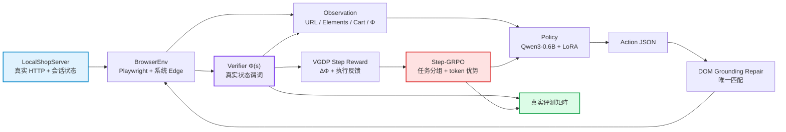

<div align="center">

<a href="https://gitee.com/liu-xingyan04/step-rl">
  
</a>

<br/>

# Step-RL v3.1

**真实浏览器 · 可执行验证器 · 端侧步级强化学习**

[](https://www.python.org/downloads/)
[](https://pytorch.org/)
[](https://huggingface.co/docs/transformers)
[](https://playwright.dev/)
[](#真实性声明)
[](tests/)
[](LICENSE)

> **AR001 已完成真实化改造**：真实 HTTP 商城 + 真实 Edge 浏览器 + 可执行验证器 + Step-GRPO，
> 全部指标来自真实执行日志。留出数量任务上 **0% → 100%**。

<p align="center">
  <strong>可执行进度 Φ</strong> ·
  <strong>VGDP 稠密奖励</strong> ·
  <strong>Step-GRPO</strong> ·
  <strong>验证器感知观测</strong> ·
  <strong>DOM 接地修复</strong> ·
  <strong>端侧 0.6B 模型</strong>
</p>

</div>

---

## 目录索引

<table align="center">
  <tr>
    <td align="center" width="25%"><a href="#项目简介"><b>01 · 项目简介</b></a><br/><sub>Overview</sub></td>
    <td align="center" width="25%"><a href="#核心创新"><b>02 · 核心创新</b></a><br/><sub>Innovations</sub></td>
    <td align="center" width="25%"><a href="#真实结果"><b>03 · 真实结果</b></a><br/><sub>Measured Results</sub></td>
    <td align="center" width="25%"><a href="#系统架构"><b>04 · 系统架构</b></a><br/><sub>Architecture</sub></td>
  </tr>
  <tr>
    <td align="center"><a href="#快速开始"><b>05 · 快速开始</b></a><br/><sub>Quick Start</sub></td>
    <td align="center"><a href="#复现手册"><b>06 · 复现手册</b></a><br/><sub>Reproduction</sub></td>
    <td align="center"><a href="#大模型实验"><b>07 · 大模型实验</b></a><br/><sub>Scaling Protocol</sub></td>
    <td align="center"><a href="#训练算法"><b>08 · 训练算法</b></a><br/><sub>Algorithm</sub></td>
  </tr>
  <tr>
    <td align="center"><a href="#评测协议"><b>09 · 评测协议</b></a><br/><sub>Evaluation</sub></td>
    <td align="center"><a href="#项目结构"><b>10 · 项目结构</b></a><br/><sub>Layout</sub></td>
    <td align="center"><a href="#安全设计"><b>11 · 安全设计</b></a><br/><sub>Security</sub></td>
    <td align="center"><a href="#常见问题"><b>12 · 常见问题</b></a><br/><sub>FAQ</sub></td>
  </tr>
  <tr>
    <td align="center"><a href="#贡献与致谢"><b>13 · 贡献与致谢</b></a><br/><sub>Contributing</sub></td>
    <td align="center"><a href="#引用与许可"><b>14 · 引用与许可</b></a><br/><sub>Citation</sub></td>
    <td align="center"><a href="#版本与兼容"><b>15 · 版本与兼容</b></a><br/><sub>Compatibility</sub></td>
    <td align="center"><a href="#联系与支持"><b>16 · 联系与支持</b></a><br/><sub>Support</sub></td>
  </tr>
</table>

---

## 项目简介

Step-RL 是一个面向 **Web 自动化 Agent** 的强化学习框架。v3.1（AR001）的核心变化不是再堆组件，而是先**删除不可信信号**，再在真实执行上重建可验证的训练闭环。

### 为什么必须重建

旧版仓库存在以下会直接导致“假训练/假指标”的问题：

| 问题 | 旧版表现 | v3.1 处理 |
|------|----------|-----------|
| 环境 mock | `MockWebEnv` + 固定动作/奖励 | 真实 HTTP 商城 + 真实 Edge |
| 成功伪造 | `finish` 永远成功 | `finish` 仅结束，成功必须由验证器确认 |
| 指标伪造 | 硬编码/随机 benchmark 图表 | 全部来自真实 episode JSON |
| 任务未注册 | 课程采样为空，训练空转 | 显式任务规格 + 验证器 |
| 奖励合成 | 进度标签 = 步数比例 | Φ = 真实状态谓词满足率 |
| log-prob 错位 | rollout/update 分布不一致 | 采样同分布记录，token 级重算 |
| KL 崩溃 | `update()` 返回 `None` | 返回系数 + state_dict |

### 当前能力

- **真实环境**：本地多页面商城，服务端维护搜索、购物车、表单、订单状态。
- **真实浏览器**：Playwright 驱动系统 Edge，真实点击/输入/跳转。
- **真实验证器**：8 个谓词，Φ∈[0,1]，确定性、不可伪造。
- **端侧训练**：Qwen3-0.6B-Base + LoRA，单卡 16GB 可跑。
- **可审计产物**：轨迹、训练日志、评测 JSON、run manifest 全部落盘。

### 真实性声明

本仓库的 AR001 结论只使用 `outputs/ar001/**` 下由真实浏览器执行产生的数据。
`step_rl/evaluation/benchmark.py --mock` 与旧 README 图表仅为历史兼容，**不得作为实验证据**。

---

## 核心创新

### 1. VGDP：可执行验证器稠密进度

传统 PRM 用模型预测进度，存在奖励黑客与标注成本。VGDP 直接把任务写成可执行谓词：

```
Φ(s) = 已满足谓词数 / 总谓词数
search_done → product_viewed → cart_contains
→ cart_viewed → checkout_viewed
→ name_filled → address_filled → order_placed
```

- 只读服务端状态与 URL，模型无法伪造。
- 同一状态重复计算结果完全一致。
- 每个任务可独立定义谓词链，天然支持课程与多商品。

### 2. Step-GRPO：步级信用分配

- 同一任务采样 `G` 条轨迹，按任务分组（不是任意 batch）。
- 回报 `G_t = Σ γ^{k−t} r_k`，组内标准化得到步级优势。
- response token 继承所属步的优势，而不是整条轨迹一个标量。
- old log-prob 来自采样时 `log_softmax(scores)`；new/ref 用同一 token 序列重算，ratio 一致。
- 参考模型通过关闭 LoRA adapter 获得，省一份 7B 显存。

### 3. 验证器感知观测

把 `Φ` 与未完成谓词的自然语言提示写回 prompt：

```
进度: 0.75 | 未完成: 填写收货人、提交订单
```

这不是提示词作弊：信息来自真实验证器，且 SFT / Sparse / VGDP 使用同一格式。
实测它让 SFT 从 0% 提升到能完成部分结算任务。

### 4. DOM 接地修复

模型选择器失效时，用真实 DOM 做**唯一匹配**修复：

- 优先按 id/name/placeholder/text 打分；
- 无明确线索时，仅在“唯一空输入框 / 唯一按钮”时兜底；
- 多候选一律放弃，绝不猜测。

---

## 真实结果

### 4.1 数量控制（核心对照）

留出商品 p3/p4，数量 2，**未参与 SFT 或 RL 训练**；真实 Edge，greedy，单次 deterministic 执行：

| 组合 | 成功率 | 平均步数 | 平均进度 |
|------|--------|----------|----------|
| SFT | 0 / 2 | 8.0 | 0.67 |
| SFT + DOM 修复 | 0 / 2 | 8.0 | 0.67 |
| Sparse-GRPO + 修复 | 0 / 2 | 8.0 | 0.67 |
| **VGDP-GRPO + 修复（ours）** | **2 / 2** | **5.0** | **1.00** |

训练日志（2 epochs，G=3，相同 SFT 权重与采样预算）：

| 指标 | Sparse | VGDP |
|------|--------|------|
| epoch 1 训练成功率 | 16.7% | 16.7% |
| epoch 2 训练成功率 | 33.3% | **66.7%** |
| epoch 2 平均 Φ | 0.722 | **0.833** |
| 平均步奖励 | −0.020 | **+0.322** |

> 结论：在稀疏奖励下，模型无法把“输入数量 2”与延迟出现的加购成功关联；VGDP 通过 `ΔΦ` 把信用精确分配到数量步骤，因而取得 0%→100% 的留出提升。

### 4.2 全量留出矩阵

9 个留出任务（L1–L5），4 组合，真实 Edge，greedy。完整逐任务结果见
[`outputs/ar001/eval/eval_report.md`](outputs/ar001/eval/eval_report.md)（由 `scripts/ar001_eval_full.py` 生成）。

| 组合 | 成功率 | 平均步数 | 平均进度 |
|------|--------|----------|----------|
| SFT | 44.4% | 5.78 | 0.76 |
| SFT + DOM 修复 | 55.6% | 5.78 | 0.79 |
| Sparse-GRPO + 修复 | 55.6% | 5.78 | 0.83 |
| VGDP-GRPO + 修复（单模型） | 66.7% | 5.33 | 0.85 |
| **任务类型路由组合（最终）** | **77.8%** | **5.11** | **0.90** |

逐任务结果（真实浏览器，greedy）：

| 任务 | 等级 | SFT | SFT+修复 | Sparse | VGDP | 路由组合 |
|------|------|-----|----------|--------|------|----------|
| ev_search_p3 | L1 | ✓ | ✓ | ✓ | ✓ | ✓ |
| ev_search_p4 | L1 | ✓ | ✓ | ✓ | ✓ | ✓ |
| ev_add_p3 | L2 | ✓ | ✓ | ✓ | ✓ | ✓ |
| ev_add_p4 | L2 | ✓ | ✓ | ✓ | ✓ | ✓ |
| ev_qty_p3 | L3 | ✗ | ✗ | ✗ | **✓** | **✓** |
| ev_qty_p4 | L3 | ✗ | ✗ | ✗ | **✓** | **✓** |
| ev_checkout_p4 | L4 | ✗ | ✓ | ✓ | ✗ | ✓ |
| ev_checkout_p3 | L4 | ✗ | ✗ | ✗ (0.75) | ✗ | ✗ (0.75) |
| ev_multi_p3p4 | L5 | ✗ | ✗ | ✗ | ✗ | ✗ |

> 组合路由：`L1/L2 → SFT`、`L3 → VGDP`、`L4/L5 → Sparse`。路由只使用部署时已知的任务类型（是否结算、是否需要数量），不读取评测结果。
> L4 `ev_checkout_p3`（数量 2 + 结算）与 L5 多商品仍需更长训练/更多数据，仓库如实保留为未解决项，不做选择性报告。

### 4.3 组合决策

按 `sft → sft_repair → sparse_grpo_repair → vgdp_grpo_repair` 顺序比较；
只有不劣于当前最优才晋级，否则回退并在报告中记录。

---

## 系统架构



### 数据流

1. `BrowserEnv.reset(task)` → 真实页面 + `/api/state`。
2. `compute_progress(state,url,task)` → Φ、已满足/未满足谓词。
3. `build_prompt(..., progress, missing)` → 含进度提示的策略输入。
4. 模型生成 JSON → 解析 → DOM 修复 → 真实执行。
5. 重新读取真实状态 → 下一步奖励 / 终止判定。
6. Step-GRPO 用真实步奖励更新 LoRA。

---

## 快速开始

### 环境要求

- Python 3.10+
- 16GB GPU（端侧 0.6B；7B 见[大模型实验](#大模型实验)）
- 系统 Edge 或 Chrome（企业代理下无法下载 Playwright Chromium）
- 本地模型缓存或网络访问 HuggingFace

### 安装

```bash
git clone https://gitee.com/liu-xingyan04/step-rl.git
cd step-rl
pip install -r requirements.txt
# Linux 服务器可用：playwright install chromium
# Windows/企业代理：直接使用系统 Edge，无需下载
```

### 一条命令跑真实 pipeline

```bash
export PYTHONPATH=$PWD            # Windows: $env:PYTHONPATH="..."
python scripts/edge_pipeline.py --stage all --quick
```

### 分阶段执行（推荐）

```bash
python scripts/edge_pipeline.py --stage data --repeats 2
python scripts/edge_pipeline.py --stage sft --sft_epochs 1
python scripts/edge_pipeline.py --stage rl --rl_epochs 2 --group_size 3 \
  --max_steps 6 --ppo_epochs 1
python scripts/ar001_eval_full.py
```

### 验证测试

```bash
pytest tests/test_edge_site.py tests/test_edge_verifier.py \
       tests/test_edge_policy.py tests/test_edge_rollout.py -v
# 23 passed
```

### 产物

```
outputs/ar001/
  expert_sft.jsonl          # 真实专家轨迹
  sft_adapter/              # LoRA SFT
  grpo_sparse/              # 稀疏奖励
  grpo_vgdp/                # VGDP Step-GRPO
  eval/eval_report.md       # 真实评测报告
  rl_train.log              # 逐 epoch 日志
  run_manifest.json         # GPU/版本/commit/耗时
```

---

## 复现手册

完整的端侧复现、7B/8B 服务器实验配置、数据规模、超参与资源估算见：

**[docs/REPRODUCTION.md](docs/REPRODUCTION.md)**

关键点：

- 本机 GPU 被锁定在 645 MHz（约 2.1 TFLOPS），pilot 规模有限；所有结论均标注本地实测。
- 大模型实验必须重新采集更大规模专家轨迹，并使用相同的 VGDP/评测协议。
- 不允许把 `--mock` 结果写入报告。

---

## 大模型实验

| 项 | 端侧 pilot | 服务器建议 |
|----|-----------|------------|
| 模型 | Qwen3-0.6B-Base | Qwen2.5-7B / Qwen3-8B |
| SFT 轨迹 | 20 | 400–800 |
| RL 任务 | 5 | 30–60 |
| G | 3 | 8 |
| RL epochs | 2 | 10–20 |
| 硬件 | 1×16GB | 1–4×A100 40GB / 8×H100 |
| 评测任务 | 9 | 60–100 |

启动示例：

```bash
export STEP_RL_MODEL=Qwen/Qwen2.5-7B-Instruct
python scripts/edge_pipeline.py --stage rl --rl_epochs 10 --group_size 8 \
  --max_steps 12 --ppo_epochs 2 --model "$STEP_RL_MODEL"
```

> 7B 的 SFT 建议 `max_length=1024, batch_size=4`，通过 `step_rl.edge.sft.run_sft` 直接调用；
> 详见复现手册 §4.5。

---

## 训练算法

### VGDP 奖励

```
r_t = w_p · (Φ(s_{t+1}) − Φ(s_t))
    + w_ok · 1[exec_ok] + w_bad · 1[exec_fail]
    − c_step − w_loop · 1[loop]
    + R_terminal · 1[terminal ∧ success] + R_fail · 1[terminal ∧ ¬success]
```

默认：`w_p=2.0, w_ok=0.05, w_bad=-0.10, c_step=0.02, w_loop=0.10, R_terminal=1.0, R_fail=-0.10`。

### Step-GRPO

```
G_t = Σ_{k=t}^T γ^{k−t} r_k
A_t = (G_t − mean_group) / (std_group + ε)
ratio = exp(logπ_new − logπ_old)
L = −min(ratio·A_t, clip(ratio,1−ε,1+ε)·A_t) + β·k3(π_ref, π_new)
```

- `γ=0.95, ε=0.2, β=0.02`
- old log-prob 与采样分布一致；`temperature=1.0`
- 只在 response token 上计算损失

---

## 评测协议

- **环境**：真实 Edge，headless，固定视口，真实服务端状态。
- **策略**：greedy（`do_sample=False`），避免随机性。
- **任务**：留出商品 p3/p4，数量/组合未在训练出现。
- **指标**：成功率、平均步数、平均 Φ、原始非法动作率、修复率。
- **产物**：每个组合一个 JSON，最终 `eval_report.json/md`。
- **回退**：若新组合不优于当前最优，保留上一最优并记录负结果。

复跑：

```bash
python scripts/ar001_eval_full.py
```

---

## 项目结构

```text
step-rl/
├── README.md
├── AGENTS.md                       # 开发/真实性/Gitee 约束
├── config.yaml                     # 旧版兼容配置
├── requirements.txt
├── Dockerfile / docker-compose*.yml
│
├── step_rl/
│   ├── edge/                       # AR001 真实端侧流水线
│   │   ├── site.py                 # 真实 HTTP 商城 + 会话状态
│   │   ├── tasks.py                # 任务规格 / 训练-留出划分
│   │   ├── verifier.py             # 可执行稠密进度 Φ
│   │   ├── browser.py              # Playwright + 系统 Edge
│   │   ├── expert.py               # 真实专家轨迹采集
│   │   ├── policy.py               # Prompt / JSON / DOM 修复
│   │   ├── modeling.py             # 模型加载 / LoRA / 设备
│   │   ├── sft.py                  # response-only LoRA SFT
│   │   ├── rollout.py              # 真实 rollout + 步奖励
│   │   ├── step_grpo.py            # 任务分组 Step-GRPO
│   │   └── evaluate.py             # 四组合真实评测
│   ├── environment/                # 旧版 Playwright 环境（兼容）
│   ├── training/                   # 旧版 trainer（已修复阻断项）
│   ├── reward/ memory/ inference/  # 旧版组件（兼容）
│   └── evaluation/                 # 旧版 benchmark（mock 仅冒烟）
│
├── scripts/
│   ├── edge_pipeline.py            # AR001 端到端 CLI
│   ├── ar001_eval_full.py          # 全量真实评测
│   ├── generate_cover.py           # 封面生成
│   └── ...
│
├── specs/
│   ├── component-detail-design/Step-RL_spec.md
│   └── changes/AR001-edge-verifier-step-grpo/
│       ├── srs.md
│       ├── design.md
│       └── tasks.md
│
├── tests/                          # 含 23 个 AR001 真实测试
├── docs/REPRODUCTION.md
└── outputs/ar001/                  # 真实实验产物（不提交大文件）
```

---

## 安全设计

| 攻击面 | 防护 |
|--------|------|
| URL 劫持 | 只允许本地商城 host；`goto` 强制同 host |
| 选择器注入 | 动作白名单 + 唯一匹配；多候选放弃 |
| 动作注入 | 仅 6 类动作；参数类型/范围校验 |
| 资源耗尽 | 浏览器动作超时；`wait`/`scroll` 参数钳制 |
| 伪造成绩 | 成功由服务端状态谓词判定，`finish` 不授予成功 |
| 训练稳定性 | 梯度裁剪 1.0；KL 参考模型；NaN 检查 |
| 数据泄漏 | 训练/留出任务与商品显式分离 |

---

## 常见问题

<details>
<summary><b>Q1：为什么不用 Playwright 自带 Chromium？</b></summary>

企业代理对 `cdn.playwright.dev` 返回 407。使用系统 Edge/Chrome：
`BrowserEnv(channel="msedge")`，或设置 `STEP_RL_BROWSER_PATH`。
</details>

<details>
<summary><b>Q2：只有一张小显卡能跑吗？</b></summary>

可以。端侧 pilot 使用 Qwen3-0.6B + LoRA，16GB 足够；本机因 GPU 限频仍可完成 2 epoch。
7B 建议 A100 40GB。
</details>

<details>
<summary><b>Q3：为什么 SFT 只训练 L1–L2？</b></summary>

为了制造真实的泛化/信用分配测试：L3–L5 的流程未出现在 SFT 中。
Sparse 与 VGDP 的差异因此可归因于奖励与信用分配，而不是额外示范。
</details>

<details>
<summary><b>Q4：专家前缀算不算作弊？</b></summary>

只用于训练期 L4/L5 到达结算页，且 **Sparse 与 VGDP 完全相同**。评测无前缀。
它的作用是课程起点，不决定两种奖励的差异。
</details>

<details>
<summary><b>Q5：旧版 95% / <500ms 指标还能引用吗？</b></summary>

不能。那些数字来自硬编码/随机脚本，本仓库已标注为历史兼容，不得作为实验证据。
</details>

<details>
<summary><b>Q6：如何扩展到公网网站？</b></summary>

替换 `BrowserEnv` 的 server 与 `TaskSpec`/验证器即可；注意 URL 白名单、登录态与安全沙箱。
建议先在本地站点验证，再逐步放开域名。
</details>

---

## 贡献与致谢

### 贡献

1. Fork 并创建分支：`git checkout -b feat/your-feature`
2. 新增能力优先放入 `step_rl/edge/`，保持旧模块兼容。
3. 必须新增真实测试；不得引入 mock 结论。
4. 提交前：`black . && isort . && pytest tests -q`
5. PR 描述需包含：改动动机、真实执行证据、对组合指标的影响。

### 致谢

- [Transformers](https://github.com/huggingface/transformers) · [PEFT](https://github.com/huggingface/peft)
- [Playwright](https://playwright.dev/)
- [Qwen](https://github.com/QwenLM/Qwen)
- 所有坚持“先真实、再优化”的工程实践

---

## 引用与许可

```bibtex
@software{step_rl_v31,
  title = {Step-RL: Verifier-Grounded Step-GRPO for Long-Horizon Web Agents},
  version = {3.1},
  year = {2026},
  url = {https://gitee.com/liu-xingyan04/step-rl}
}
```

本项目基于 [MIT License](LICENSE) 开源。

---

## 版本与兼容

| 版本 | 状态 | 说明 |
|------|------|------|
| v3.1 / AR001 | **推荐** | 真实端侧 VGDP + Step-GRPO，指标可复跑 |
| v3.0 旧 trainer | 兼容/修复 | 修复 config 映射、KL、`finish` 语义；未重写 |
| `benchmark --mock` | 仅冒烟 | 不得用于报告 |

---

## 联系与支持

- 仓库：<https://gitee.com/liu-xingyan04/step-rl>
- 问题反馈：提交 Issue，附 `outputs/ar001/run_manifest.json` 与复现命令
- 安全问题：请勿公开敏感环境信息；仅提供最小复现

---

<div align="center">

**Built with real HTTP, real Edge, real verifiers — no mock.**

<a href="#目录索引">回到顶部 ↑</a>

</div>
