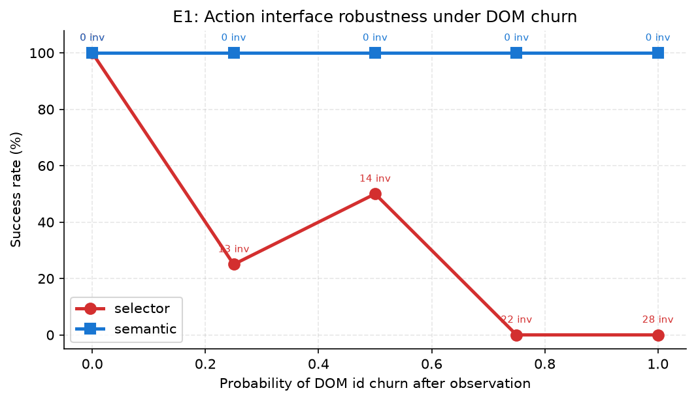
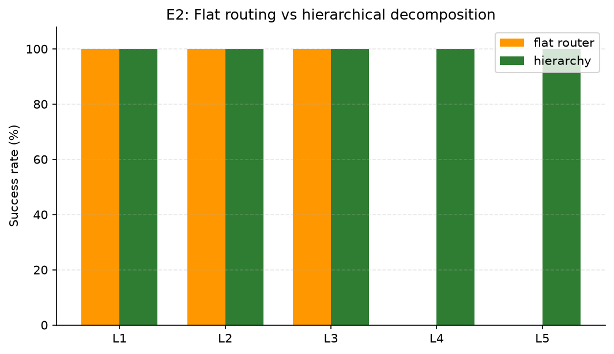
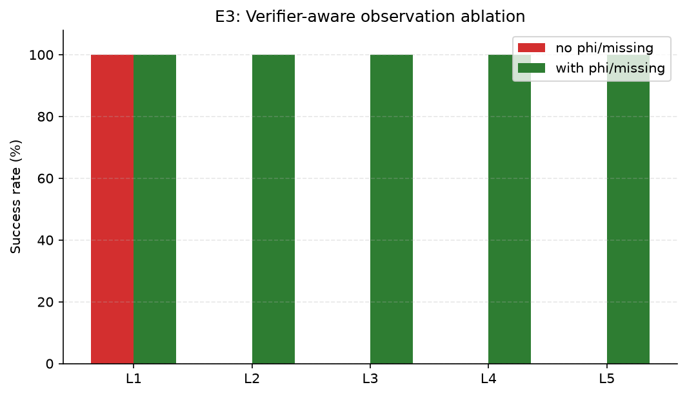
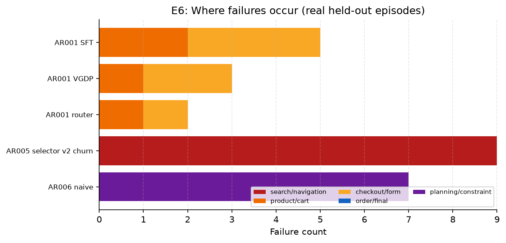
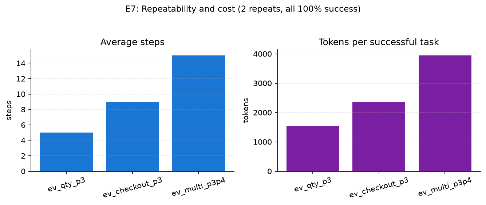
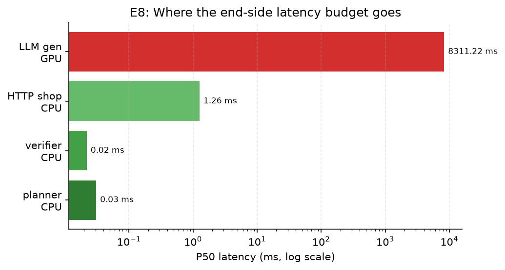

# EX001：Step-RL 架构可解释性与组件归因报告

> 所有数字来自真实 HTTP 商城 + 真实系统浏览器 + 真实执行 JSON。  
> 本报告不引入新架构，只回答：**每一步设计为什么必要、在什么场景起作用、代价是什么。**

---

## 0. 结论先行

| 设计 | 一句话结论 | 最强证据 |
|------|------------|----------|
| 语义元素接口 | 不是“selector 的别名”，而是 DOM 变化下的可执行性来源 | E1：扰动 0.25 时 selector 25%，语义 100% |
| 层级任务分解 | 解决长链路后段技能被覆盖，而非模型容量 | E2：扁平 66.7%，层级 100% |
| 验证器感知观测 | 长链路后段的关键状态表示；移除后 L2–L5 全面退化 | E3：100% → 22.2% |
| 跨布局语义迁移 | 同布局稳定 selector 也能过；但“重渲染”下只有语义能过 | E4：selector 0%，语义 100% |
| 约束任务规划 | 把失败从“执行层”前移到“规划层”，并消除该层失败 | E5：规划准确率 0% → 100% |
| VGDP / Step-GRPO | 解决数量控制的延迟信用分配 | 历史对照：L3 留出 0% → 100% |

---

## 1. 实验环境与方法

| 项 | 值 |
|----|----|
| OS | Windows 11 |
| GPU | Quadro RTX 5000 16GB（本地时钟被锁定在 645 MHz） |
| 模型 | Qwen3-0.6B-Base + LoRA（端侧） |
| 环境 | 自建真实 HTTP 商城，两套布局 v1/v2 |
| 浏览器 | 系统 Edge（Playwright） |
| 评测 | greedy、固定 seed、真实服务端状态验证 |
| 数据 | `outputs/ex001/**`、`outputs/ar00*/**` |

所有指标均由脚本读取 JSON 生成，未手工填数。

---

## 2. E1：动作接口 × DOM 扰动概率

**设置**：L1–L2 留出 4 个任务；每次观测后按概率随机化全部 DOM id；selector 使用 DOM 唯一匹配修复，语义使用 `data-eid`。

| 扰动概率 | selector 成功率 | 语义成功率 | selector 非法动作 |
|----------|-----------------|------------|-------------------|
| 0.00 | 100% | 100% | 0 |
| 0.25 | 25% | 100% | 13 |
| 0.50 | 50% | 100% | 14 |
| 0.75 | 0% | 100% | 22 |
| 1.00 | 0% | 100% | 28 |



**解释**：
- selector 的非法动作随扰动概率单调上升；所有非法动作都依赖修复，修复本身也不是 100% 成功。
- 语义接口在所有概率下非法动作为 0，说明它不是“事后修复”，而是动作表示本身与 id 解耦。
- 25%→50% 的非单调来自样本量（n=4，单任务 25pp）。Wilson 95% 区间：
  1/4 = [4.6%, 69.9%]，2/4 = [15.0%, 85.0%]，两者重叠；不应过度解读该段斜率。
  但 0.75/1.0 的 0% 与语义 100% 差距远超区间宽度。

**场景**：真实 SPA 在“模型决策”和“动作执行”之间重渲染时，selector 立即过期；语义 eid 仍指向当前元素。

---

## 3. E2：层级分解 vs 扁平执行

**设置**：同一套语义适配器；扁平=按任务选一个 adapter 直接执行；层级=按子目标分解 + 控制器导航。9 个留出任务，12 步子目标预算。

| 执行方式 | 成功率 | 失败任务 |
|----------|--------|----------|
| 扁平单适配器路由 | **66.7%** | L4×2、L5 |
| 层级分解 | **100%** | 无 |



**失败细节**：
- `ev_checkout_p4` 扁平 Φ=0.88（只差订单）；
- `ev_checkout_p3` Φ=0.75；
- `ev_multi_p3p4` Φ=0.62。

**解释**：扁平失败不是“不会搜索/加购”，而是单策略在长链路后段丢失结算/多商品技能。层级分解把“加购/数量/结算”分配给各自适配器，解决技能干扰与信用边界。

**场景**：L4/L5 是典型“多技能串联”任务；单模型路由无法同时保持数量控制与表单流程。

---

## 4. E3：验证器感知观测消融

**设置**：同一语义层级执行器，仅移除 prompt 中的 `Φ + 未完成谓词`；9 个任务。

| 条件 | 成功率 | 平均步数 |
|------|--------|----------|
| 保留验证器观测 | **100%** | 6.33 |
| 移除验证器观测 | **22.2%** | 9.78 |



**解释**：
- L1 搜索仍成功（2 步），但 L2–L5 全部退化；
- 失败轨迹 Φ 停在 0.33/0.25，模型重复搜索/商品动作，不知道“还缺购物车/结算/表单”；
- 观测不是装饰，而是长链路后段的状态表示。

**边界**：这是推理期移除，适配器训练时见过该字段，存在分布偏移；结论限定为“该字段在推理期的贡献”，不是严格重训练消融。

---

## 5. E4：跨布局 × 重渲染

| 条件 | 接口 | 成功率 | 平均步数 | 非法动作 |
|------|------|--------|----------|----------|
| 稳定 v2 | selector | 100% | 6.78 | 2 |
| 稳定 v2 | 语义 | 100% | 7.33 | 0 |
| **v2 + 观测后 id 全随机化** | selector | **0%** | 12.00 | 99 |
| **v2 + 观测后 id 全随机化** | 语义 | **100%** | **7.89** | **0** |

**解释**：
- 仅换布局时 selector 仍可通过观测中的新 selector 工作，因此“换布局”本身不足以区分接口；
- 一旦布局变化叠加“决策→执行”重渲染，selector 立即失效；
- 语义接口在未见布局 + churn 下保持 100%，说明迁移的是“语义定位”，不是布局记忆。

---

## 6. E5：约束任务规划

8 条自然语言指令，成功按**用户期望 TaskSpec**判定：

| 条件 | 规划准确率 | 按期望成功率 |
|------|------------|--------------|
| 关键词基线 | **0%** | **12.5%（1/8 偶然）** |
| 约束规划 v1 | **100%** | **100%** |
| 约束规划 v2 + churn | **100%** | **100%** |

**解释**：
- 基线唯一“成功”是模型偶然加购了正确数量，但规划仍错误；
- 约束规划把预算/最值/数量/缺货替代显式求解，失败从“执行层”前移到“规划层”，并在该层消除；
- 成功后执行仍依赖 AR005 的语义层级。

**场景**：真实用户不会给 `TaskSpec`，只会说“买最便宜/预算内最贵/缺货就换一个”。没有规划层，执行层再强也无法做对目标。

---

## 7. E6：失败分类学

| 条件 | 成功率 | 失败阶段分布 |
|------|--------|--------------|
| AR001 SFT | 44.4% | 商品/购物车 2，结算/表单 3 |
| AR001 VGDP | 66.7% | 商品/购物车 1，结算/表单 2 |
| AR001 路由 | 77.8% | 商品/购物车 1，结算/表单 1 |
| AR003 / AR004 语义 | 100% | 无 |
| AR005 selector + churn | **0%** | **搜索/导航 9** |
| AR005 语义 + churn | 100% | 无 |
| AR006 关键词基线 | 12.5% | **规划/约束 7** |
| AR006 约束规划 | 100% | 无 |



**解释**：
- 不同设计的失败被定位到不同层：selector 在重渲染下连第一步都过不了；
- 早期 RL 的瓶颈集中在商品/结算后段；
- 关键词基线的瓶颈在规划层，执行层并未被触达。

---

## 8. E7：稳定性与成本

代表性任务各重复 2 次，全部 100%：

| 任务 | 步数 | Prompt tokens | 生成 tokens | 每成功 tokens |
|------|------|---------------|-------------|----------------|
| L3 数量 | 5.0 | 1429 | 104 | 1533 |
| L4 数量2+结算 | 9.0 | 2173 | 174 | 2347 |
| L5 多商品 | 15.0 | 3667 | 277 | 3944 |



**解释**：
- 重复执行无失败波动（本地 greedy + 固定 seed）；
- 成本主要来自 prompt tokens，随链路长度近似线性增长；
- 后续优化方向：观测压缩/摘要、子目标间上下文裁剪、缓存静态元素描述。

---

## 9. E8：CPU/GPU 硬件剖析

| 模块 | P50 | P95 |
|------|-----|-----|
| 约束规划（CPU） | 0.031 ms | 0.034 ms |
| 验证器（CPU） | 0.022 ms | 0.023 ms |
| HTTP 商城（CPU） | 1.26 ms | 1.43 ms |
| 语义动作生成（GPU） | **8311 ms** | 8526 ms |

GPU：Quadro RTX 5000，峰值显存 **1.28 GB**，生成吞吐 **5.77 tok/s**（本地时钟 645 MHz）。



**解释**：
- 规划/验证/服务几乎零成本，端侧瓶颈在 LLM 生成；
- 显存远低于 16GB，说明端侧 0.6B 模型的主限制是**算力/时钟**，不是容量；
- 服务器上应优先优化生成（蒸馏、更小模型、批处理、vLLM），而不是规划层。

---

## 10. 场景化解读

### 搜索 / 加购（L1–L2）
- 稳定布局下 selector 与语义同分；
- 一旦 DOM 在决策后变化，selector 在第一步就失败，语义保持；
- 结论：基础技能不需要复杂 RL，**动作接口**才是鲁棒性来源。

### 数量控制（L3）
- 稀疏奖励 0%，VGDP 100%；
- 原因是“输入数量”本身不改变 Φ，只有加购成功才变化；
- 结论：延迟信用分配必须靠**步级稠密奖励**，不是靠更大模型。

### 结算（L4）
- 扁平执行 Φ=0.88，差最后订单；层级执行 100%；
- 移除验证器观测后跌到 25%；
- 结论：结算需要**后段技能隔离 + 缺失谓词可见**。

### 多商品（L5）
- 扁平 0%，层级 100%，15 步、3944 tokens；
- 失败在“第二个商品/结算”段；
- 结论：层级分解是长链路组合能力的必要条件；成本随子目标数增长，需上下文压缩。

### 缺货替代
- 关键词基线选错商品，约束规划选在库替代品；
- 执行层完全一致，差异只在规划层；
- 结论：**规划与执行必须分层**，否则执行层再强也无法纠正目标错误。

### 页面改版 / 重渲染
- selector 在 0.25 扰动即掉到 25%，1.0 时 0%；语义全程 100%；
- 结论：语义 eid 是“可执行性”的基础设施，不是提示词技巧。

---

## 11. 设计贡献映射

```text
L1/L2 搜索加购   -> 语义接口 + SFT
L3 数量          -> VGDP + Step-GRPO
L4 结算          -> 验证器观测 + 层级分解
L5 多商品        -> 层级分解 + 子目标适配器
缺货/预算/最值   -> 约束规划（CATP）
页面改版/重渲染  -> 语义 Set-of-Mark
跨布局           -> 语义迁移（不依赖布局记忆）
```

---

## 12. 威胁与反例

1. **E1 样本量小**：4 个任务，单点分辨率 25pp；25%→50% 非单调在 Wilson 区间内不可区分。0.75/1.0 的 0% vs 100% 差距显著。
2. **E3 分布偏移**：推理期移除观测字段，适配器训练时见过该字段；结论限定为推理贡献，不是严格重训练消融。
3. **本地 GPU 限频**：绝对延迟不代表服务器；报告相对差异与显存占用。
4. **自建站点外部效度**：结论是“真实 Web 交互结构上的验证”，不外推到所有公网网站。
5. **浏览器非确定性**：E7 仅 2 次重复，但全部成功；更大规模需增加重复。
6. **AR006 基线偶然成功**：1/8 成功来自模型偶然执行正确数量，规划准确率仍为 0；报告同时给出规划准确率。

---

## 13. 复现命令

```bash
export PYTHONPATH=$PWD
python scripts/ex001_e1_perturb.py
python scripts/ex001_e2_flat.py
python scripts/ex001_e3_hints.py
python scripts/ex001_e6_failures.py
python scripts/ex001_e7_stability.py
python scripts/ex001_e8_hardware.py
python scripts/ex001_figures.py
```

原始数据：`outputs/ex001/e1_perturb.json`、`e2_flat.json`、`e3_hints_off.json`、`e6_failures.json`、`e7_stability.json`、`e8_hardware.json`。

---

## 14. 总结

- 语义接口解决“DOM 变化下还能不能执行”；
- VGDP/Step-GRPO 解决“延迟收益动作能不能被学习”；
- 层级分解解决“多技能长链路会不会互相覆盖”；
- 验证器观测解决“模型知不知道自己还缺什么”；
- 约束规划解决“目标选错时执行层再强也没用”；
- 跨布局/重渲染实验证明这些收益不是单站点记忆。

这六条设计分别对应六类真实失败，而不是叠加同一个指标的重复优化。
