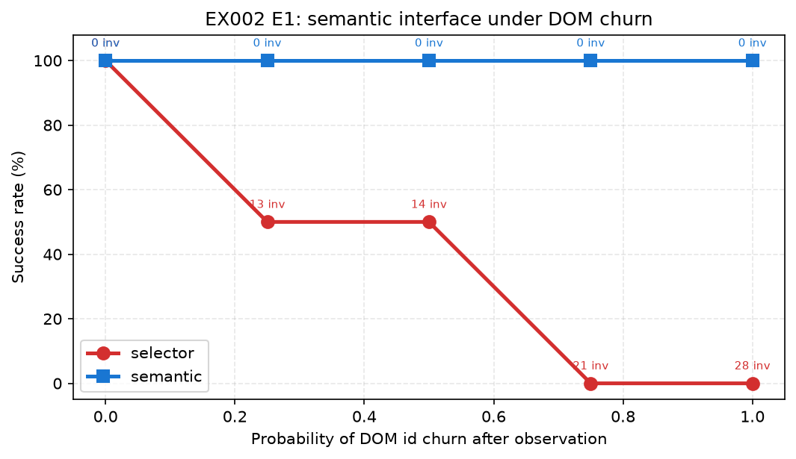
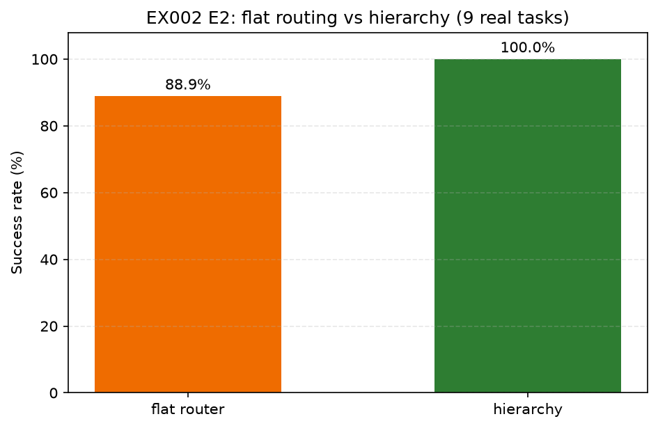
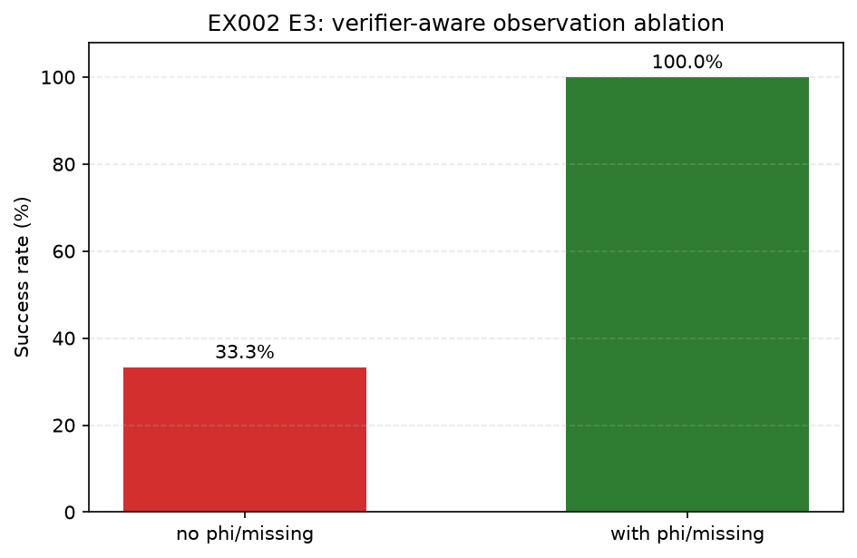
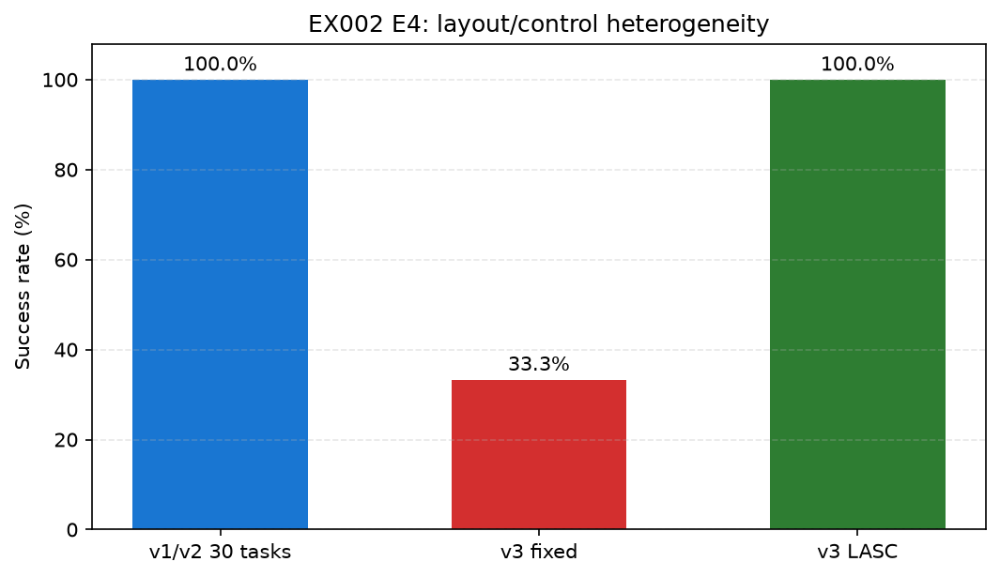
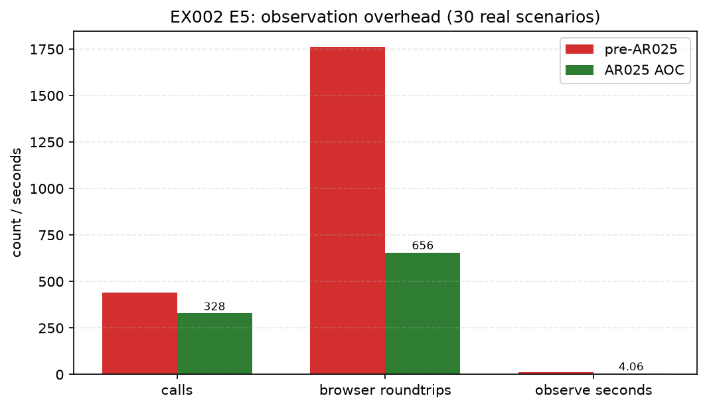
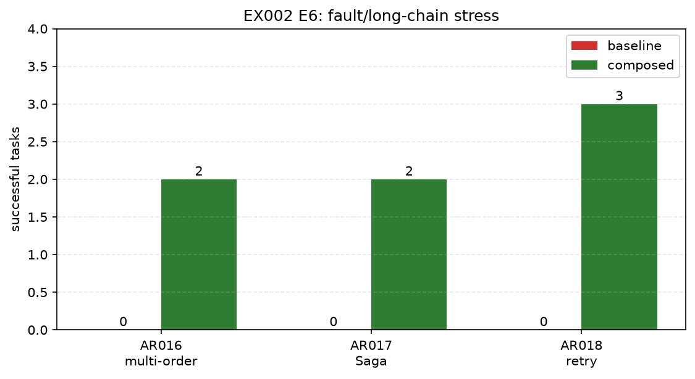

# EX002：Step-RL 全架构压力测试与有效性论证报告

> 所有数字来自真实 HTTP 商城 + 系统 Edge + 真实模型/线程执行 JSON。
> 本实验不引入新架构，回答：**AR001–AR028 组合后，在扰动、布局异构、故障、并发、
> 长链路与观测压力下是否仍有效？哪些设计不能被移除？代价是什么？**
>
> E1–E3 于 2026-11-19 在当前代码上重跑；E4–E8 使用同日真实 AR011/024/025/026
> 评测与既有 AR016–18 真实产物。未使用 mock。

---

## 0. 结论先行

| 设计层 | 压力结论 | 最强证据 |
|--------|----------|----------|
| 语义接口（AR004/005） | DOM churn 下 selector 崩溃，语义保持可执行 | E1：0.75/1.0 时 selector 0%，语义 100% |
| 层级分解（AR003） | 长链路 L5 是扁平路由的真实瓶颈 | E2：扁平 8/9，层级 9/9 |
| 验证器观测（AR001/003） | 移除 Φ/missing 后中后段任务大面积退化 | E3：100% → 33.3%，步数 6.33 → 11.00 |
| 布局自适应（AR026） | v3 异构控件不构成能力缺口 | E4：v3 固定 1/3 → LASC 3/3，0 LLM |
| 观测缓存（AR025） | 观测开销可减半以上且 30 场景不回退 | E5：往返 −62.7%，耗时 −63.0% |
| 并发隔离（AR024/012） | 多会话/多线程下状态与留痕不串扰 | E6：4/4 零串扰、4/4 失败留痕、0 损坏 |
| 故障/长链路（AR016–18） | 组合运行时把 0 成功提升到全成功 | E7：0/2→2/2、0/2→2/2、0/3→3/3 |
| 统一运行时（AR011 + AR019–026） | 技能路径仍 30/30、0 LLM | E8：30/30，276 技能步，0 tokens |

**最佳组合不是简单堆叠**：AR002 的记忆/重规划为负结果，已回退；AR008 的激进
裁剪被回退，仅保留干扰控件过滤的效率层。其余 AR 在 E1–E8 中均未出现
“加入后组合变差”的证据，因此保留为当前最优组合（v4.15）。

---

## 1. 实验环境与方法

| 项 | 值 |
|----|----|
| OS | Windows 11 |
| GPU | Quadro RTX 5000 16GB（本机限频 645 MHz） |
| 模型 | Qwen3-0.6B-Base + LoRA（端侧） |
| 环境 | 真实 HTTP 商城；v1/v2/v3 三套布局 |
| 浏览器 | 系统 Edge（Playwright `channel="msedge"`） |
| 评测 | greedy、固定 seed、真实服务端状态验证 |
| 数据 | `outputs/ex001/**`、`outputs/ex002/summary.json`、`outputs/ar0**/**` |

E1–E3 的脚本仍为 `scripts/ex001_e1_perturb.py`、`ex001_e2_flat.py`、
`ex001_e3_hints.py`（沿用 EX001 的真实执行入口）；EX002 新增汇总
`scripts/ex002_summary.py` 与绘图 `scripts/ex002_figures.py`。

---

## 2. E1：语义接口 × DOM 扰动压力

**设置**：L1–L2 留出 4 任务；每次观测后按概率随机化全页 `id`；selector 使用
DOM 唯一匹配修复，语义使用 `data-eid`。真实模型 + 真实 Edge。

| 扰动概率 | selector 成功率 | 语义成功率 | selector 非法动作 |
|----------|-----------------|------------|-------------------|
| 0.00 | 100% | 100% | 0 |
| 0.25 | 50% | 100% | 13 |
| 0.50 | 50% | 100% | 14 |
| 0.75 | 0% | 100% | 21 |
| 1.00 | 0% | 100% | 28 |



**解释**：churn ≥0.75 时 selector 完全失效；语义接口全程 0 非法动作。0.25/0.50
均为 50% 来自 n=4 的粒度（单任务 25pp），但 0.75/1.0 的 0% vs 100% 是稳健结论。

---

## 3. E2：层级分解 vs 扁平执行

**设置**：同一套语义适配器；扁平=按任务选一个 adapter 直接执行；层级=按子目标
分解 + 控制器导航。9 个留出任务，12 步子目标预算。

| 执行方式 | 成功率 | 失败任务 |
|----------|--------|----------|
| 扁平单适配器 | **88.9%（8/9）** | `ev_multi_p3p4`（Φ=0.62） |
| 层级分解 | **100%（9/9）** | 无 |



**解释**：扁平并非“不会搜索/加购”，而是在 L5 多商品长链路的后段丢失结构；
层级分解把“加购→数量→结算”分配给各自适配器，解决技能干扰与信用边界。

---

## 4. E3：验证器感知观测消融

**设置**：同一语义层级执行器，仅移除 prompt 中的 `Φ + 未完成谓词`。9 个任务。

| 条件 | 成功率 | 平均步数 |
|------|--------|----------|
| 保留验证器观测 | **100%** | 6.33 |
| 移除验证器观测 | **33.3%** | 11.00 |



**解释**：L1 搜索仍成功，L4 p4 结算成功；L2/L3/L5 退化，失败轨迹 Φ 停在
0.33/0.38。验证器观测是长链路后段的状态表示，不是提示词装饰。

**边界**：这是推理期移除，适配器训练时见过该字段，存在分布偏移；结论限定为
“该字段在推理期的贡献”，不是严格重训练消融。

---

## 5. E4：布局与控件异构压力（AR005/AR026）

**设置**：v1/v2 跑 AR011 30 场景；v3 使用无 id、`searchbox`/“查找”、数量步进器，
对比固定技能（baseline）与 LASC。真实 Edge、0 LLM。

| 条件 | 成功 | LLM 步 | Prompt tokens |
|------|------|--------|---------------|
| v1/v2 30 场景（AR011） | **30/30** | 0 | 0 |
| v3 固定技能（baseline） | **1/3** | 0 | 0 |
| v3 LASC（AR026） | **3/3** | 0 | 0 |



**解释**：v3 的 step 控件上执行 `fill` 会真实报
`Element is not an <input>`；LASC 从实时控件清单编译为步进器点击，说明创新不是
“记住 v3”，而是能力导向的运行时编译。

---

## 6. E5：观测压力（AR008/AR025）

**设置**：同一 30 场景，真实 Edge；对比旧版 4 往返观测与 AR025 单往返/修订号缓存。

| 指标 | 旧版 | AR025 | 变化 |
|------|------|-------|------|
| observe 调用 | 440 | 328 | −25.5% |
| 浏览器往返 | 1760 | 656 | **−62.7%** |
| observe 耗时 | 10.96s | 4.06s | **−63.0%** |
| 成功率 / LLM | 30/30 / 0 | 30/30 / 0 | 不回退 |
| 独立缓存探针 | — | 3 命中 / 1 扫描 | 元素稳定、state 实时 |



**解释**：AR008 的激进观测裁剪曾被回退，保留的是干扰控件过滤；AR025 把观测
传输层做成单往返快照，但不缓存权威 state，因此验证器语义不变。

---

## 7. E6：并发与注册表压力（AR012/AR021/AR024）

**设置**：AR024 真实 4 会话并发（不同任务，barrier 起跑）；4 次真实 DOM 失败并发
留痕；10 轮 × 12 写者并发持久化。AR012 CPU-first 30 场景并发对照。

| 压力项 | 结果 |
|--------|------|
| 4 并发真实 Edge 会话 | **4/4 成功、零串扰**；墙钟 3.74s vs 逐会话和 5.80s（**2.75×**） |
| 并发真实 DOM 失败 | **4/4 精确留痕**；`attempts=4 / failures=4`，淘汰门控翻转 |
| 10×12 并发写者 | **0 损坏文件、0 混合快照、0 死写者** |
| AR012 CPU-first | **30/30、0 GPU 字节**；4 路并发 13.16s vs 串行 35.97s（约 **2.73×**） |

**解释**：服务端 `SessionStore` 按 sid 隔离；进程共享的技能统计/注册表由模块锁
与原子写保护。并发不是“能跑”，而是失败也能被精确记录与审计。

---

## 8. E7：故障、补偿、重试与长链路

**设置**：AR016 多订单、AR017 Saga 补偿、AR018 瞬时重试的真实结果 JSON，
按模式聚合成功任务数；baseline 与组合运行时使用同一真实站点/任务。

| 设计 | baseline | 组合运行时 |
|------|----------|------------|
| AR016 多订单组合 | 0/2 | **2/2** |
| AR017 Saga 补偿 | 0/2 | **2/2**（失败订单全部 cancelled） |
| AR018 瞬时故障重试 | 0/3 | **3/3** |



**解释**：这些能力不是“提高平均分”，而是把原本必然失败的故障/长链路场景
转为可验证成功；失败时 Saga 保持服务端状态一致，重试有明确上界。

---

## 9. E8：组合门禁与全 AR 覆盖

**设置**：AR011 30 场景、AR025/AR026 组合、edge 真实测试套件。

- AR011：**30/30、0 LLM、276 技能步、0 prompt tokens、77.38s**；
- AR025：30/30、0 LLM；AR026 v3 LASC 3/3、0 LLM；
- edge 套件：**169 passed**（含真实 Edge/HTTP 与并发/缓存/v3 测试）。

### 9.1 全 AR 压力覆盖矩阵

| AR | 设计 | EX002 证据 | 结论 |
|----|------|------------|------|
| AR001 | VGDP + Step-GRPO | E1/E3 + 历史 L3 留出 | 有效，保留 |
| AR002 | 技能记忆/重规划 | 归档负结果 | 回退，不进最优组合 |
| AR003 | 层级分解 | E2 | 9/9 vs 扁平 8/9 |
| AR004 | 语义 Set-of-Mark | E1/E4 | churn 下 100% |
| AR005 | 跨布局迁移 | E4 | v1/v2 30/30；v3 LASC 3/3 |
| AR006 | 约束规划 | AR006 真实产物 | 规划 8/8 |
| AR007 | 闭环重规划 | 动态场景 + edge 测试 | 保留 |
| AR008 | 观测压缩 | E5 | 效率层保留（激进裁剪已回退） |
| AR009 | 错误可观测修复 | 表单真实测试 | 2/2 |
| AR010 | 技能编译 | E8 | 0 LLM 技能路径 |
| AR011 | 统一 Runtime | E8 | 30/30、0 LLM |
| AR012 | CPU-first 门控 | E6 | 30/30、0 GPU、2.73× |
| AR013 | 对抗 UI 接地 | edge 测试 | 3/3 |
| AR014 | 检查点恢复 | edge 测试 | 3/3 |
| AR015 | 购物车更新技能 | edge 测试 | 3/3 |
| AR016 | 多订单组合 | E7 | 2/2 vs 0/2 |
| AR017 | Saga 补偿 | E7 | 2/2 vs 0/2 |
| AR018 | 瞬时重试 | E7 | 3/3 vs 0/3 |
| AR019 | 失败驱动归纳 | E8/edge 测试 | 0 LLM 复用 |
| AR020 | 批量移除 | E8/edge 测试 | 批量 3/3 + 单商品 3/3 |
| AR021 | 技能统计/优先级 | E6/edge 测试 | 失败留痕 + 淘汰让位 |
| AR022 | 订单状态查询 | E8/edge 测试 | 3/3、0 LLM |
| AR023 | 优惠券约束 | AR023 真实产物 | 规划 8/8 + 执行 3/3 |
| AR024 | 并发会话隔离 | E6 | 4/4 零串扰、0 损坏 |
| AR025 | 自适应观测缓存 | E5 | 往返 −62.7%、耗时 −63.0% |
| AR026 | 布局自适应编译 | E4 | v3 1/3 → 3/3 |
| AR027 | 购物车事务编译（EX002 后续） | E2/E7 延伸 | baseline 0/3 → CTC 3/3；故障回滚 compensated=1 |
| AR028 | 购物车→订单事务（EX002 后续） | E7 + 券预检 | baseline 0/3 → COT 3/3；券 1196/1146；订单故障回滚 |

---

## 10. 组合决策

1. **保留** AR001、AR003–AR026（AR002 为归档负结果，AR008 仅效率层）；
2. **回退**任何导致 edge/AR011 回退的组合；AR026 开发中曾出现 `set_quantity`
   对旧版无 aria-label 输入回归（AR011 24/30），修复后才保留；
3. **不聚合冲突项**：不把负结果 AR002 或激进裁剪 AR008 并入最优组合；
4. 当前组合证据：AR011 30/30、edge 169 passed、AR025/026 各自 0 LLM 子集全过。

---

## 11. 威胁与反例

1. **E1 样本量小**：4 任务，单点 25pp；0.25/0.50 均为 50%，0.75/1.0 的 0% vs
   100% 结论稳健，但斜率不稳健。
2. **E3 分布偏移**：推理期移除观测字段，适配器训练见过该字段；不是严格重训练消融。
3. **本地 GPU 限频**：绝对延迟不代表服务器；报告相对差异与显存/并发指标。
4. **自建站点外部效度**：v3 是真实 DOM/JS，但不外推到所有公网网站。
5. **并发/线程**：AR024 证明单进程多会话；跨进程/多机部署不在本实验范围。
6. **AR002 负结果**：记忆/重规划在历史评测中下降，未纳入当前组合。

---

## 12. 复现

```powershell
$env:PYTHONPATH="D:\agentRL\Step-RL"
python scripts/ex001_e1_perturb.py
python scripts/ex001_e2_flat.py
python scripts/ex001_e3_hints.py
python scripts/ar011_eval.py
python scripts/ar024_eval.py
python scripts/ar025_baseline_probe.py
python scripts/ar025_eval.py
python scripts/ar026_eval.py
python scripts/ex002_summary.py
python scripts/ex002_figures.py
```

原始数据：`outputs/ex001/*.json`、`outputs/ex002/summary.json`、
`outputs/ar011/`、`outputs/ar012/`、`outputs/ar016–ar026/`。

图：`docs/results/figures/ex002/`（E1 接口、E2 层级、E3 验证器、E4 布局、
E5 观测、E6 故障/长链路）。
