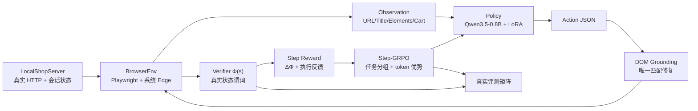

# [AR001] 详细设计

| 字段 | 内容 |
|------|------|
| AR 编号 | AR001 |
| 关联 srs.md | ./srs.md |
| 日期 | 2026-11-03 |
| 状态 | Draft |

## 1. 设计目标

在不依赖任何 mock 的前提下，建立可复现的端侧 Agent RL 闭环，并验证：

```
VGDP 稠密进度 + 步级 GRPO + DOM 接地修复  >  SFT / 稀疏 GRPO
```

## 2. 总体架构



## 3. 真实商城设计（site.py）

### 3.1 页面与路由

| 路由 | 方法 | 作用 |
|------|------|------|
| `/` | GET | 首页、搜索框、商品推荐 |
| `/search?q=` | GET | 搜索结果（真实匹配） |
| `/product/<pid>` | GET | 商品详情、数量输入、加购 |
| `/cart` | GET | 购物车、去结算 |
| `/add/<pid>?qty=n` | GET | 加购（写会话状态） |
| `/checkout` | GET | 结算表单 |
| `/place-order` | POST | 下单（校验购物车/表单） |
| `/order/<oid>` | GET | 订单成功页 |
| `/api/state` | GET | 返回会话 JSON 状态 |
| `/api/reset` | POST | 重置会话 |

### 3.2 服务端状态

```python
{
  "query": str,
  "cart": {pid: qty},
  "form": {"name": str, "address": str},
  "order": {"id": str, "items": {pid: qty}} | None,
  "visited": [url, ...]
}
```

Cookie `sid` 隔离会话；所有状态真实可验证。

### 3.3 商品目录

固定 4 个商品（p1..p4），含名称/价格/关键词；搜索为服务端真实子串匹配（大小写不敏感）。

## 4. 任务与验证器（tasks.py / verifier.py）

### 4.1 任务规格

```python
@dataclass
class TaskSpec:
    task_id: str
    level: int
    goal: str
    start_path: str
    target_pid: str
    target_qty: int
    require_checkout: bool
    predicates: list[Predicate]
```

### 4.2 谓词与进度

谓词 `Predicate(name, fn)`，`fn(state, url) -> bool`。  
`Φ(s) = (# satisfied) / (# predicates)`；`success = all(satisfied)`。

典型谓词链：

```
search_done → product_viewed → cart_contains → cart_viewed
→ checkout_viewed → form_filled → order_placed
```

只使用真实 URL 与服务端状态，确定性、不可被模型输出伪造。

### 4.3 训练/留出划分

- SFT 数据：L1–L2，商品 p1/p2。
- RL 训练：L3–L5，商品 p1/p2（SFT 未见流程）。
- 留出评测：L1–L5，商品 p3/p4 + 新数量组合（SFT/RL 均未见目标组合）。

## 5. 真实浏览器环境（browser.py）

- 使用 `async_playwright().chromium.launch(channel="msedge", headless=True)`。
- 观测提取：
  - `get_url`, `get_title`
  - 遍历 `a,button,input,select,textarea,[role=button]`，输出稳定选择器（优先 `#id`）。
  - 附带 placeholder / name / text / type / value。
  - 通过 `page.evaluate(fetch('/api/state'))` 取真实会话状态。
- 动作执行：
  - `goto`：URL 白名单校验。
  - `click/type`：`page.locator(selector)`，存在性与可交互性检查，超时。
  - `scroll/wait`：参数类型与范围校验。
  - `finish`：仅结束回合，**不判定成功**。
- 每次动作后等待 DOM 稳定（短轮询），返回 `ok/error`。

## 6. 动作策略与接地修复（policy.py）

### 6.1 Prompt

```
你是网页操作代理。只输出一个 JSON 对象。
任务: {goal}
页面: {url} | {title}
元素:
[e1] input#q placeholder=搜索商品
[e2] button#search-btn text=搜索
...
购物车: {cart}
历史: ...
输出: {"thought":"...","action":"...","params":{...}}
```

### 6.2 解析

- 优先严格 `json.loads`；失败则提取第一个平衡 `{...}`。
- 动作白名单与参数校验；失败返回 `parse_error`。

### 6.3 接地修复

1. 若 `selector` 存在且 DOM 命中唯一元素 → 直接使用。
2. 否则收集候选：`#id`、`[name=]`、`[placeholder=]`、`role+text`、`text`。
3. 对目标动作类型过滤（输入框/按钮/链接）。
4. 仅当唯一最高分（阈值 0.75）时替换 selector；记录 `repaired=True`。
5. 否则返回失败，不猜测。

## 7. 专家轨迹（expert.py）

脚本专家基于真实观测中的元素与任务目标选择动作：

- 搜索：`type #q` → `click #search-btn`
- 选商品：`click #product-<pid>`
- 数量：`type #qty` → `click #add-to-cart`
- 购物车/结算：`click #nav-cart` → `click #checkout-btn`
- 表单：`type #name/#address` → `click #place-order`
- 结束：`finish`

所有动作经真实浏览器执行；Φ 由验证器计算；只保留成功轨迹。

## 8. 训练算法

### 8.1 SFT

- 输入：`prompt + response`；labels 仅 response 有效。
- LoRA：`r=16, alpha=32, dropout=0.05, target_modules="all-linear"`。
- AdamW，lr `2e-4`，batch 1，grad accum 8，bf16。

### 8.2 VGDP 步奖励

```
r_t = w_p * (Φ(s_{t+1}) - Φ(s_t))
    + w_ok * 1[action_ok]
    + w_bad * 1[not action_ok]
    - c_step
    + (R_terminal if t == T and success else 0)
```

默认：`w_p=2.0, w_ok=0.05, w_bad=-0.1, c_step=0.02, R_terminal=1.0`。  
回退/循环额外 `-0.1`。

### 8.3 Step-GRPO

对每个任务采样 G 条轨迹：

```
G_t = Σ_{k=t}^{T} γ^{k-t} r_k,  γ=0.95
A_t = (G_t - mean_group(G_t)) / (std_group(G_t) + 1e-6)
```

对 response token 级：

```
ratio = exp(logπ_new(a_t|s) - logπ_old(a_t|s))
L_pg = -min(ratio*A_t, clip(ratio,1-ε,1+ε)*A_t)
L_kl = k3(π_ref || π_new)
L = L_pg + β*L_kl - c_ent*H
```

- old log-prob 来自采样时 `log_softmax(scores)`，temperature=1.0，保证一致性。
- 参考模型：关闭 LoRA adapter 的前向。
- 梯度裁剪 1.0。

### 8.4 稀疏基线

同一实现，令 `w_p=0, w_ok=0, w_bad=0`，仅终局奖励 + 步惩罚。

## 9. 实验矩阵

| 组 | SFT | RL | 修复 | 目的 |
|----|-----|----|------|------|
| A `sft` | ✓ | - | ✗ | 下界基线 |
| B `sft_repair` | ✓ | - | ✓ | 推理期接地收益 |
| C `sparse_grpo_repair` | ✓ | 稀疏 | ✓ | 稀疏 RL 收益 |
| D `vgdp_grpo_repair` | ✓ | VGDP | ✓ | 完整创新 |

评测：留出任务 12 个（每级至少 2 个），greedy 解码，单次确定性环境执行；记录逐任务结果。  
主指标：成功率；次指标：平均步数、平均 Φ、原始非法动作率、修复率。

### 9.1 组合与回退规则

1. 以 A 为初始最优。
2. 若 B 成功率 ≥ A，则 B 成为最优；否则回退 A。
3. 若 C ≥ 当前最优，则 C 成为最优；否则回退。
4. 若 D ≥ 当前最优，则 D 成为最优；否则回退并记录负结果。
5. 任何回退都写入报告，不删除失败实验。

## 10. 文件与接口

```
step_rl/edge/site.py       LocalShopServer, PRODUCTS
step_rl/edge/tasks.py      TaskSpec, TRAIN_TASKS, EVAL_TASKS
step_rl/edge/verifier.py   progress(state,url,task) -> ProgressResult
step_rl/edge/browser.py    BrowserEnv.reset/observe/act/close
step_rl/edge/expert.py     collect_expert_trajectories()
step_rl/edge/policy.py     build_prompt/parse_action/repair_action
step_rl/edge/sft.py        run_sft()
step_rl/edge/rollout.py    rollout_task()
step_rl/edge/step_grpo.py  train_step_grpo()
step_rl/edge/evaluate.py   evaluate_policy(), render_report()
scripts/edge_pipeline.py   CLI 编排
```

## 11. 风险与缓解

| 风险 | 影响 | 缓解 |
|------|------|------|
| 0.8B 模型 JSON 遵循差 | 轨迹无效 | SFT 覆盖格式；解析容错；接地修复 |
| RL 探索不足 | 高层任务不提升 | 观测中列出可交互元素；Φ 逐步引导；group sampling |
| 浏览器不稳定 | 评测抖动 | 本地静态站点、固定视口、显式等待、重试 1 次 |
| 训练时间超预算 | 无法完成矩阵 | 小步数 + 及时早停；先跑 1 seed |
| 显存不足 | OOM | bf16 + LoRA + 梯度检查点 + 短序列 |
| 结果不如基线 | 创新无效 | 按回退规则保留最优；记录负结果，不伪造 |

## 12. 验收命令

```bash
python scripts/edge_pipeline.py --stage all --quick
python scripts/edge_pipeline.py --stage evaluate --matrix all
pytest tests/test_edge_site.py tests/test_edge_verifier.py tests/test_edge_policy.py -v
```
