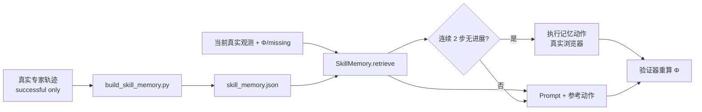

# [AR002] 详细设计

| 字段 | 内容 |
|------|------|
| AR 编号 | AR002 |
| 关联 srs.md | ./srs.md |
| 日期 | 2026-11-04 |
| 状态 | Draft |

## 1. 核心思路

AR001 的验证器解决了“奖励信号真实”，但没有解决“小模型在长链路上丢失子目标”。  
AR002 把成功轨迹中的**状态-动作对应关系**外置为可检索记忆，并用验证器的停滞信号触发干预：

```
Ψ(s) = (require_checkout, page_type, missing_predicates, pending_targets)
memory[Ψ] -> action_template
if Φ stagnant for 2 steps: execute memory action (real)
```

这不是新增训练，而是**推理期架构创新**，可与任意 AR001 适配器组合。

## 2. 数据流



## 3. 记忆记录

```python
{
  "level": 4,
  "require_checkout": true,
  "page_type": "checkout",
  "missing": ["name_filled", "address_filled", "order_placed"],
  "action_template": {"action": "type", "params": {"selector": "#name", "text": "@NAME@"}},
  "delta_phi": 0.125,
  "target_pid": null
}
```

- 仅保留 `exec_ok=True` 且 `phi_after > phi_before` 或最终成功的步骤。
- 同一状态键保留 `delta_phi` 最高的前 3 条，控制体积。
- 输出 JSON ≤ 20KB，入仓。

## 4. 页面类型

| page_type | 判定 |
|-----------|------|
| search | path `/` 或 `/search` |
| product | `/product/*` |
| cart | `/cart` |
| checkout | `/checkout` |
| order | `/order/*` |

## 5. 检索

```python
score = 3.0 * jaccard(missing_now, missing_rec)
      + 1.0 * (page_type equal)
      + 1.0 * (require_checkout equal)
      + 0.5 * (level close)
      + 0.2 * delta_phi
```

要求 `page_type` 相同且 `jaccard > 0`，否则返回 None。

## 6. 动作模板解析

- 占位符：`@PID@`、`@QUERY@`、`@QTY@`、`@NAME@`、`@ADDRESS@`。
- 解析时从 TaskSpec 与当前服务端状态取：
  - 未满足目标 pid；
  - 该 pid 的关键词；
  - 剩余数量。
- 解析后交给现有 `repair_action` / `BrowserEnv.execute` 做唯一性与白名单校验。

## 7. 重规划控制器

```python
if stagnation >= 2 and replan_budget > 0:
    suggestion = memory.retrieve(...)
    if suggestion:
        action = resolve(suggestion, task, state)
        result = env.execute(action)
        replan_budget -= 1
        stagnation = 0
        continue  # 回到模型
```

- `stagnation`：`phi_after <= phi_before` 或 `exec_ok=False` 累加，否则清零。
- 每 episode 最多 3 次。
- 所有干预都记录在 `steps[].source`，便于审计。

## 8. 评测矩阵

| 组合 | 适配器路由 | 记忆 prompt | 重规划 |
|------|------------|-------------|--------|
| `router` | ✓ | ✗ | ✗ |
| `router_memory` | ✓ | ✓ | ✗ |
| `router_replan` | ✓ | ✓ | ✓ |

- 任务：AR001 的 9 个留出任务。
- 组合方式：L1/L2→SFT，L3→VGDP，L4/L5→Sparse。
- 指标：成功率、平均步数、平均 Φ、重规划次数、记忆命中率。
- 回退：不高于 `router` 则保留 `router`。

## 9. 风险

| 风险 | 缓解 |
|------|------|
| 记忆泄漏评测任务 | 构建时只允许 p1/p2 训练任务 |
| 记忆动作选择器过时 | 解析 + DOM 唯一性校验 + 失败不猜测 |
| 重规划掩盖模型问题 | 报告 `source=memory_replan` 比例；单独列指标 |
| 记忆体积影响 push | 紧凑 JSON，目标 <20KB |

## 10. 文件

```
step_rl/edge/skill_memory.py       # MemoryRecord/retrieve/resolve
step_rl/edge/skill_memory.json     # 入仓的紧凑记忆（真实轨迹派生）
scripts/build_skill_memory.py      # 构建
scripts/ar002_eval.py              # 三组合评测
tests/test_edge_skill_memory.py    # 单测
```
