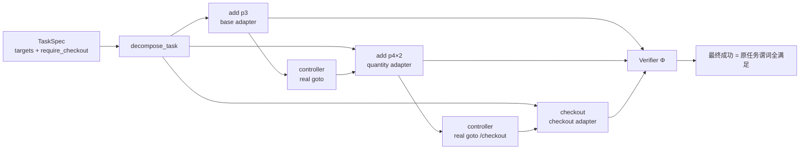

# [AR003] 详细设计

| 字段 | 内容 |
|------|------|
| AR 编号 | AR003 |
| 关联 srs.md | ./srs.md |
| 日期 | 2026-11-04 |
| 状态 | Draft |

## 1. 设计动机

AR001 的路由是“**一个任务选一个适配器**”，但长链路任务包含多个技能段：

```
任务: 加 p3×1 + 加 p4×2 + 结算
       └─ SFT ─┘ └─ VGDP ─┘ └─ Sparse ─┘
```

单适配器必然在某一段退化。AR003 改为“**一个子目标选一个适配器**”，在同一真实会话中顺序执行。

## 2. 架构



## 3. 分解算法

```python
if not task.require_checkout:
    return [task]
subtasks = []
for pid, qty in task.targets.items():
    subtasks.append(TaskSpec(
        level=3 if qty >= 2 else 2,
        goal=f"搜索“{keyword}”，将商品 {name} 数量 {qty} 加入购物车",
        targets={pid: qty},
        require_checkout=False,
    ))
subtasks.append(TaskSpec(
    level=4,
    goal="完成结算并提交订单",
    targets=task.targets,
    require_checkout=True,
))
```

目标文本必须包含真实商品关键词/名称，否则小模型会回退到训练分布中的默认商品。

## 4. 适配器路由

| 子目标 | 适配器 | 原因 |
|--------|--------|------|
| 加购 1 件 | `base` (SFT) | 格式与基础流程 |
| 加购 ≥2 件 | `quantity` (VGDP) | 数量控制由稠密进度习得 |
| 结算 | `checkout` (Sparse) | 保留完整表单/订单流程 |

## 5. 控制器导航

| 子目标位置 | 导航 |
|------------|------|
| 第一个 | 任务起始页（reset） |
| 后续加购 | `goto /`（购物车保留） |
| 结算 | `goto /checkout`（购物车保留） |

导航是真实 HTTP 请求，记录 `source=controller`；不直接判定成功。

## 6. 多适配器加载

```python
model = PeftModel.from_pretrained(base, sft, adapter_name="base")
model.load_adapter(vgdp, adapter_name="quantity")
model.load_adapter(sparse, adapter_name="checkout")
model.set_adapter("base" | "quantity" | "checkout")
```

只保留一份基座，显存可控。

## 7. 执行流程

```python
obs = env.reset(task)
for i, sub in enumerate(decompose_task(task)):
    model.set_adapter(adapter_for_subtask(sub))
    if i > 0:
        env.execute({"action": "goto", "params": {"url": nav_target}})
        obs = env.observe()
    rollout = rollout_task(env, sub, model, tokenizer,
                           initial_obs=obs, sample=False, max_steps=8)
    obs = env.observe()
    if not rollout.success:
        break
final = compute_progress(obs.state, obs.url, task)
success = final.success and all_subtasks_success
```

## 8. 评测

- 9 个留出任务（p3/p4，未参与训练）。
- greedy，真实 Edge，单次 deterministic。
- 指标：成功率、平均步数、平均 Φ、控制器动作数。
- 对照：AR001 `router` 77.8%。
- 回退：若 ≤77.8%，保留 router。

## 9. 风险

| 风险 | 缓解 |
|------|------|
| 子目标文本缺少商品关键词 | 分解时写入 keyword/name |
| 会话状态丢失 | 共享 env，不 reset，只真实导航 |
| 结算页空购物车 | 前一子目标成功后才进入结算 |
| 步数增加 | 直接导航 `/checkout`，避免重复搜索 |
| 多适配器切换错误 | 单测校验路由；评测记录子目标来源 |

## 10. 文件

```
step_rl/edge/hierarchical.py       # decompose / route / run_hierarchy
step_rl/edge/modeling.py           # load_multi_adapter
scripts/ar003_eval.py              # 真实评测
tests/test_edge_hierarchical.py    # 单测
```
