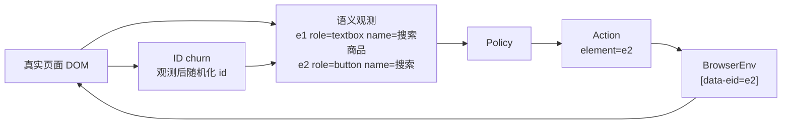

# [AR004] 详细设计

| 字段 | 内容 |
|------|------|
| AR 编号 | AR004 |
| 关联 srs.md | ./srs.md |
| 日期 | 2026-11-04 |
| 状态 | Draft |

## 1. 问题定义

AR003 的动作示例：

```json
{"action":"click","params":{"selector":"#search-btn"}}
```

selector 与 DOM 实现强耦合。SPA 重渲染/改版后 selector 失效，模型无法感知，执行 100% 失败。

SoM-SAI 的动作：

```json
{"action":"click","params":{"element":"e2"}}
```

`e2` 只在当前观测快照内有效，执行器通过 `data-eid="e2"` 定位。页面 id 如何变化都不影响。

## 2. 架构



## 3. 语义观测

每个元素：

```json
{
  "eid": "e2",
  "selector": "#search-btn",
  "role": "button",
  "accessible_name": "搜索",
  "value": ""
}
```

- `eid` 按 DOM 顺序稳定生成；
- `role` 由标签/type 推导；
- `accessible_name` 优先级：aria-label → placeholder → 文本 → name → value；
- 语义 prompt 只暴露 `eid/role/name`，不暴露 selector。

## 4. 执行

```python
if params.element:
    selector = f'[data-eid="{params.element}"]'
else:
    selector = params.selector
```

- 仍检查唯一匹配与动作白名单；
- 失败显式返回错误；
- 语义模式关闭 DOM repair，避免“偷偷用旧 selector 修复”。

## 5. ID 扰动

在 `observe()` **返回之后**执行：

```js
for (const el of document.querySelectorAll('[id]')) {
  el.id = 'x' + Math.random().toString(36).slice(2, 10);
}
```

- 观测中的 selector 立即过期；
- `data-eid` 不参与扰动，语义动作仍有效；
- 这是对“决策与执行之间 DOM 变化”的真实压力测试。

## 6. 训练

| 阶段 | 数据/目标 | 说明 |
|------|-----------|------|
| 语义 SFT | 20 条真实专家轨迹（L1–L2） | 动作仅 element |
| 语义 VGDP | L3 数量任务 | 稠密 Φ 奖励 |
| 语义 Sparse | L3 数量任务 | 稀疏奖励基线 |

多适配器加载与 AR003 相同，评测时按子目标切换 `base/quantity/checkout`。

## 7. 评测矩阵

| 条件 | 接口 | ID churn |
|------|------|----------|
| A | selector + repair | 是 |
| B | semantic | 否 |
| C | semantic | 是 |

主指标：成功率；次指标：非法动作、修复次数、平均步数。

## 8. 回退

- 若 C < AR003 稳定 100%，回退 AR003；
- 若 C 与 B 均 100%，选择 C（更鲁棒）；
- 步数增加 >1.0 时需在报告中说明。

## 9. 风险

| 风险 | 缓解 |
|------|------|
| eid 跨步失效 | 每步观测重新生成，动作只用于当前步 |
| 语义名不唯一 | 保留 role/name，必要时加序号 |
| 静默回退 selector | 语义模式下禁用 repair，并记录 raw_invalid |
| 训练分布变化 | 全部训练数据使用同一语义格式 |

## 10. 文件

```
step_rl/edge/browser.py      # eid 观测、element 执行、id churn
step_rl/edge/policy.py       # 语义 prompt
step_rl/edge/expert.py       # selector -> eid 转换
step_rl/edge/step_grpo.py    # semantic rollout 训练
step_rl/edge/hierarchical.py # 语义层级执行
scripts/ar004_eval.py        # 稳定/扰动评测
tests/test_edge_semantic.py  # 单测
```
