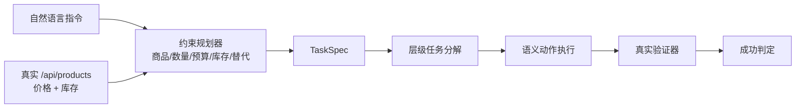

# [AR006] 详细设计

| 字段 | 内容 |
|------|------|
| AR 编号 | AR006 |
| 关联 srs.md | ./srs.md |
| 日期 | 2026-11-04 |
| 状态 | Draft |

## 1. 架构位置



## 2. 规划算法

### 2.1 商品识别

- 匹配商品名与关键词（长度优先，避免“充电”混淆“无线充电器”）；
- 按从句顺序保留首次出现的商品。

### 2.2 数量

- 识别 `N件/个/台/条/部`，支持中文数字与阿拉伯数字；
- 默认 1。

### 2.3 预算

- 识别 `预算 N`、`不超过 N`、`N 元以内`；
- 有明确商品时：总价超预算则按最贵行回退；
- 无明确商品时：只在预算内候选集中选择。

### 2.4 最值与替代

- `最便宜/最低` → 候选最低价；
- `最贵/最高` → 候选最高价；
- `缺货` + 两个商品 → 选择第一个有库存者。

### 2.5 编译

- `targets` 保序；
- `search_query` 取首个目标商品关键词；
- `require_checkout` 由“结算/下单/购买”决定；
- level 由目标数与数量决定，供层级执行器使用。

## 3. 基线

`naive_plan`：

- 只按目录顺序找第一个出现的商品；
- 数量固定 1；
- 忽略预算、最值、缺货、多商品；
- 无商品名时返回 None。

## 4. 评测口径

关键修正：任务成功必须按**用户期望 TaskSpec**判定，不能用基线自己的规划自证。

```python
expected_spec = TaskSpec(targets=expected, require_checkout=True)
success = compute_progress(real_state, url, expected_spec).success
```

同时记录：
- `plan_correct`：planned targets == expected；
- `success`：按期望判定；
- `own_success`：按自身规划判定（仅用于诊断）。

## 5. 数据与库存

- `/api/products` 返回 `price/stock/keywords`；
- `LocalShopServer(stock_overrides=...)` 支持真实缺货场景；
- `/add` 超库存返回 400，规划器必须在规划阶段规避。

## 6. 风险

| 风险 | 缓解 |
|------|------|
| 规则解析覆盖不足 | 明确支持集；未识别则返回 None，不猜测 |
| 预算+多商品歧义 | 明确回退规则并记录 |
| 基线偶然成功 | 同时报告规划准确率，逐条审计 |
| 库存竞态 | 单会话评测；规划前读取实时库存 |

## 7. 文件

```
step_rl/edge/planner.py       # 约束解析/编译/基线
step_rl/edge/site.py          # 库存与 /api/products
scripts/ar006_eval.py         # 8 指令 × 3 条件真实评测
tests/test_edge_planner.py    # 计划与库存单测
```
