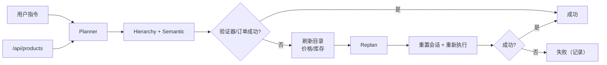

# [AR007] 详细设计

## 1. 架构



## 2. 服务器动态事件

`LocalShopServer` 新增：

```python
checkout_stock_drop={"p4": 1}
checkout_price_override={"p3": 350}
checkout_budget=300
```

在 `/place-order` 首次调用时应用（每会话一次）：

1. 应用库存/价格变化；
2. 若 `checkout_budget` 存在，按当前价格计算购物车总额，超预算 → 400；
3. 若购物车数量 > 当前库存 → 400；
4. 通过则创建订单。

变化是真实服务端状态变更，客户端无法绕过。

## 3. RuntimeSupervisor

```python
catalog = fetch_catalog()
spec = plan(instruction, catalog)
run = yield hierarchy(spec)
if run.success: return
catalog2 = fetch_catalog()      # 漂移已发生
spec2 = plan(instruction, catalog2)
if spec2 is None or spec2.targets == spec.targets: return fail
run2 = yield hierarchy(spec2)   # 重置会话后重新执行
return run2
```

- 最多 2 次尝试；
- 记录 `attempts`、`initial_targets`、`replanned_targets`、`trigger`；
- 最终成功由期望 TaskSpec 判定。

## 4. 场景

### D1：库存替代

指令：`买两件蓝牙耳机；如果缺货，就买两件USB-C数据线，并结算`

- 初始目录：p4 库存 9，planner → p4×2；
- 执行到结算：服务器把 p4 库存降为 1，订单因库存不足失败；
- supervisor 刷新目录 → p4 库存 1 不足 2 → planner 选择 p2×2；
- 重置会话并执行 → 成功。

### D2：预算价格

指令：`预算300元，买无线充电器并结算`

- 初始：p3 价格 199，planner → p3×1；
- 结算时服务器把 p3 价格改为 350，总额超 300 → 订单失败；
- supervisor 刷新目录 → p3 350 超预算 → planner 在预算内选 p2（59）；
- 重置并执行 → 成功。

## 5. 评测

| 条件 | 指令 | 说明 |
|------|------|------|
| baseline | D1/D2 | 一次性规划 |
| supervisor | D1/D2 | 失败后重规划 |
| static regression | AR006 8 条 | 不应触发重规划 |

指标：成功率、尝试次数、重规划目标、步数。

## 6. 风险

| 风险 | 缓解 |
|------|------|
| 重规划掩盖执行 bug | 记录 attempt/trigger，逐场景审计 |
| 重置会话丢失用户数据 | 仅实验场景；生产需状态迁移，报告注明 |
| 动态事件不确定 | 服务器每会话只触发一次，固定 seed |
| 静态回归 | 8 条静态指令必须 0 次重规划 |

## 7. 文件

```
step_rl/edge/site.py          # 动态库存/价格/预算
step_rl/edge/supervisor.py    # 闭环重规划
step_rl/edge/planner.py       # 缺货替代数量修复
scripts/ar007_eval.py         # D1/D2 + 静态回归
tests/test_edge_supervisor.py # 单测
```
