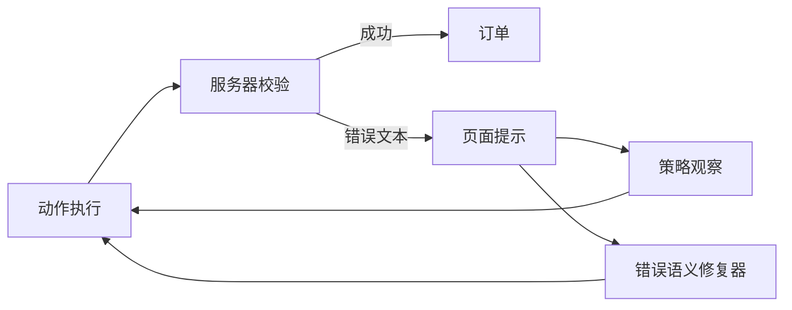

# [AR009] 详细设计

## 1. 架构



## 2. 服务器校验

`LocalShopServer` 新增：

```python
checkout_name_requires_title=True
checkout_address_requires_road=True
```

`/place-order`：

- 收货人不含“先生/女士” → 400 “收货人需包含称谓（先生/女士）”；
- 地址不含“路” → 400 “地址需包含‘路’”；
- 校验在库存/预算之后、订单创建之前。

## 3. 错误可观测

`build_prompt` 增加可选 `page_notice`：

```
页面提示: 收货人需包含称谓（先生/女士）
```

仅当 `obs["text"]` 含“错误/需/不能/不足”等关键词时注入，截断 200 字符。

## 4. 控制器修复

```python
if "称谓" in notice and name input exists:
    type #name -> "刘星言先生"
elif "路" in notice and address input exists:
    type #address -> "深圳市龙岗区坂田路1号"
```

- 每次最多 2 次；
- 记录 `source=error_repair`；
- 真实执行、真实验证，不直接改状态。

## 5. 评测

任务：

1. `买一件无线充电器并结算`（两项校验）
2. `买两件USB-C数据线并结算`（两项校验）

条件：baseline / observable / observable+repair；成功按用户期望 TaskSpec。

## 6. 风险

| 风险 | 缓解 |
|------|------|
| 修复规则过窄 | 只支持两类真实校验，报告注明 |
| 错误提示 token 膨胀 | 仅错误页注入 |
| 模型看到错误仍不纠正 | 控制器兜底，分条件归因 |
| 基线重复动作 | 记录失败轨迹，不伪造 |

## 7. 文件

```
step_rl/edge/site.py       # 表单校验
step_rl/edge/policy.py     # page_notice
step_rl/edge/rollout.py    # error_feedback / error_repair
scripts/ar009_eval.py
tests/test_edge_error_repair.py
```
