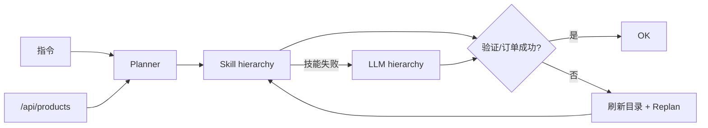

# [AR011] 详细设计

## 1. 统一流程



## 2. 关键决策

- **技能优先**：常见子目标免生成；
- **失败重规划**：库存/价格/预算漂移时刷新真实目录；
- **LLM 回退**：技能无法解析或验证失败时，使用当前观测调用 LLM；
- **验证器唯一**：最终成功由当前 TaskSpec 验证器判定。

## 3. 实现

```python
async def run_task(env, instruction, model, tokenizer, max_attempts=2):
    catalog = fetch_catalog(env.server.base_url)
    spec = plan_instruction(instruction, catalog)
    for attempt in range(max_attempts):
        rollout = await run_skill_hierarchy(env, spec, model, tokenizer, fallback=False)
        if rollout.success:
            return result
        new_catalog = fetch_catalog(...)
        new_spec = plan_instruction(instruction, new_catalog)
        if new_spec and new_spec.targets != spec.targets:
            spec = new_spec
            continue
        # skill failure without target change -> LLM fallback
        return await run_hierarchy(env, spec, model, tokenizer)
    return await run_hierarchy(env, spec, model, tokenizer)
```

## 4. 组合评测

| 组 | 来源 | 任务数 | 基线 |
|----|------|--------|------|
| 静态 | AR004/AR010 EVAL | 9 | LLM 每步 100% |
| 约束 | AR006 | 8 | 规划+LLM 100% |
| 动态 | AR007 | 2 | 0% |
| 错误 | AR009 | 2 | 0% |
| 跨布局 churn | AR005 | 9 | 语义 LLM 100% |
| **组合基线** | 真实结果汇总 | **30** | **26/30（86.7%）** |

统一运行时目标：30/30，0 LLM 调用。

## 5. 风险

| 风险 | 缓解 |
|------|------|
| 技能覆盖不足 | LLM 回退 |
| 动态重规划循环 | 最多 2 次 attempt |
| 基线非同一进程 | 使用各 AR 真实 JSON，报告注明 |
| 跨布局技能名缺失 | 语义名/唯一角色回退 |

## 6. 文件

```
step_rl/edge/runtime.py      # run_task
scripts/ar011_eval.py        # 30 场景
tests/test_edge_runtime.py   # 现有动态测试 + 新组合测试
```
