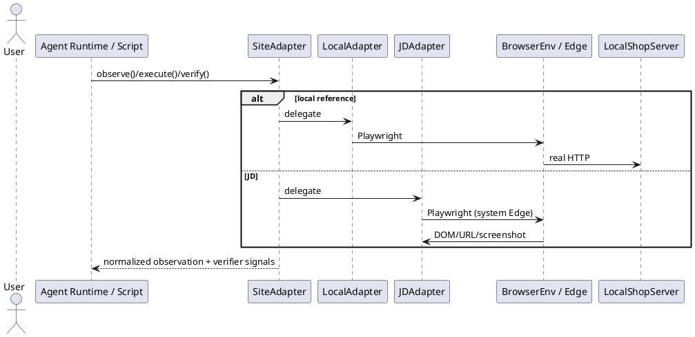
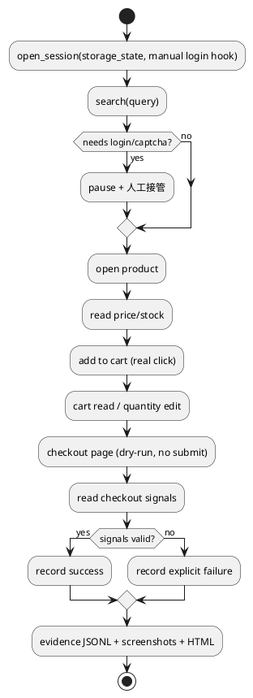

# 1 AR概述

| 字段 | 内容 |
|------|------|
| AR系统流水号 | AR029 |
| AR描述 | 真实主流电商多站点适配第一阶段：SiteAdapter 框架 + local reference + JD dry-run |
| 关联需求 | `srs.md`（已确认） |

# 2 动态行为

## 2.1 适配器分层



## 2.2 JD dry-run 时序



# 3 功能点分解

| 序号 | 功能点 | 说明 |
|------|--------|------|
| 1 | SiteAdapter 契约 | 站点无关的 observe/execute/catalog/verify/auth/evidence 接口 |
| 2 | LocalAdapter | 包装 LocalShopServer + BrowserEnv，golden reference |
| 3 | 归一化观测/动作 | core 不依赖 CSS；元素 role/name/value/state |
| 4 | 验证器适配 | 站点权威信号 → 共享谓词；成功只由验证器判定 |
| 5 | JDAdapter | 真实 JD 搜索/详情/加购/购物车/券/结算页 dry-run/订单查询 |
| 6 | 人工接管与安全 | 登录/验证码暂停；dry-run；限速；凭据本地 |
| 7 | 证据协议 | JSONL/截图/HTML/验证器快照/失败分类 |
| 8 | 回归与文档 | 181 edge + AR011 30/30；COMPLIANCE/README/REPRODUCTION |

# 4 实现设计

## 4.1 功能实现思路

新增 `step_rl/edge/adapters/`，以 Protocol 定义契约；`LocalAdapter` 复用现有
`LocalShopServer + BrowserEnv`，不改变旧 runtime 默认路径。`JDAdapter` 用系统 Edge
和独立 DOM 解析实现真实页面操作；JD 特判只存在于 `jd.py`。core 通过 adapter
接口读取归一化观测与验证器信号。

## 4.2 功能实现设计

### 4.2.1 目录结构

```text
step_rl/edge/adapters/
  __init__.py
  base.py        # Protocol + dataclass + capabilities
  local.py       # LocalShopServer/BrowserEnv reference adapter
  jd.py          # JD real-site adapter (dry-run)
  evidence.py    # JSONL/screenshot/HTML/redaction
```

### 4.2.2 流程说明

- `open_session`: local 启动 BrowserEnv；JD 启动 Edge，加载 storage_state，必要时
  等待人工登录；
- `observe`: 返回 `Observation(url,title,page_type,elements,signals,revision)`；
- `execute`: 语义动作；执行后校验 URL/DOM；失败显式；
- `verify`: local 调用现有 verifier；JD 用 URL/DOM/金额/购物车信号；
- `evidence`: 每步写 JSONL，关键页面写 PNG/HTML；敏感字段脱敏。

## 4.3 接口描述

```python
class SiteAdapter(Protocol):
    name: str
    capabilities: AdapterCapabilities
    async def open_session(self, *, storage_state=None, manual_login=False): ...
    async def close(self): ...
    async def observe(self) -> Observation: ...
    async def execute(self, action: Action) -> ActionResult: ...
    async def catalog(self) -> list[CatalogItem]: ...
    async def promos(self) -> list[PromoInfo]: ...
    async def verify(self, spec, state) -> Verification: ...
    async def order_status(self, order_id: str) -> dict: ...
    def auth_hooks(self) -> AuthHooks: ...
```

JD 额外方法：`search`, `open_product`, `add_to_cart`, `read_cart`,
`set_cart_quantity`, `remove_from_cart`, `open_checkout`, `read_checkout`,
`read_orders`, `capture_evidence`。

## 4.4 代码设计

- `base.py` 不 import 任何具体站点；
- `local.py` 只 import `LocalShopServer/BrowserEnv`；
- `jd.py` 只 import Playwright/标准库/evidence；
- 现有 `runtime.py/planner.py/verifier.py` 不改默认行为；新增 adapter 脚本作为入口；
- 登录态：`%LOCALAPPDATA%\\StepRL\\credentials\\<site>.json`，`.gitignore`；
- 限速：1 会话，动作间至少 5s，每 run ≤20 页面，dry-run 默认。

# 5 重构设计

本次不重构旧 core；新增 adapter 包与脚本，local adapter 作为回归参考。后续 AR030
再扩展第二/第三站，AR031 Console，AR032 跨站评测。

# 6 测试设计

## 6.1 单元测试（UT）

- Adapter 契约字段/能力；
- 归一化观测 schema；
- JD URL/search builder、dry-run guard、evidence 脱敏；
- LocalAdapter 与 LocalShopServer 真实交互（golden）。

## 6.2 接口测试

- `LocalAdapter.open_session/observe/execute/catalog/verify` 对真实本地站；
- `JDAdapter` 真实页面（需用户接管）搜索/详情/加购/购物车/结算 dry-run。

## 6.3 业务场景测试

- 搜索、加购、改量、移除、券可行/不可行、结算页 dry-run、订单查询；
- 真实失败/拒绝：不可行券、无结果搜索、库存不足。

## 6.4 异常场景测试

- 未登录/验证码 → 暂停并转人工，不绕过；
- DOM 缺失/选择器失效 → 显式失败；
- 动作超时/导航失败 → 记录错误，不静默成功；
- 证据目录不可写 → 显式失败；
- 超过金额/页面/频率上限 → 拒绝执行。
